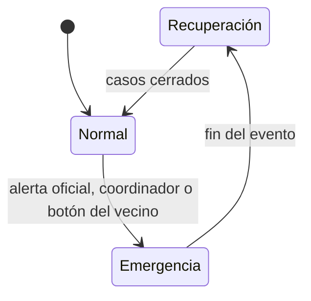
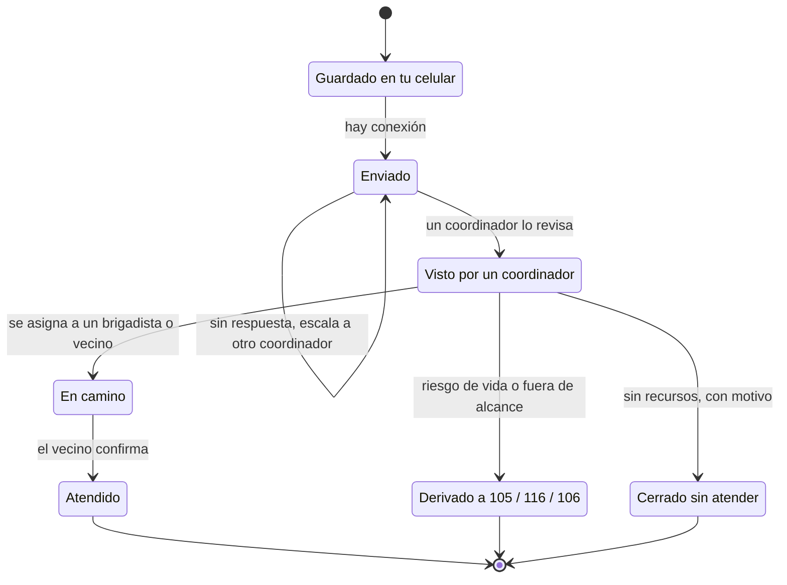

# Arquitectura propuesta: App vecinal de servicios, solidaridad y emergencias (parte 2)

> Borrador v2 · Continuación de `arquitectura-app-vecinal.md` (secciones 1 a 5). Versiones verificadas al 6 de noviembre de 2026.

---

## 6. Cómo se cubre cada requisito

| Requisito | Solución en la arquitectura |
|---|---|
| Información recomendada sobre productos y servicios cercanos | Módulos Directorio + Reputación: búsqueda PostGIS por radio + puntaje bayesiano + Visto Bueno de tu zona; también disponible offline desde SQLite, con la fecha de la última actualización |
| Promover servicios y compartir recomendaciones | Perfil de proveedor con atributos flexibles (`jsonb`), publicación en 3 toques y enlaces para compartir por WhatsApp |
| Solicitar y ofrecer ayuda e intercambios solidarios | Módulo Solidaridad: tipos de publicación, coincidencias por cercanía y categoría, estados *abierta → en curso → resuelta* |
| Servicios y grupos de apoyo en emergencias | Módulo Emergencias: directorio precargado offline con fuente y fecha, servicios marcados para emergencia y grupos de apoyo verificados |
| Coordinación de necesidades y recursos en emergencias | Pedidos de ayuda con estados visibles, tiempos de respuesta y escalamiento; recursos críticos con fecha de reporte; consola web para coordinadores. Solo en zonas con cobertura operativa (sección 9) |
| Geolocalización de servicios, recursos y necesidades | GPS en el celular + PostGIS (`geography` e índices GiST) + zonas (polígonos o celdas H3) + mapas MapLibre; ubicación exacta de personas solo para quien la necesita (sección 8) |
| Tutorial | Onboarding interactivo con indicaciones sobre la pantalla real y un "modo práctica" (publicaciones de prueba que no se publican); contenido configurable de forma remota y accesible desde el menú |
| Máximo 3 clics para publicar | **(1)** botón "+" → **(2)** tipo: *Ofrezco / Necesito / Recomiendo / Ayuda urgente* → **(3)** formulario mínimo prellenado + "Publicar". Ubicación y categoría sugeridas, foto y dictado por voz opcionales. Se guarda al instante en el celular aunque no haya señal, y la app indica si ya se envió |
| Funcionamiento online y offline | Consulta de lo descargado y cola de envíos sin conexión, con estados visibles; sincronización con PowerSync al haber conexión; mapas offline y datos de emergencia precargados con su fecha |
| Uso intuitivo y accesible | Meta WCAG 2.2 AA: texto escalable, botones de al menos 48 dp, alto contraste, lector de pantalla (TalkBack/VoiceOver), dictado por voz, íconos acompañados de texto, lenguaje simple, "modo sencillo" para adultos mayores, español + quechua |

---

## 7. Modo emergencia y seguridad de las personas

### 7.1 Activación

- **Automática:** una alerta de fuente oficial que cubra el polígono de la zona (por ejemplo IGP, SENAMHI o INDECI, según los canales de datos que ofrezcan).
- **Manual:** coordinadores de zona verificados activan el evento para su zona.
- **Local:** botón "Estoy en emergencia", que funciona incluso sin señal y muestra de inmediato el directorio y los números oficiales.

**Qué cambia en la app:** el inicio pasa a ser el tablero de emergencia (*Necesito ayuda* · *Puedo ayudar* · *Recursos* · *Directorio de emergencia*); la sincronización prioriza los datos críticos; las imágenes se desactivan por defecto (modo ahorro de datos); y el directorio de oficios filtra los servicios marcados como `disponible_en_emergencia`.

**Regla de cobertura:** los pedidos de ayuda y el tablero humanitario solo se habilitan en zonas con cobertura operativa (sección 9.3). En las demás, la app muestra el directorio de emergencia y los números oficiales, y explica que en esa zona todavía no hay coordinación vecinal.

### 7.2 Estados de un pedido de ayuda

| Estado | Qué ve quien pidió ayuda |
|---|---|
| Guardado en tu celular | "Tu pedido **todavía no fue enviado**. Nadie lo ha recibido." + las alternativas de la sección 7.4 |
| Enviado | La hora de envío y cuánto tiempo lleva sin ser revisado |
| Visto por un coordinador | Que una persona lo revisó y cuándo |
| En camino | Que alguien va en camino (sin exponer datos personales de quien ayuda) |
| Atendido | Que se cerró y se pide confirmación |
| Derivado / Cerrado sin atender | El motivo y qué hacer ahora |

Cada transición queda registrada con hora y rol. Si un pedido sigue *enviado* sin ser revisado después del tiempo acordado (sección 9.2), se escala automáticamente al siguiente coordinador o a la zona vecina, y quien pidió ayuda recibe en su celular las alternativas oficiales.

### 7.3 Frescura de la información

- Cada pantalla muestra "Actualizado hace X" y, sin conexión, un aviso: "Estás viendo datos de hace X; algunos pueden haber cambiado".
- Cada recurso crítico muestra "reportado hace X" y, pasado un umbral, se marca como **posiblemente desactualizado** (umbrales configurables por tipo; por ejemplo, 2 horas para el stock de agua y 30 días para un punto de encuentro).
- Los pedidos muestran su estado y la hora de su último cambio; sin conexión, la app advierte que pudieron haber sido atendidos.
- Los datos oficiales (puntos de encuentro, centros de salud, números) llevan su fuente y su fecha de verificación.

### 7.4 Si no hay conexión

Cuando un pedido de ayuda queda *guardado en tu celular*, la app muestra de inmediato:

- **"Si hay riesgo para la vida, no esperes a la app."** Botones para llamar al **116** (Bomberos), **105** (Policía) o **106** (SAMU). Las llamadas usan la red celular de voz y pueden funcionar aunque no haya datos móviles.
- **Enviar un SMS a tus contactos de emergencia:** abre la app de mensajes del teléfono con el texto y la ubicación aproximada ya escritos, sin necesitar internet.
- **Ir al punto de encuentro más cercano**, con el mapa offline.

> Los números de emergencia se mantienen en el directorio curado (con fuente y fecha), no fijos en el código: el Estado está implementando una central 911 que unificará el 105, el 116, el 106 y la Línea 100.

### 7.5 Canales de aviso

| Tipo de aviso | Canal | Regla |
|---|---|---|
| Aviso público de zona ("se activó el modo emergencia en tu zona") | FCM por tópico de zona | Solo información pública. Los tópicos están optimizados para volumen, no para latencia, y su distribución no es instantánea |
| Aviso personal (tu pedido cambió de estado; tienes un caso asignado) | FCM a token del dispositivo | Sin datos sensibles en el texto ("Tienes una actualización"); el detalle se ve dentro de la app, tras autenticarse |
| Aviso urgente a coordinadores | Token del dispositivo + SMS de respaldo (opcional, con costo) | Nunca depender de un solo canal |
| Alertas oficiales | Canales oficiales del Estado | La app complementa, no reemplaza |

### 7.6 Contra la desinformación

Cada reporte muestra su estado (*sin verificar* → *confirmado por N vecinos* → *verificado por un coordinador*) y las fuentes oficiales llevan insignia.

### 7.7 Evolución futura (I+D)

Una malla entre celulares sin internet (Wi-Fi Direct/Bluetooth: Nearby Connections en Android, Multipeer Connectivity en iOS) y SMS de respaldo para alertas críticas.

---

## 8. Datos sensibles en el celular

### 8.1 Clasificación de los datos

| Clase | Ejemplos | ¿Llega a los celulares? | Protección |
|---|---|---|---|
| **Pública** | Directorio, servicios, reseñas, publicaciones del muro, puntos de encuentro | Sí, a los vecinos de la zona (stream automático) | Moderación; nunca incluye datos de salud ni la ubicación exacta de personas |
| **Personal** | Teléfono, contactos de emergencia, historial propio | Solo al propio usuario | Cifrado local |
| **Sensible** | Pedidos de ayuda, ubicación exacta de personas, condición de salud o discapacidad, identidad de quien pide ayuda | **Nunca de forma masiva.** El público ve solo un agregado anónimo por celda ("3 pedidos de agua en esta zona"). El detalle llega únicamente al coordinador y al brigadista asignados, bajo demanda | Cifrado local, caducidad, bloqueo del modo operativo y auditoría |

### 8.2 Qué recibe cada celular

- **Datos públicos:** Sync Streams con suscripción automática por zona.
- **Datos sensibles:** streams bajo demanda por caso, que el celular de un coordinador o brigadista abre solo mientras el caso le está asignado. Quien pidió ayuda conserva su propio pedido.
- **Minimización:** el brigadista ve la ubicación aproximada al aceptar el caso y la exacta solo cuando pasa a *en camino*.
- **Revocación en línea:** cuando termina una asignación, esas filas dejan de pertenecer a los streams del usuario y PowerSync las borra del celular en la siguiente sincronización.

### 8.3 Protección en el dispositivo

- Base local cifrada con SQLCipher (`powersync_sqlcipher`, en beta), con una clave generada en el dispositivo y guardada en Keychain/Keystore.
- Modo operativo (coordinadores y brigadistas) con bloqueo por PIN o biometría y cierre automático por inactividad.
- **Caducidad local:** los datos sensibles se borran del celular al cerrar el caso o al vencer su plazo (por ejemplo, 24 horas), aunque el celular siga sin conexión.
- Sin datos sensibles en el texto de las notificaciones, porque se ven en la pantalla bloqueada.
- En Android, capturas de pantalla bloqueadas en las pantallas sensibles.

### 8.4 Teléfono perdido o acceso revocado

| Situación | Qué pasa |
|---|---|
| Se revoca el acceso con el celular en línea | Los datos salen de sus streams y se borran en la siguiente sincronización; las sesiones se invalidan |
| Se revoca el acceso con el celular sin conexión | Los datos siguen cifrados y protegidos por el bloqueo hasta que vence su caducidad local o el celular se reconecta; entonces se borran |
| El usuario reporta su teléfono perdido | Se revocan sus sesiones desde otro dispositivo o desde la consola; al reconectarse, la app borra la base local |
| Otra persona va a usar el teléfono | Cerrar sesión borra por completo la base local |

**Riesgo residual (debe aceptarse de forma explícita):** un teléfono perdido, sin conexión y con la app desbloqueada podría exponer datos sensibles hasta que estos caduquen. El cifrado, el bloqueo, la minimización y las caducidades cortas reducen ese riesgo, pero no lo eliminan.

---

## 9. Operación humana y gobernanza

La tecnología solo funciona si hay personas responsables detrás. Sin roles, turnos y tiempos de respuesta definidos, el tablero humanitario crearía expectativas de ayuda que nadie garantiza.

### 9.1 Roles

| Rol | Responsabilidad | Requisitos |
|---|---|---|
| Coordinador de zona | Revisar y priorizar pedidos, asignarlos, escalar, activar y cerrar el modo emergencia de su zona | Nivel 3, capacitación, acuerdo de confidencialidad, turno asignado |
| Brigadista verificado | Atender los pedidos asignados y actualizar su estado | Nivel 3, capacitación, acuerdo de confidencialidad |
| Moderador | Revisar denuncias y el contenido en cola | Capacitación en las normas de la comunidad |
| Curador del directorio de emergencia | Mantener puntos de encuentro, centros de salud y números, con fuente y fecha | Vínculo con fuentes oficiales o aliados |
| Aliados institucionales | Municipalidad y serenazgo, compañías de bomberos, centros de salud, parroquias, ollas comunes, juntas vecinales | Acuerdo formal de colaboración |
| Administrador de la plataforma | Roles, accesos, auditoría y respuesta a incidentes de seguridad | Equipo técnico |

### 9.2 Tiempos de respuesta

Los valores son un **ejemplo**; los definitivos se acuerdan con los aliados.

| Prioridad | Ejemplo | Primera revisión humana | Si no se cumple |
|---|---|---|---|
| Riesgo de vida | Persona herida, incendio | No pasa por la app: se deriva de inmediato al 116, 105 o 106 | — |
| Alta | Adulto mayor sin agua ni medicamentos | ≤ 15 min durante un evento activo | Escala al siguiente coordinador |
| Media | Necesita traslado a un albergue | ≤ 2 h | Escala al coordinador de la zona vecina |
| Baja | Préstamo de herramientas | Mejor esfuerzo | — |

### 9.3 Regla de cobertura

Una zona tiene **cobertura operativa** cuando cuenta con al menos dos coordinadores activos y un turno definido para el evento en curso. Solo entonces se habilitan los pedidos de ayuda y el tablero humanitario.

### 9.4 Mensajes que gestionan expectativas

- "Esta app conecta vecinos; no reemplaza a los servicios de emergencia."
- "Si hay riesgo para la vida, llama al 116, 105 o 106."
- Mostrar siempre el estado real de cada pedido y cuánto tiempo lleva sin respuesta.

### 9.5 Consola web de operación

Cola de casos con prioridades y temporizadores, mapa con celdas agregadas, asignación, historial auditado, moderación, gestión de turnos y curaduría del directorio de emergencia. Funciona solo en línea, con la misma API y con roles operativos.

### 9.6 Después de cada evento

Una revisión sin culpables: qué pedidos tardaron, qué falló y qué se ajusta (umbrales, turnos, mensajes). Al cerrar el evento, los casos se cierran y se anonimizan.

---

## 10. Seguridad, privacidad y confianza

- **Autenticación:** teléfono + OTP (SMS o WhatsApp) mediante un proveedor (por ejemplo, Firebase Auth o Twilio Verify); JWT de vida corta + *refresh token* rotativo; tokens guardados en Keychain/Keystore (`flutter_secure_storage`).
- **Autorización:** roles + nivel de confianza + reglas por zona, verificadas en el backend y en los Sync Streams.
- **Datos personales (Perú):** cumplir la **Ley N.º 29733** y su nuevo reglamento (**D.S. N.º 016-2024-JUS**, vigente desde marzo de 2025): consentimiento previo y expreso, finalidad declarada, minimización de datos y derechos ARCO ejercibles desde la app. Los pedidos de ayuda pueden contener datos de salud o discapacidad, así que se tratan como **datos sensibles** (sección 8). Como buena práctica, hacer una evaluación de impacto en la privacidad antes de activar el tablero humanitario.
- **Fotos:** borrar los metadatos EXIF/GPS en el dispositivo antes de subirlas; moderación automática + humana.
- **Estándares de referencia:** OWASP MASVS para la app; OWASP ASVS y API Security Top 10 para el backend.
- **Continuidad:** backups con recuperación a un punto en el tiempo (PITR) y simulacros de restauración.

---

## 11. Infraestructura, DevOps y calidad

| Área | Recomendación |
|---|---|
| Infraestructura inicial (etapa micro) | API en contenedores (2 réplicas) + PostgreSQL gestionado con PostGIS + object storage con CDN + PowerSync (en la nube o auto-hospedado) + FCM. Sin Valkey: colas en Postgres y caché en memoria |
| Cómputo | Contenedores (Docker) en un servicio gestionado con autoescalado (Cloud Run, AWS ECS Fargate o similar). Kubernetes solo cuando existan varios servicios |
| Base de datos | PostgreSQL gestionado con PostGIS y replicación lógica (Cloud SQL, Amazon RDS, Supabase o Neon), en la región sudamericana más cercana. PowerSync necesita replicación lógica: algunos Postgres *serverless* no la soportan, y en Neon la conexión de replicación mantiene el cómputo activo (no escala a cero), lo que suma costo |
| Archivos y mapas | Object storage + CDN; Cloudflare R2 no cobra la transferencia de salida, ideal para servir fotos y teselas PMTiles |
| Borde | CDN + WAF + límites de tasa (por ejemplo, Cloudflare) delante del balanceador |
| Infraestructura como código | Terraform u OpenTofu; entornos dev · staging · prod |
| CI/CD | GitHub Actions; builds móviles con Codemagic o Fastlane; betas por TestFlight y por las pruebas internas de Google Play |
| Observabilidad | OpenTelemetry (trazas, métricas, logs) + Sentry en la app y el backend; métricas de sincronización (tamaño de la cola local, tiempo hasta *enviado*, rechazos) y de operación (tiempo hasta *visto*); NestJS 12 ofrece además su SDK oficial `@nestjs/observe` |
| Pruebas | Unitarias del dominio · widget y *golden tests* en Flutter (incluido texto grande) · integración con Testcontainers (Postgres real con PostGIS) · contrato OpenAPI · pruebas de los Sync Streams con casos de acceso · E2E móvil (Patrol) · pruebas de campo offline con dispositivos reales · carga con k6 del escenario de emergencia |
| Tamaño de la app | Android App Bundle (cada equipo descarga solo lo que necesita), imágenes y fuentes optimizadas |

---

## 12. Orden de construcción

El alcance del producto no cambia. El orden sirve para validar primero lo que, si falla, tiene consecuencias graves, y para no pagar infraestructura antes de necesitarla. Las fases no tienen fechas: se pasa a la siguiente cuando se cumple su condición.

| Fase | Qué se construye | Condición para avanzar |
|---|---|---|
| **0 · Prueba técnica** | Esqueleto con todas las piezas del stack; flujo offline completo (cola, estados, reintentos, rechazos) en un Android de gama baja y un iPhone; cifrado y purga local; descarga de mapas con la fuente elegida; avisos por token y por tópico | Se cumplen los criterios de la sección 13.1 |
| **1 · Piloto en un barrio** | Directorio con Visto Bueno, muro de favores, directorio de emergencia offline (solo lectura), tutorial y moderación | Uso real sostenido, moderación funcionando y métricas de sincronización sanas |
| **2 · Emergencias con operación** | Pedidos de ayuda con estados, tablero humanitario, recursos críticos, roles, consola web y alianzas firmadas | Cobertura operativa en la zona y un simulacro con los aliados |
| **3 · Escala** | Más zonas y distritos, quechua, Valkey + BullMQ, réplicas de lectura y extracción de servicios según métricas | — |

---

## 13. Supuestos por validar y compatibilidades

### 13.1 Supuestos por validar

| Supuesto | Cómo se valida | Criterio de aceptación (ejemplo) |
|---|---|---|
| La cola offline no pierde ni duplica envíos | Modo avión, señal débil, cierre forzado, reinicio y batería baja en Android de gama baja y iPhone | 0 pérdidas y 0 duplicados en 500 operaciones |
| La sincronización en segundo plano es oportunista | Medir cuánto tarda en cada sistema con la app en segundo plano | Comportamiento documentado; la UI no promete inmediatez |
| Los rechazos y conflictos se entienden | Dos vecinos toman el mismo favor sin conexión | El segundo ve el motivo y una alternativa |
| Los datos sensibles solo llegan a quien corresponde | Casos de prueba de los Sync Streams + prueba de penetración | 0 filas sensibles en dispositivos no autorizados |
| La purga funciona | Revocar el acceso en línea y sin conexión; cerrar sesión | Datos borrados al reconectar o al vencer la caducidad |
| La capacidad en un pico de emergencia | k6 con ~2 500 peticiones por segundo más la reconexión simultánea de miles de clientes de sync | Latencia p95 y tasa de error dentro de lo acordado; la cola crítica no se degrada |
| Los mapas offline son viables y están permitidos | Descargar el distrito desde la fuente elegida | Términos que permiten el uso offline; tamaño aceptable para gama baja |
| El stack es compatible entre sí | El esqueleto de la Fase 0 | Compila, sincroniza y se despliega en ambos sistemas |

### 13.2 Matriz de compatibilidad

| Combinación | Estado al 6-nov-2026 |
|---|---|
| PowerSync ↔ PostgreSQL 18 | **Verificado:** PowerSync requiere PostgreSQL 11 o superior |
| PowerSync ↔ proveedor de Postgres | **Con condiciones:** requiere replicación lógica; no todos los *serverless* la soportan; en Neon impide escalar a cero |
| PowerSync: Sync Rules o Sync Streams | **Con condiciones:** las Sync Rules están en retirada; diseñar directamente con Sync Streams |
| Cifrado local en Flutter | **Con condiciones:** `powersync_sqlcipher` está en beta; probar los casos de uso propios |
| `maplibre_gl` ↔ Flutter 3.47 | **Verificado el mínimo** (Flutter 3.29); confirmar en el esqueleto |
| NestJS 12 ↔ Node.js 26 | **Por confirmar** en el esqueleto |
| ORM (Drizzle o Kysely) ↔ NestJS 12 (ESM) | **Por confirmar** en el esqueleto |
| PostgreSQL 18 + PostGIS 3.6 en el proveedor gestionado elegido | **Por confirmar** su disponibilidad |

### 13.3 Decisiones abiertas para el equipo

1. Qué flujos entran al piloto y en qué barrio.
2. Qué aliados participan y quiénes asumen los roles operativos (coordinadores, brigadistas, moderadores).
3. La fuente de los mapas offline (auto-hospedada o un proveedor).
4. El proveedor de OTP y SMS, y el presupuesto de SMS de respaldo.
5. El presupuesto mensual de infraestructura por etapa.
6. Los umbrales de caducidad y los tiempos de respuesta definitivos.

---

## 14. Licencias de los componentes

Todo el núcleo es open source. Conviene documentar las licencias de terceros desde el inicio.

| Componente | Licencia |
|---|---|
| Flutter, Dart | BSD-3-Clause |
| Riverpod | MIT |
| MapLibre para Flutter | BSD |
| NestJS, Node.js | MIT |
| PostgreSQL | PostgreSQL License (permisiva) |
| PostGIS | GPL-2.0 (usarlo como extensión en tu servidor no te obliga a liberar tu código) |
| Valkey | BSD-3-Clause |
| Datos de OpenStreetMap | ODbL: exige mostrar "© OpenStreetMap contributors" |
| PowerSync | Revisar los términos de los SDK (incluido el de cifrado) y del servicio, en la nube o auto-hospedado |

---

## 15. Fuentes

- Versiones de Flutter (3.47.1, Dart 3.13.1): <https://docs.shorebird.dev/getting-started/flutter-version.md>
- Calendario de lanzamientos de Flutter 2026 (3.50 en noviembre): <https://flutter.dev/blog/whats-new-in-flutter-3-41>
- Riverpod 3 (changelog): <https://pub.dev/packages/flutter_riverpod/versions/3.4.1/changelog>
- MapLibre para Flutter, requisitos y regiones offline: <https://github.com/maplibre/flutter-maplibre-gl> · <https://maplibre.org/flutter-maplibre-gl/advanced/offline-regions/>
- Política de uso de teselas de la OpenStreetMap Foundation: <https://operations.osmfoundation.org/policies/tiles/>
- Expo SDK 58 con React Native 0.88: <https://expo.dev/changelog/sdk-58.md>
- Node.js 26 LTS: <https://fireup.pro/news/nodejs-26-lts-whats-new-upgrade>
- NestJS 12: <https://infoq.com/news/2026/10/nestjs-12-observability>
- PostgreSQL 18.6 y versiones soportadas: <https://www.postgresql.org/>
- PostgreSQL 19 RC 1 (lanzamiento planificado para el 19-nov-2026): <https://www.postgresql.org/about/news/postgresql-19-rc-1-released-3409/>
- PostGIS 3.7.0rc3: <https://postgis.net/2026/10/PostGIS-3.7.0rc3/>
- PowerSync, requisitos de la base de datos: <https://docs.powersync.com/configuration/source-db/setup>
- PowerSync, migración de Sync Rules a Sync Streams: <https://docs.powersync.com/sync/streams/migration>
- PowerSync, protocolo de sincronización (borrado de filas en el cliente): <https://docs.powersync.com/architecture/powersync-protocol>
- PowerSync con SQLCipher para Flutter: <https://pub.dev/documentation/powersync_sqlcipher/latest/>
- Apple, estrategias de ejecución en segundo plano: <https://developer.apple.com/documentation/backgroundtasks/choosing-background-strategies-for-your-app>
- Firebase, mensajes por tópicos: <https://firebase.google.com/docs/cloud-messaging/topic-messaging>
- Licencias de Valkey y Redis 8: <https://redis.io/blog/what-is-valkey/>
- Reglamento de la Ley N.º 29733 (D.S. 016-2024-JUS): <https://cms.law/en/per/publication/aprueban-nuevo-reglamento-de-la-ley-de-proteccion-de-datos-personales>
- Central 911 que unificará el 105, 116, 106 y la Línea 100: <https://elperuano.pe/noticia/305020-del-105-al-911-gobierno-avanza-hacia-un-sistema-integrado-para-atender-emergencias-mas-rapido>
