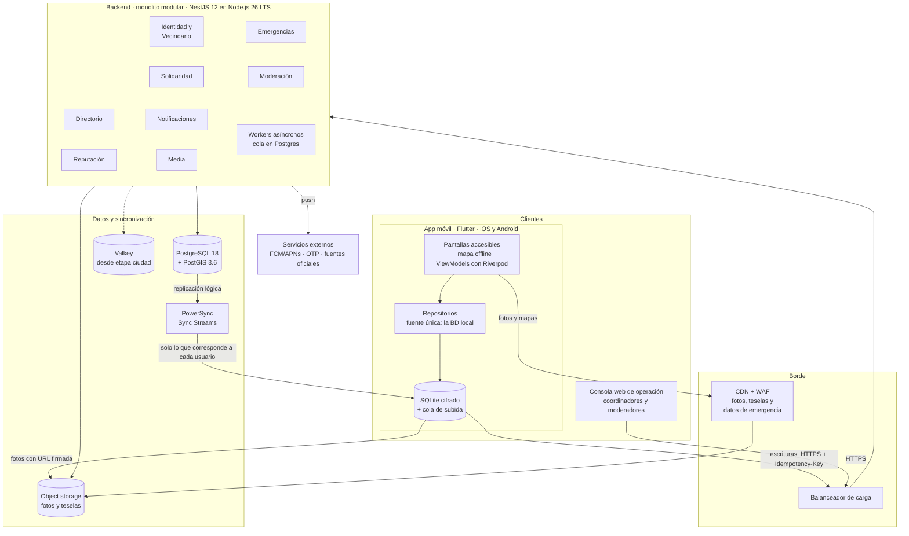
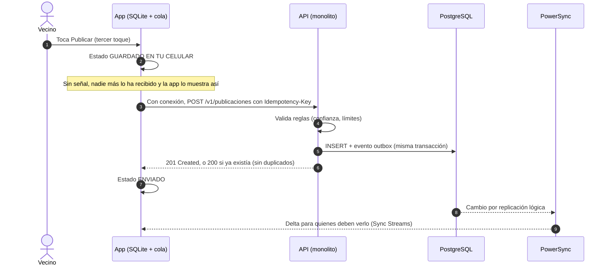

# Arquitectura propuesta: App vecinal de servicios, solidaridad y emergencias

> **Estado:** borrador v2 para revisión del equipo; todavía no es una arquitectura aprobada. **Versiones verificadas al 6 de noviembre de 2026.** Antes de crear los proyectos, confirma la matriz de compatibilidad de la sección 13.

### Qué cambió en la v2

Esta versión incorpora una revisión externa del borrador v1:

- **Seguridad de las personas:** cada pedido de ayuda muestra en qué estado está (*guardado en tu celular*, *enviado*, *visto*, *atendido*), cada dato indica cuándo se actualizó y la app explica qué hacer sin conexión (sección 7).
- **Promesa offline realista:** sin conexión se puede consultar lo descargado y dejar acciones en cola, pero nada se envía. En segundo plano, el sistema operativo decide cuándo se sincroniza (sección 3.4).
- **Datos sensibles:** clasificación de los datos, qué llega a cada celular, cifrado local, caducidad y qué pasa si se pierde el teléfono o se revoca un acceso (sección 8).
- **Operación humana:** roles, tiempos de respuesta, escalamiento y una consola web para coordinadores. El tablero humanitario solo se activa donde hay personas que respondan (sección 9).
- **Orden de construcción sin fechas:** el alcance del producto se mantiene, pero se construye por fases, empezando por lo más riesgoso y con una infraestructura inicial más liviana (secciones 11 y 12).
- **Correcciones:** el ranking es de consistencia eventual en todo el documento; las cifras de capacidad pasan a ser hipótesis con plan de prueba; los mapas offline ya no dependen del servidor público de OpenStreetMap; los tópicos de FCM solo se usan para avisos públicos; PowerSync pasa de Sync Rules (en retirada) a Sync Streams.

**Contenido**

1. Resumen de decisiones
2. Vista general
3. App móvil (iOS + Android)
4. Backend: monolito modular
5. Datos: base de datos y escalabilidad
6. Cómo se cubre cada requisito
7. Modo emergencia y seguridad de las personas
8. Datos sensibles en el celular
9. Operación humana y gobernanza
10. Seguridad, privacidad y confianza
11. Infraestructura, DevOps y calidad
12. Orden de construcción
13. Supuestos por validar y compatibilidades
14. Licencias de los componentes
15. Fuentes

---

## 1. Resumen de decisiones

| Tema | Decisión | Por qué |
|---|---|---|
| Plataforma móvil | **Flutter** (Dart): una sola base de código para iOS y Android | Rendimiento predecible en celulares de gama baja, la misma UI accesible en ambas plataformas y un ecosistema offline-first maduro |
| Arquitectura de la app | **Offline-first** · MVVM + Clean Architecture por funcionalidad · Riverpod | Sin señal se puede consultar lo descargado y dejar acciones en cola; la app siempre muestra qué se envió y qué no |
| Backend | **Monolito modular** en **NestJS** (TypeScript) sobre **Node.js LTS** | Un solo despliegue, transacciones ACID y bajo costo, con módulos de fronteras claras que se pueden separar si algún día hace falta |
| Consola de operación | **Aplicación web** para coordinadores y moderadores | La coordinación humana necesita su propia herramienta: cola de casos, asignación, moderación y curaduría del directorio |
| Base de datos del servidor | **PostgreSQL + PostGIS** (relacional) | Los datos están muy relacionados (vecino → reseña → servicio → zona) y las búsquedas son geográficas |
| Base de datos del celular | **SQLite cifrado** (SQLCipher) | Tiene la misma forma relacional que el servidor, y el cifrado protege los datos si se pierde el teléfono |
| Sincronización | **PowerSync con Sync Streams** (servidor → celular) + **cola de subida** hacia la API (celular → servidor) | Cada celular recibe solo lo que le corresponde, y toda escritura pasa por las reglas de negocio |
| Fotos de reseñas y publicaciones | **Object storage S3-compatible + CDN**; la BD guarda solo la referencia | Las imágenes nunca se guardan dentro de una base de datos, sea SQL o NoSQL |
| Colas y caché | **Colas en PostgreSQL** al inicio (p. ej., pg-boss); **Valkey + BullMQ** cuando el volumen lo pida | Menos servicios y costos al empezar; el cambio queda detrás de una interfaz |
| Mapas | **MapLibre** con teselas vectoriales de OpenStreetMap **auto-hospedadas** (PMTiles) o de un proveedor cuyos términos permitan la descarga offline | El servidor público de teselas de OpenStreetMap prohíbe el uso offline |
| Notificaciones | **FCM**: tópicos por zona solo para avisos públicos; mensajes personales a tokens de dispositivo, sin datos sensibles | Las notificaciones son un canal más, nunca el único canal crítico |
| Escalabilidad | Réplicas sin estado → réplicas de lectura → particionado → *sharding* por zona | Crece de un barrio a todo el país sin reescribir; cada paso se activa según métricas y pruebas de carga |

### Versiones recomendadas

| Pieza | Versión | Nota |
|---|---|---|
| Flutter | **3.47.x** (estable; 3.47.1 salió el 19-ago-2026) | Flutter 3.50 está planificado para noviembre de 2026: conviene actualizar cuando salga su primer parche |
| Dart | **3.13.x** | Viene incluido con Flutter 3.47 |
| Riverpod (`flutter_riverpod`) | **3.x** (≥ 3.4) | Riverpod 3 es estable desde septiembre de 2025 |
| MapLibre (`maplibre_gl`) | **0.26.x** | Requiere Flutter 3.29+, Android 5.0+ e iOS 13+ |
| PowerSync con cifrado (`powersync_sqlcipher`) | **0.1.x** | Está en beta: el fabricante lo considera apto para producción si se prueban los casos de uso propios |
| Node.js | **26 LTS** | Es LTS desde el 28-oct-2026, con soporte hasta abril de 2029 |
| NestJS | **12.x** | Paquetes ESM, validación con Standard Schema y observabilidad oficial |
| TypeScript | **6.x** | Es la versión que aplica `nest upgrade` al pasar a NestJS 12 |
| PostgreSQL | **18.x** (18.6 o superior) | PowerSync requiere PostgreSQL 11 o superior. PostgreSQL 19 tiene su lanzamiento planificado para el 19-nov-2026: migrar cuando el proveedor y PostGIS lo soporten |
| PostGIS | **3.6.x** | PostGIS 3.7 está en *release candidate* |
| Valkey (etapa ciudad) | Rama estable actual | Alternativa: Redis 8, que volvió a ofrecer una licencia open source (AGPLv3) |
| *Alternativa móvil* | React Native 0.88 + Expo SDK 58 | Si el equipo es fuerte en TypeScript/React |

> Para el backend también son válidos **Spring Boot (Java/Kotlin)** o **.NET** si el equipo ya los domina. La arquitectura (monolito modular + hexagonal) es exactamente la misma.

---

## 2. Vista general



Los workers procesan en segundo plano los eventos de dominio (moderación, rankings, miniaturas, notificaciones). Al inicio, la cola vive en PostgreSQL; Valkey (línea punteada) se incorpora cuando el volumen lo pida.

**Idea central:** la app no depende de la red para mostrar lo que ya descargó, pero sin conexión nada le llega a nadie, y la app lo dice con claridad. La red sincroniza, la base del celular responde y la consola web permite que personas reales coordinen la ayuda.

---

## 3. App móvil (iOS + Android)

### 3.1 Opciones evaluadas

| Criterio | **Flutter** ✅ | React Native + Expo | Kotlin/Compose Multiplatform |
|---|---|---|---|
| Lenguaje | Dart | TypeScript | Kotlin (+ algo de Swift) |
| UI | Motor de render propio: misma UI en todos los equipos | Componentes nativos de cada plataforma | Compose en ambas plataformas |
| Rendimiento en gama baja | Muy bueno y predecible (compilación AOT a código nativo) | Bueno (Nueva Arquitectura + Hermes) | Muy bueno |
| Offline-first | Maduro (SQLite con PowerSync o Drift, cifrado disponible) | Maduro (expo-sqlite, PowerSync) | Correcto, con un ecosistema más pequeño |
| Mapas offline | MapLibre con regiones descargables | MapLibre con paquetes offline | Requiere más trabajo nativo |
| Ventaja diferencial | Un único diseño accesible, idéntico en iOS y Android | Mismo lenguaje que el backend NestJS | Máxima integración nativa |
| Cuándo elegirlo | **Opción por defecto para este producto** | Si el equipo domina TypeScript/React | Si el equipo ya domina Kotlin y Swift |

Descartados: **nativo separado** (Swift + Kotlin implica dos bases de código y el doble de esfuerzo) e **híbridos web** tipo Ionic/Capacitor (rendimiento y mapas offline más débiles en equipos de gama baja).

### 3.2 Por qué Flutter para este producto

1. **Celulares de gama baja.** Muchos vecinos usarán equipos Android económicos. Flutter compila a código nativo y su rendimiento se mantiene estable aun en esos equipos.
2. **Un solo diseño accesible.** Lo que se diseña y prueba (contraste, tamaños de letra, tutorial) se ve igual en iOS y Android: menos pruebas duplicadas y ninguna sorpresa para las personas mayores.
3. **Offline-first de primera.** SQLite local cifrado con PowerSync (o Drift), cola de subida y *streams* reactivos de la base de datos hacia la UI.
4. **Mapas sin internet.** `maplibre_gl` permite descargar regiones: teselas, fuentes y *sprites* quedan guardados en el dispositivo (solo Android e iOS).
5. **Correcciones urgentes.** Opcionalmente, *code push* (Shorebird) para corregir errores durante una emergencia sin esperar la revisión de las tiendas.

### 3.3 Arquitectura interna de la app

Sigue la guía oficial de arquitectura de Flutter (MVVM + repositorios), organizada **por funcionalidad** y con tres capas en cada una:

- **presentation**: pantallas (Views) y ViewModels (`Notifier`/`AsyncNotifier` de Riverpod). Los widgets no contienen lógica de negocio.
- **domain**: entidades, *value objects* y casos de uso (`PublicarFavor`, `DarVistoBueno`, `PedirAyuda`). Dart puro, 100 % testeable.
- **data**: repositorios, acceso a SQLite, cliente de la API y mapeo DTO ↔ entidad.

| Patrón | Dónde | Para qué |
|---|---|---|
| MVVM | presentation | Separar la UI del estado y de la lógica |
| Repository + fuente única de verdad | data | La UI solo lee de SQLite; la red solo actualiza SQLite |
| Outbox (cola de comandos) | data | Guardar acciones sin señal y reintentar con *backoff* exponencial |
| Máquina de estados de envío | data → presentation | Mostrar siempre si cada acción está guardada en el celular, enviada o rechazada |
| Clave de idempotencia (UUIDv7 generado en el celular) | data | Reintentar sin crear publicaciones duplicadas |
| State | core | El paso Normal ↔ Emergencia ↔ Recuperación cambia el inicio, el menú y las prioridades |
| Strategy / Adapter (puertos) | core | Cambiar de proveedor de mapas, push u OTP sin tocar las funcionalidades |
| Observer (*streams*) | data → presentation | La pantalla se actualiza sola cuando llegan cambios del servidor |
| Inyección de dependencias | Riverpod | Probar con *fakes* y cambiar implementaciones |
| Feature flags + configuración remota | core | Activar módulos por zona o por emergencia sin publicar una versión nueva |

```text
app/lib/
├── core/                 # tema accesible, i18n (es-PE, quechua), router, DI,
│                         # cliente HTTP, base local cifrada, sync, modo emergencia
└── features/
    ├── directorio/       # oficios y profesiones cercanos
    │   ├── data/         # repositorios, consultas SQLite, DTOs
    │   ├── domain/       # entidades y casos de uso
    │   └── presentation/ # pantallas, widgets, viewmodels
    ├── reputacion/       # Visto Bueno, reseñas con fotos
    ├── solidaridad/      # muro de favores e intercambios
    ├── emergencias/      # pedidos de ayuda, tablero, recursos, grupos de apoyo
    ├── operacion/        # modo operativo para coordinadores y brigadistas
    ├── publicar/         # flujo de 3 toques
    ├── mapa/             # mapa y descarga de la región offline
    └── onboarding/       # tutorial interactivo
```

### 3.4 Offline-first en detalle

**Qué promete y qué no promete la app**

| Sin conexión, la app **sí** puede | Sin conexión, la app **no** puede |
|---|---|
| Mostrar lo que ya descargó, indicando cuándo se actualizó | Hacer que un pedido le llegue a otra persona |
| Guardar publicaciones, reseñas y pedidos en una cola local | Garantizar que lo descargado siga vigente (un recurso pudo agotarse) |
| Reintentar automáticamente cuando vuelva la conexión | Sincronizar en segundo plano en un momento exacto: lo decide el sistema operativo |
| Mostrar los mapas y el directorio de emergencia descargados | Avisar a otros vecinos de algo nuevo |

**Cuándo se sincroniza**

- **Con la app abierta** (el camino principal): al abrirla, al volver a ella y al recuperar la conexión.
- **Al salir de la app con un envío en curso:** se le pide al sistema un tiempo extra limitado para terminarlo.
- **Fotos:** con las transferencias en segundo plano del propio sistema (URLSession en iOS, WorkManager en Android), que continúan aunque la app quede suspendida.
- **En segundo plano:** solo de forma oportunista. En iOS, el sistema decide cuándo ejecutar las tareas de actualización (con hasta 30 segundos de ejecución) y limita las notificaciones silenciosas si se envían más de tres por hora; Android también aplica restricciones de batería. Por eso la UI nunca promete envíos inmediatos en segundo plano.

**Estados visibles de cada envío**

| Estado | Qué significa | Qué ve el vecino |
|---|---|---|
| **Guardado en tu celular** | Está en la cola local; **nadie más lo ha recibido** | Un aviso destacado y, si es un pedido de ayuda, alternativas inmediatas (sección 7.4) |
| **Enviado** | El servidor lo aceptó y lo guardó | La hora de envío |
| **No se pudo completar** | El servidor lo rechazó (p. ej., otro vecino ya tomó el favor) | El motivo y una alternativa, en una bandeja de "acciones por revisar" |

Los pedidos de ayuda tienen además los estados *visto por un coordinador*, *en camino* y *atendido* (sección 7.2).



- **Lecturas.** PowerSync usa *Sync Streams*: los datos públicos de tu zona (directorio, reseñas, muro, puntos de encuentro) se descargan automáticamente, y los datos sensibles nunca se replican de forma masiva (sección 8). Los streams admiten prioridades, de modo que en una emergencia se descarga primero lo crítico.
- **Escrituras.** PowerSync guarda cada cambio en una cola local de subida, y tú defines cómo se envía a tu API. Cada envío lleva una clave de idempotencia para que los reintentos no dupliquen nada.
- **Conflictos.**
  - Contenido de un solo autor (reseñas, publicaciones, pedidos): no hay conflicto.
  - Estados compartidos (favor tomado, stock de un recurso crítico): decide el servidor, con control de concurrencia optimista (columna `version`), y el rechazo se explica en la app.
  - Contadores (Visto Bueno, promedio de estrellas): los calcula el servidor a partir de los hechos; el celular nunca envía contadores.
- **Fotos.** Se comprimen en el celular (lado mayor ≤ 1280 px, WebP o JPEG al ~75 %), se les borran los metadatos EXIF (incluida la ubicación GPS) y se suben directo al object storage con una URL firmada. Un worker genera las miniaturas y la app muestra un *blurhash* mientras cargan.
- **Mapas.** La región del distrito se descarga por Wi-Fi con MapLibre. Como referencia, su documentación estima entre 20 y 100 MB para el centro de una ciudad entre los niveles de zoom 10 y 15, así que conviene limitar el área y los niveles de zoom. **El servidor público `tile.openstreetmap.org` prohíbe la descarga masiva y el uso offline**, así que las teselas deben venir de un archivo PMTiles auto-hospedado (generado a partir de los datos de OpenStreetMap) en el object storage detrás de la CDN, o de un proveedor cuyos términos permitan expresamente la descarga offline. La descarga se valida con la fuente elegida en la Fase 0 (sección 12).
- **Datos críticos siempre presentes.** El directorio de emergencia, los puntos de encuentro, los centros de salud y los números de emergencia viven en el celular, cada uno con su fuente y su fecha de verificación, y además se publican como JSON estático en la CDN.
- **Alternativa sin PowerSync.** Sync propio con `GET /v1/sync?zona=…&desde=<cursor>`, usando `actualizado_en` + borrado lógico (`eliminado_en`) y Drift en el cliente: más trabajo, cero dependencias externas.

### 3.5 Paquetes recomendados (Flutter)

| Necesidad | Paquete |
|---|---|
| Estado + inyección de dependencias | `flutter_riverpod` (+ `riverpod_generator`) |
| Navegación y enlaces profundos | `go_router` |
| Base local cifrada + sincronización | `powersync_sqlcipher` (o `drift` si se hace sync propio) |
| Mapas con regiones offline | `maplibre_gl` |
| Ubicación | `geolocator` |
| Notificaciones push | `firebase_messaging` |
| Subida de fotos en segundo plano | `background_downloader` |
| Tareas periódicas en segundo plano | `workmanager` |
| Llamadas y SMS a números de emergencia | `url_launcher` |
| Bloqueo del modo operativo con biometría | `local_auth` |
| HTTP con reintentos y autenticación | `dio` |
| Modelos inmutables | `freezed` + `json_serializable` |
| Fotos livianas | `image_picker` + `flutter_image_compress` |
| Dictado por voz | `speech_to_text` |
| Tutorial guiado | `showcaseview` |
| Compartir por WhatsApp y redes | `share_plus` |
| Almacenamiento seguro de claves y tokens | `flutter_secure_storage` |
| Errores y rendimiento | `sentry_flutter` |
| Idiomas | `flutter_localizations` + `intl` |

> Fija versiones exactas en `pubspec.lock` y revisa la compatibilidad de cada paquete en pub.dev al iniciar.

---

## 4. Backend: monolito modular

### 4.1 ¿Monolito o microservicios?

| Criterio | **Monolito modular** ✅ | Microservicios |
|---|---|---|
| Operación | 1 artefacto, 1 pipeline | N servicios, red interna, *service discovery*, trazas distribuidas |
| Consistencia | Transacciones ACID (p. ej., una reseña y su evento se guardan juntos) | Consistencia eventual y sagas |
| Costo | Bajo | Alto: más cómputo, más observabilidad, más personas |
| Escalado | Horizontal: N réplicas idénticas detrás del balanceador | Independiente por servicio |
| Cuándo conviene | Desde el primer usuario hasta varios millones | Muchos equipos autónomos, o partes con necesidades muy distintas de escala o disponibilidad |

**Decisión: monolito modular.** "Modular" no es solo una carpeta; implica reglas estrictas:

- Cada módulo es **dueño de sus tablas** (un esquema de Postgres por módulo: `identidad.*`, `reputacion.*`, …).
- Ningún módulo lee ni escribe tablas de otro: se comunican por su **interfaz pública** (llamada en proceso) o por **eventos de dominio**.
- Las fronteras se validan automáticamente en CI (por ejemplo, con `dependency-cruiser` o reglas de ESLint).
- El servidor es **sin estado**: las sesiones van en JWT y los archivos en object storage, así que se escala agregando réplicas.

Con esas reglas, convertir un módulo en microservicio es mover una carpeta y cambiar una llamada en proceso por HTTP o una cola, no reescribir el sistema.

### 4.2 Módulos (bounded contexts)

| Módulo | Responsabilidad | Entidades principales |
|---|---|---|
| Identidad y Vecindario | Registro con OTP, perfiles, zonas, niveles de confianza, roles (vecino, proveedor, moderador, coordinador, brigadista) | Usuario, Zona, Verificación |
| Directorio | Oficios y profesiones, servicios ofrecidos, búsqueda por cercanía y categoría | PerfilProveedor, Servicio, Categoría |
| Reputación | Visto Bueno Vecinal, reseñas con fotos, ranking, antifraude | Reseña, FotoReseña, VistoBueno |
| Solidaridad | Muro de favores: préstamo de herramientas, ayuda temporal, donaciones, intercambio de habilidades, movilidad solidaria | Publicación, Respuesta, Intercambio |
| Emergencias | Eventos por zona, pedidos de ayuda con estados y escalamiento, recursos críticos, grupos de apoyo, turnos y cobertura | Evento, PedidoAyuda, Asignación, RecursoCrítico, GrupoApoyo, Turno |
| Notificaciones | Avisos por tópico de zona y por dispositivo, preferencias, SMS de respaldo (opcional) | Suscripción, Plantilla |
| Media | URLs firmadas, miniaturas, moderación de imágenes | Archivo |
| Moderación | Denuncias, cola de revisión, sanciones | Denuncia, Caso |

**Clientes de la API:** la app móvil y la **consola web de operación** (sección 9.5). La consola funciona solo en línea, usa la misma API con roles operativos y puede hacerse con Flutter web, para reutilizar modelos, o con React.

### 4.3 Patrones del backend

| Patrón | Uso concreto |
|---|---|
| Arquitectura hexagonal (puertos y adaptadores) | El dominio no depende del framework; Postgres, FCM, el proveedor OTP y la cola son adaptadores intercambiables |
| DDD táctico (ligero) | Agregados que protegen reglas: "una reseña por vecino y servicio", "nadie se reseña a sí mismo", "un favor lo toma un solo vecino" |
| CQRS ligero | Escrituras → casos de uso con validación; lecturas → sync, vistas materializadas o consultas optimizadas |
| Eventos de dominio + *Transactional Outbox* | La reseña y su evento `ResenaPublicada` se guardan en la misma transacción. Los workers moderan la reseña y, si se publica, recalculan el ranking y envían las notificaciones |
| Puerto de colas | Interfaz `ColaDeTrabajos`: adaptador sobre PostgreSQL (p. ej., pg-boss) al inicio y BullMQ + Valkey cuando el volumen lo pida |
| State (máquina de estados) | Pedidos de ayuda: solo se permiten transiciones válidas, cada estado tiene tiempos límite y escalamiento, y cada cambio queda auditado |
| Repository + Unit of Work | Transacciones explícitas por caso de uso |
| Idempotencia | Cabecera `Idempotency-Key` en toda escritura (clave para el modo offline) |
| Retry + Circuit Breaker | Llamadas a FCM, al proveedor OTP y a fuentes oficiales |
| Rate limiting (*token bucket*) | Antispam y protección en picos de emergencia (en el borde al inicio y en Valkey después) |
| Chain of Responsibility | Moderación: filtro de texto → imagen → reputación del autor → revisión humana |
| Strangler Fig | Extraer módulos a servicios de forma gradual, sin un "big bang" |

### 4.4 Estructura (NestJS)

```text
backend/src/
├── modules/
│   ├── identidad/
│   │   ├── domain/          # entidades, value objects, eventos de dominio
│   │   ├── application/     # casos de uso (comandos y consultas)
│   │   ├── infrastructure/  # repositorios Postgres, adaptadores externos
│   │   └── api/             # controladores REST y DTOs
│   ├── directorio/
│   ├── reputacion/
│   ├── solidaridad/
│   ├── emergencias/
│   ├── notificaciones/
│   ├── media/
│   └── moderacion/
├── shared/                  # auth, outbox, puerto de colas, eventos, errores, observabilidad
└── workers/                 # consumidores de la cola
```

Librerías sugeridas: **Drizzle ORM** o **Kysely** (SQL tipado y explícito; las consultas geográficas conviene escribirlas en SQL), **pg-boss** como cola inicial (y **BullMQ** después), `@nestjs/swagger` para OpenAPI, y **Vitest** + **Testcontainers** para las pruebas.

### 4.5 Convenciones de API

- REST versionado (`/v1/...`) con contrato **OpenAPI**; el cliente Dart se genera a partir del contrato.
- Paginación por **cursor** (no por *offset*), respuestas compactas, compresión (brotli/gzip) y `ETag`.
- Errores en formato estándar **Problem Details (RFC 9457)**.
- Validación de entrada con **Standard Schema** (Zod, Valibot…), soportado de forma nativa en NestJS 12.
- **JWT** de vida corta + *refresh token* rotativo.
- Toda escritura acepta `Idempotency-Key`.
- Mientras hay conexión, el tablero de emergencia se actualiza casi en tiempo real por el canal de sync; no hace falta un WebSocket aparte.

### 4.6 Cuándo extraer un microservicio

Solo cuando una métrica lo justifique:

| Señal | Candidato probable |
|---|---|
| Envíos masivos que compiten con el resto del sistema en una emergencia | **Notificaciones** (el primero) |
| Procesamiento pesado de CPU (miniaturas, moderación de imágenes) | **Media** |
| Necesidad de mayor disponibilidad y aislamiento de fallas | **Emergencias** |
| Búsqueda avanzada o recomendaciones con ML | **Búsqueda / Recomendaciones** |

Cómo hacerlo: patrón *Strangler Fig*, comunicación por eventos (la cola ya existe) y una base de datos propia para el servicio extraído.

---

## 5. Datos: base de datos y escalabilidad

### 5.1 ¿Relacional o no relacional para perfiles, servicios, calificaciones y reseñas con fotos?

**Relacional: PostgreSQL + PostGIS. Las fotos no cambian la decisión.**

1. **Los datos son relaciones.** Vecino → zona; proveedor → servicios → reseñas → fotos; vecino → Visto Bueno → servicio. La integridad referencial evita reseñas huérfanas o Vistos Buenos de usuarios que no existen.
2. **La base de datos garantiza las reglas.** `UNIQUE (servicio_id, autor_id)` asegura una reseña por vecino; `CHECK (calificacion BETWEEN 1 AND 5)` valida las estrellas.
3. **Transacciones ACID.** La reseña y su evento de dominio se guardan juntos: todo o nada. El ranking se actualiza después (sección 5.5).
4. **Geografía nativa.** PostGIS combina "a menos de 2 km" + filtros + orden por reputación en una sola consulta con índice espacial.
5. **Flexibilidad tipo NoSQL donde hace falta.** Columnas `jsonb` (con índice GIN) para los atributos que cambian según el oficio: tarifa referencial, horario, certificaciones, modalidad.
6. **Búsqueda en español incluida.** Full-text con la configuración `spanish`, `unaccent` y `pg_trgm` para tolerar errores de tipeo ("gasfitero" ≈ "gásfiter").

> **Sobre las fotos:** una foto nunca se guarda dentro de la base de datos, ni en PostgreSQL ni en MongoDB. Va al **object storage**, y la BD guarda solo su ruta (`storage_key`), sus dimensiones y un *blurhash*. Un comentario con 3 fotos = 1 fila en `resenas` + 3 filas en `resena_fotos`: un caso relacional clásico.

**¿Y una base NoSQL como principal?**

- **Firestore:** las búsquedas por radio + filtros + orden por ranking son limitadas (tradicionalmente requieren geohashes y varias consultas), el costo crece con cada lectura de un feed y genera dependencia del proveedor.
- **MongoDB:** es viable (tiene índices geoespaciales), pero embeber las reseñas dentro del documento del servicio crea arreglos sin límite (máximo 16 MB por documento), y la integridad y los agregados pasan a ser responsabilidad del código.

### 5.2 Qué almacén para cada cosa (persistencia políglota)

| Necesidad | Almacén | Desde cuándo |
|---|---|---|
| Datos de negocio, geografía, reseñas | PostgreSQL + PostGIS | Desde el inicio |
| Datos sensibles de emergencias | PostgreSQL, en un esquema separado con acceso restringido y auditoría | Desde que se activa el tablero humanitario |
| Datos en el celular (offline) | SQLite cifrado | Desde el inicio |
| Fotos, archivos y teselas de mapa | Object storage (S3, Cloudflare R2, GCS) + CDN | Desde el inicio |
| Colas de trabajo | PostgreSQL (p. ej., pg-boss) | Desde el inicio |
| Caché, límites de uso y colas de alto volumen | Valkey | Etapa ciudad |
| Búsqueda avanzada (sinónimos, facetas) | Meilisearch u OpenSearch | Solo si la búsqueda de Postgres se queda corta |
| Analítica e indicadores de impacto | Réplica → BigQuery o ClickHouse | Etapa ciudad o país |
| Chat entre vecinos (si se agrega) | PostgreSQL | Evaluar un almacén dedicado solo a gran escala |

### 5.3 Modelo de datos del núcleo

Boceto de los módulos Identidad, Directorio y Reputación. En producción, cada módulo vive en su propio esquema (`identidad.usuarios`, `directorio.servicios`, …). Las claves foráneas entre módulos son aceptables dentro del monolito; si un módulo se extrae, se reemplazan por validación mediante eventos.

```sql
-- Extensiones
CREATE EXTENSION IF NOT EXISTS postgis;   -- geografía
CREATE EXTENSION IF NOT EXISTS pg_trgm;   -- búsqueda tolerante a errores de tipeo
CREATE EXTENSION IF NOT EXISTS unaccent;  -- "gásfiter" = "gasfiter"

-- ── Identidad y Vecindario ──────────────────────────────────────────────
CREATE TABLE zonas (
  id        uuid PRIMARY KEY DEFAULT uuidv7(),   -- uuidv7() es nativo en PostgreSQL 18
  nombre    text NOT NULL,
  distrito  text NOT NULL,
  limite    geography(MultiPolygon, 4326) NOT NULL
);
CREATE INDEX zonas_limite_gix ON zonas USING gist (limite);

CREATE TABLE usuarios (
  id               uuid PRIMARY KEY DEFAULT uuidv7(),
  telefono         text NOT NULL UNIQUE,
  nombre_visible   text NOT NULL,
  zona_id          uuid REFERENCES zonas(id),
  nivel_confianza  smallint NOT NULL DEFAULT 0 CHECK (nivel_confianza BETWEEN 0 AND 3),
  creado_en        timestamptz NOT NULL DEFAULT now()
);

-- ── Directorio ──────────────────────────────────────────────────────────
CREATE TABLE categorias (
  id                serial PRIMARY KEY,
  nombre            text NOT NULL UNIQUE,   -- gasfitería, carpintería, clases, paseo de mascotas…
  util_en_emergencia boolean NOT NULL DEFAULT false
);

CREATE TABLE servicios (
  id                       uuid PRIMARY KEY DEFAULT uuidv7(),
  proveedor_id             uuid NOT NULL REFERENCES usuarios(id),
  categoria_id             int  NOT NULL REFERENCES categorias(id),
  titulo                   text NOT NULL,
  descripcion              text,
  ubicacion                geography(Point, 4326) NOT NULL,
  radio_cobertura_m        int  NOT NULL DEFAULT 2000,
  disponible_en_emergencia boolean NOT NULL DEFAULT false,
  atributos                jsonb NOT NULL DEFAULT '{}',   -- tarifa referencial, horario, certificaciones…
  -- Agregados: los recalcula un worker a partir de las reseñas publicadas (consistencia eventual)
  total_resenas            int          NOT NULL DEFAULT 0,
  promedio                 numeric(3,2) NOT NULL DEFAULT 0,
  puntaje_ranking          numeric(6,4) NOT NULL DEFAULT 0,  -- promedio bayesiano
  total_vistos_buenos      int          NOT NULL DEFAULT 0,
  version                  int          NOT NULL DEFAULT 1,  -- concurrencia optimista
  actualizado_en           timestamptz  NOT NULL DEFAULT now(),
  eliminado_en             timestamptz                       -- borrado lógico: necesario para sincronizar
);
CREATE INDEX servicios_ubicacion_gix ON servicios USING gist (ubicacion);
CREATE INDEX servicios_atributos_gin ON servicios USING gin (atributos);

-- ── Reputación ──────────────────────────────────────────────────────────
CREATE TABLE resenas (
  id             uuid PRIMARY KEY,                    -- UUIDv7 generado en el celular: reintentos sin duplicados
  servicio_id    uuid NOT NULL REFERENCES servicios(id),
  autor_id       uuid NOT NULL REFERENCES usuarios(id),
  zona_autor_id  uuid NOT NULL REFERENCES zonas(id),  -- zona del vecino al momento de reseñar
  calificacion   smallint NOT NULL CHECK (calificacion BETWEEN 1 AND 5),
  comentario     text CHECK (char_length(comentario) <= 2000),
  estado         text NOT NULL DEFAULT 'en_revision'
                 CHECK (estado IN ('en_revision', 'publicada', 'oculta')),
  creado_en      timestamptz NOT NULL DEFAULT now(),
  UNIQUE (servicio_id, autor_id)                      -- una reseña por vecino y servicio
);

CREATE TABLE resena_fotos (
  id           uuid PRIMARY KEY,
  resena_id    uuid NOT NULL REFERENCES resenas(id) ON DELETE CASCADE,
  storage_key  text NOT NULL,       -- ruta en el object storage: la foto NO vive en la BD
  ancho        int,
  alto         int,
  blurhash     text,                -- vista previa difuminada mientras carga
  orden        smallint NOT NULL DEFAULT 0
);

CREATE TABLE vistos_buenos (
  servicio_id  uuid NOT NULL REFERENCES servicios(id),
  vecino_id    uuid NOT NULL REFERENCES usuarios(id),
  creado_en    timestamptz NOT NULL DEFAULT now(),
  PRIMARY KEY (servicio_id, vecino_id)   -- un Visto Bueno por vecino y servicio
);
```

Para la búsqueda de texto, agrega una columna `tsvector` con la configuración `spanish` y una función `unaccent` envuelta como `IMMUTABLE` (requisito de PostgreSQL para poder indexarla), más un índice `pg_trgm` sobre `titulo`.

Resto de módulos (resumen):

| Módulo | Tablas principales |
|---|---|
| Solidaridad | `publicaciones` (tipo: ofrezco / necesito / presto / dono / intercambio / movilidad; categoría, ubicación, estado, `vence_en`), `respuestas`, `intercambios` |
| Emergencias (esquema restringido) | `eventos` (polígono, nivel, estado), `pedidos_ayuda` (estado, prioridad, celda pública, ubicación exacta restringida, `caduca_en`), `historial_pedidos` (transiciones auditadas), `asignaciones`, `turnos`, `recursos_criticos` (tipo, cantidad, `reportado_en`), `grupos_apoyo` |
| Notificaciones | `suscripciones` (tópicos por zona), `preferencias` |
| Moderación | `denuncias`, `casos` |

### 5.4 Ejemplo: búsqueda geográfica + reputación

"Gasfiteros a menos de 2 km de mí, priorizando los que tienen Visto Bueno de vecinos verificados de mi zona":

```sql
SELECT s.id,
       s.titulo,
       s.puntaje_ranking,
       (SELECT count(*)
          FROM vistos_buenos vb
          JOIN usuarios u ON u.id = vb.vecino_id
         WHERE vb.servicio_id = s.id
           AND u.zona_id = :mi_zona
           AND u.nivel_confianza >= 2)           AS vistos_buenos_de_mi_zona,
       round(ST_Distance(s.ubicacion, :yo))       AS distancia_m
FROM servicios s
WHERE s.categoria_id = :gasfiteria
  AND s.eliminado_en IS NULL
  AND ST_DWithin(s.ubicacion, :yo, 2000)         -- radio en metros; usa el índice GiST
ORDER BY vistos_buenos_de_mi_zona DESC, s.puntaje_ranking DESC
LIMIT 20;

-- :yo = ST_SetSRID(ST_MakePoint(:lng, :lat), 4326)::geography
```

### 5.5 Ranking, Visto Bueno y antifraude

**Puntaje bayesiano**, para ordenar por estrellas sin injusticias:

```text
puntaje = (C × m + suma_de_calificaciones) / (C + n)

m = promedio de la categoría · n = reseñas publicadas del servicio · C ≈ 5–10 (peso de confianza)
```

Así, un servicio con una sola reseña de 5 ★ no supera a uno con 80 reseñas de 4,8 ★.

**El ranking es de consistencia eventual.** La reseña entra como `en_revision` y se guarda junto con su evento en una sola transacción. Cuando pasa la moderación, un worker la publica y recalcula el ranking a partir de todas las reseñas publicadas (nunca sumando incrementos), así que un reintento no puede descuadrarlo. El ranking público se actualiza segundos después; el autor ve su reseña al instante en su celular, marcada como "en revisión".

**Niveles de confianza del vecino:**

| Nivel | Cómo se obtiene | Qué habilita |
|---|---|---|
| 0 · Registrado | Teléfono + OTP | Ver y pedir ayuda (en una emergencia nadie queda fuera) |
| 1 · Vecino | Residencia confirmada en la zona (por ejemplo, presencia recurrente, con consentimiento) | Publicar en el muro y reseñar |
| 2 · Vecino verificado | Aval de 2 vecinos verificados o validación de la junta vecinal | Su Visto Bueno cuenta para el ranking |
| 3 · Identidad verificada | Validación del DNI | Proveedor destacado; requisito para coordinadores y brigadistas |

**Antifraude:** un Visto Bueno y una reseña por vecino y servicio; nadie se reseña a sí mismo; antigüedad mínima de la cuenta; límites diarios; detección de patrones (muchas reseñas desde el mismo dispositivo o red); denuncias que van a la cola de moderación.

### 5.6 Escalabilidad: de un barrio a todo el país

| Etapa | Alcance | Usuarios aprox. | Infraestructura |
|---|---|---|---|
| **Micro** | Un barrio o distrito | Hasta ~10 mil | API con 2 réplicas pequeñas · Postgres gestionado con PostGIS y backups PITR · object storage + CDN · PowerSync · colas en Postgres y caché en memoria (sin Valkey) |
| **Ciudad** | Lima Metropolitana | ~100 mil a 1 millón | Autoescalado de la API · *pooler* de conexiones (PgBouncer) · 1 o 2 réplicas de lectura · Valkey + BullMQ · workers separados · vistas materializadas para los rankings |
| **Macro** | Todo el país | Varios millones | Particionado (por región, y por fecha en los pedidos de ayuda) · *sharding* por zona (Citus o una instancia por región) · extracción de Notificaciones, Media y Emergencias · varias zonas de disponibilidad y plan de recuperación ante desastres |

**Estimaciones de orden de magnitud (hipótesis por validar, no garantías):**

- **Día normal:** 1 millón de usuarios con 10 % de actividad diaria son 100 mil personas × ~30 peticiones = 3 millones de peticiones al día, unas **35 por segundo** de promedio. Para un pico de ×10 (≈ **350 por segundo**) deberían bastar unas pocas réplicas de la API y un Postgres primario con una réplica.
- **Pico de emergencia:** 300 mil vecinos que abren la app en 10 minutos (~5 peticiones cada uno) generan unas **2 500 peticiones por segundo** durante el pico. La arquitectura está pensada para reducir esa carga: (1) la información ya está en el celular, (2) el directorio de emergencia es un JSON estático en la CDN, (3) los avisos públicos salen por tópicos de FCM, (4) las escrituras entran a una cola con prioridad y límites, y (5) hay autoescalado y réplicas de lectura. Aun así, es una hipótesis hasta probarla con k6, incluyendo la sincronización, la base de datos y la **reconexión simultánea de miles de celulares** cuando vuelve la señal (para suavizarla, cada cliente reintenta con espera exponencial y una variación aleatoria).
- **Fotos:** 1 millón de reseñas × 2 fotos × ~250 KB ≈ 500 GB en object storage, un volumen bajo para ese tipo de almacenamiento. En la BD, cada foto ocupa una fila de unos cientos de bytes.

---

*Continúa en `arquitectura-app-vecinal-parte-2.md` (secciones 6 a 15).*
