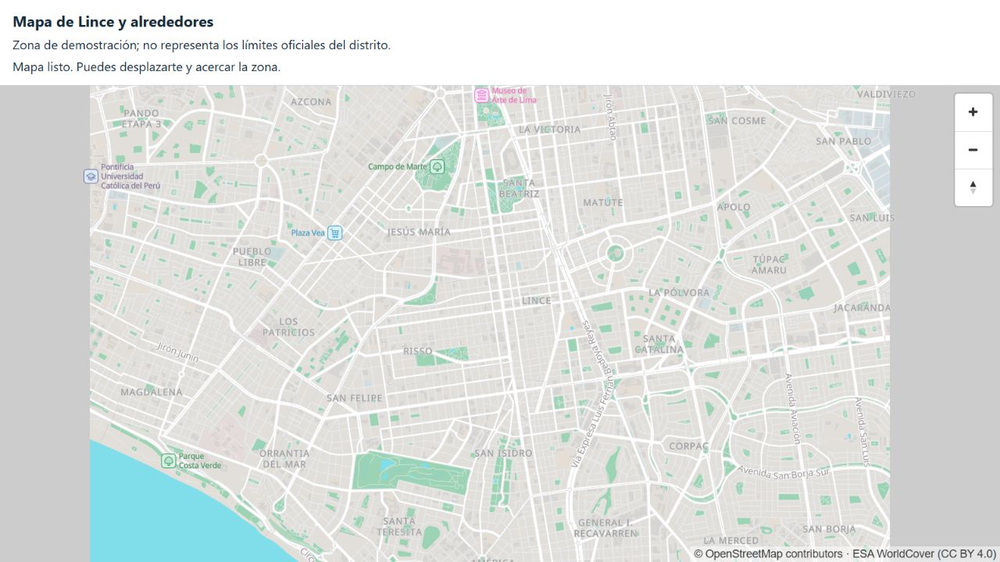

# Lote C · Parte 1 · Fuente de teselas

**Fecha:** 7 de noviembre de 2026. **Estado:** verificado localmente; pendiente de revisión y CI.
Rama: `lote-c/parte-1-teselas`. No hay entregas de A, B ni D como requisito de estas pruebas.

## Archivo generado

| Dato | Resultado |
|---|---|
| Área | Lince y alrededores, rectángulo de demostración que contiene la zona piloto |
| Límites oeste/sur/este/norte | −77,07 / −12,10 / −77,01 / −12,06 |
| Fuente | `https://build.protomaps.com/20261107.pmtiles` |
| Esquema de datos | Protomaps 4.15.2 |
| Herramienta | PMTiles CLI 1.31.2 |
| Formato | PMTiles v3, teselas MVT comprimidas con gzip, zoom 0–15 |
| Tamaño | **2 964 673 bytes (2,83 MiB)** |
| SHA-256 del recorte | `3fdd39daf578051dd16b89546e9d06cd5c39cf3126e9d0ef84387e10c11413b3` |
| Extracción observada | Aproximadamente 11,4 s; no es una medición de descarga móvil |

El manifiesto completo queda generado en `infra/cdn/publico/distrito.manifest.json`, fuera de Git.
El BLAKE3 del planeta se registra como dato del catálogo; no se descargó ni verificó el planeta entero.

## Comprobaciones realizadas

- Generación real del recorte con límites explícitos y verificación con `pmtiles verify`.
- Generación del estilo claro, nombres priorizados en español y atribución OSM.
- Copia local de 1 029 archivos de fuentes/licencia/sprites y del visor MapLibre GL JS.
- **Cinco pruebas automáticas aprobadas**: validación oficial del estilo, XYZ para la región,
  recursos en el origen propio, correspondencia entre estilo versionado y generador,
  cobertura de la zona piloto y validación de la dirección pública (algunas comprobaciones
  se agrupan en la misma prueba).
- `npm run verify`: formato, estilo, recursos y SHA-256 correctos.
- `nginx -t`: configuración válida, usando la misma configuración de servidor con raíz y
  dirección de teselas adaptadas al entorno Windows de prueba.
- `npm run verify -- --url http://127.0.0.1:8090`: **Range 206**, `Content-Range` correcto,
  primeros 1 024 bytes idénticos al archivo local, CORS y recursos accesibles.
- Tesela real del centro: `/teselas/14/4686/8746.mvt` devuelve **200** con contenido.
- Inspección del visor en navegador: calles, nombres de lugares, parques e iconos visibles;
  mensaje «Mapa listo» y atribución **© OpenStreetMap contributors** permanente.
- `npm run format:check` y comprobaciones sintácticas de los accesos PowerShell y shell sin errores.
- OpenSpec estricto: **10 elementos aprobados, 0 fallos**.

Captura del visor con la atribución OSM y ESA WorldCover:

## Entorno y límites

Validación local en Windows con Node **22.20.0**, PMTiles **1.31.2** y nginx **1.29.0**.
Docker y Flutter no estaban disponibles en el PATH del entorno de trabajo; se usaron los
binarios oficiales de nginx y PMTiles para la comprobación HTTP y visual. No se instalaron
herramientas globales. El CI preparado usa Node 26 y comprueba Docker al ejecutarse manualmente.

Pendiente: aprobación del ADR 0008, ejecución de CI en GitHub y revisión de C1.
No se ha probado una descarga móvil, modo avión, tamaño de la caché offline ni compatibilidad
en dispositivos Android/iOS: corresponden a C2. Esta evidencia no cierra esos criterios.
