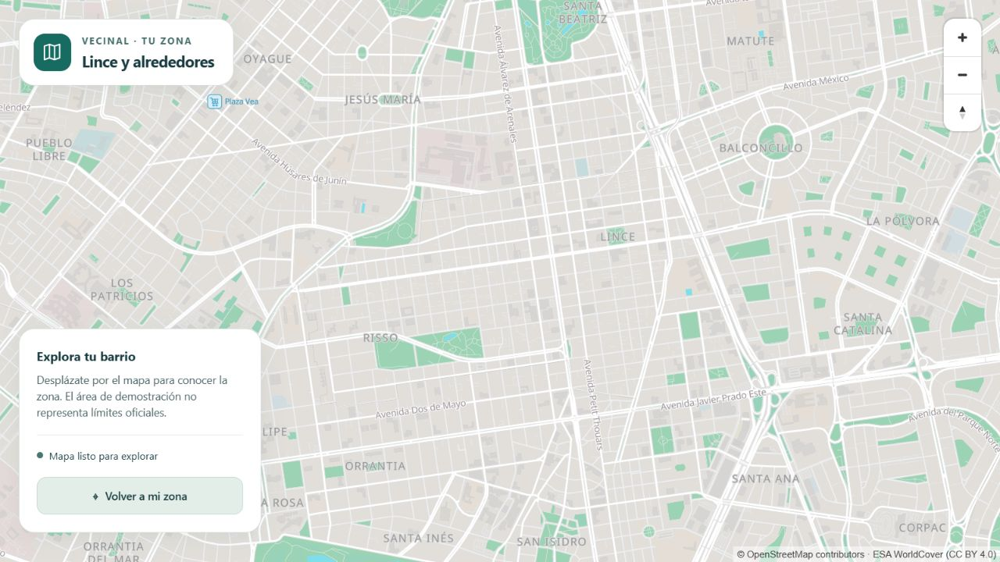

# Lote C · Parte 2 · Mapa en la app

**Fecha:** 7 de noviembre de 2026. **Estado:** implementación y validación local; prueba de campo pendiente.
Rama: `lote-c/parte-2-mapa-offline`, basada en la entrega local C1 `1e1d3a4`.

## Implementación

- Acceso desde el muro a la pantalla `/mapa`, con MapLibre y estilo propio de C1.
- Región del piloto con zoom 10–15, descarga por Wi-Fi, autorización explícita de datos
  móviles, progreso, tamaño, cancelación y borrado con confirmación.
- Persistencia nativa separada de la UI; puerto de almacenamiento y vista reemplazables.
- Recuperación del estado guardado y reconocimiento de descargas incompletas.
- Cancelación segura durante la creación de la región y al perder la conexión permitida.
- Atribución fija, textos en español y controles grandes.

## Validación automatizada

Entorno: Flutter **3.47.9**, Dart **3.13.7**, Windows. La descarga de Flutter se verificó
contra el SHA-256 publicado en el catálogo oficial antes de instalarlo.

| Comprobación | Resultado |
|---|---|
| `flutter analyze` | Sin avisos ni errores |
| `flutter test` | **66 pruebas aprobadas**, incluidas 28 nuevas del mapa |
| Política de conexión | Wi-Fi por defecto; sin red no empieza, aunque se permitan datos móviles |
| Persistencia | Solo regiones nativamente completas se anuncian disponibles |
| Concurrencia | Cancelación antes del ID, llamadas repetidas y descarte de eventos tardíos |
| Lecturas antiguas | Una consulta iniciada antes de borrar no vuelve a anunciar disponible la región |
| Ciclo de vida | Volver a entrar comprueba la región; al reanudar se consulta la conexión aunque no haya llegado su evento |
| Borrado | Limitado a las regiones gestionadas por esta funcionalidad |
| Pantalla | Ruta real, progreso, cancelación, confirmación y mensajes recuperables |
| Accesibilidad | Texto al 200 %, atribución visible, objetivos Android y controles etiquetados |

`dart format --output=none --set-exit-if-changed lib test` sin diferencias, manifiestos XML
válidos, flujo de CI con YAML válido y OpenSpec estricto: **10 elementos aprobados, 0 fallos**.
Las pruebas usan dobles de almacenamiento y vista: sus tamaños no son mediciones del celular.

## Compilación

`flutter build apk --debug` genera correctamente el APK universal de depuración en
`app/build/app/outputs/flutter-apk/app-debug.apk`. No se sube el binario a Git.
Usa la dirección predeterminada para el emulador; para un teléfono real se debe recompilar
con el origen alcanzable por ese teléfono, como explica `app/lib/features/mapa/README.md`.

Se ajustaron JDK 21, Android API 24+ e iOS 15.5+ a los requisitos del paquete MapLibre
efectivamente resuelto. Gradle preparó NDK 28.2.13676358, CMake 3.22.1 y los componentes SDK
que necesitaba, usando las licencias ya presentes en el entorno Android.

El flujo de CI también compila iOS en PR y conserva el APK como artefacto de revisión. La
compilación y ejecución en iOS todavía no están verificadas aquí: esta sesión se ejecuta en
Windows. El CI en GitHub y la revisión del equipo siguen pendientes.

## Prueba de campo pendiente

El responsable confirmó que por ahora no tiene un Android real disponible. No se fabrican
resultados para completar la evidencia. Cuando se disponga de los equipos:

1. Registrar modelo, sistema, RAM y espacio disponible del Android de gama baja.
2. Servir los mapas de C1 con una dirección alcanzable y usar ese mismo origen en el estilo.
3. Abrir el mapa con Wi-Fi, descargar y registrar duración y MB reportados por el dispositivo.
4. Activar modo avión, cerrar y volver a abrir la app, abrir `/mapa` y navegar entre zoom 10–15
   dentro del área piloto. Capturar calles, etiquetas y atribución.
5. Repetir una descarga, cancelar y comprobar que no se anuncia como lista; volver a descargar.
6. Durante una descarga, perder Wi-Fi sin permitir datos móviles y comprobar la cancelación.
7. Borrar con confirmación y comprobar que la región ya no figura descargada.
8. Repetir el flujo en un iPhone compatible y anotar permiso de red local y comportamiento de caché.
9. Adjuntar capturas y completar tamaño/tiempo medidos. Obtener CI verde y revisión del Lote A.

| Medición física | Resultado |
|---|---|
| Modelo y sistema Android | Pendiente |
| Tamaño descargado en Android | Pendiente |
| Tiempo de descarga por Wi-Fi | Pendiente |
| Mapa navegable en modo avión tras reiniciar la app | Pendiente |
| Modelo, sistema y resultado en iPhone | Pendiente |

El recorte PMTiles de C1 ocupa 2 964 673 bytes, pero ese dato no equivale al espacio de una
región offline de MapLibre, que también contiene estilo, fuentes y sprites.

## Actualización de diseño · 2026-11-07

La pantalla Flutter agrupa el mapa y los controles en tarjetas, con jerarquía de texto más clara
y una anchura de lectura limitada. Conserva la atribución fija y controles de 48 dp. Sus pruebas
incluyen descarga, cancelación, borrado y texto al 200 %, adaptadas al desplazamiento de la vista.

El visor web muestra el mapa a pantalla completa, cabecera compacta, controles en español y
botón para volver al área piloto. Limita la navegación al recorte disponible para evitar áreas
vacías. Revisión visual real y botón comprobados en navegador local; esta captura es del visor
web, no de un teléfono ni del funcionamiento en modo avión:

