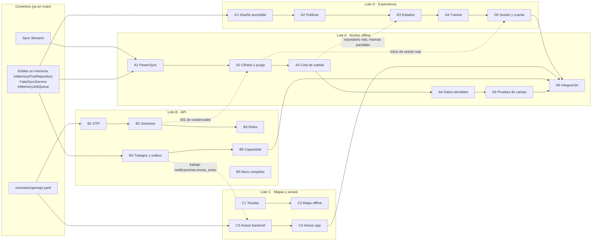

# Plan de lotes · Fase 0 (y lo que sigue)

La Fase 0 es la **prueba técnica** de la arquitectura (sección 12): demostrar con dispositivos
reales que los supuestos de la sección 13.1 se cumplen. Los **cimientos ya están en `main`**:

- Backend NestJS con el núcleo compartido (Problem Details, validación, JWT ES256 + JWKS,
  idempotencia, outbox, puerto de colas) y el muro de favores de referencia (publicar y tomar).
- App Flutter con tema accesible, estados de envío, reintentos, modo de la app y el muro sobre un
  doble en memoria.
- Contrato OpenAPI, infraestructura local (Postgres + PostGIS, PowerSync, CDN), Sync Streams,
  OpenSpec con un change por lote y CI.

Todo lo que falta de la Fase 0 está repartido en **4 lotes que se trabajan en simultáneo**, de
mayor a menor dificultad. Cada lote es un change de OpenSpec con propuesta, diseño y tareas, y
cada tarea dice cómo se verifica.

El **estado de cada lote** (lo hecho y lo que falta) y su **guía paso a paso** están en
`docs/fase-0/<lote>/README.md`; el resumen de todos, en `docs/fase-0/README.md`.

## Los 4 lotes

| Lote | Tema | Dificultad | Dueño | Change de OpenSpec | Partes |
|---|---|---|---|---|---|
| **A** | Núcleo offline: PowerSync de punta a punta, cifrado y purga, cola de subida con rechazos, datos sensibles bajo demanda, pruebas de campo e **integración y revisión** | ★★★★ Muy alta | Stefano | `lote-a-nucleo-offline` | 6 |
| **B** | API: OTP, sesiones revocables, roles y niveles, pg-boss + relay del outbox + workers, muro completo y prueba de capacidad con k6 | ★★★ Alta | JDiazD33 | `lote-b-api-identidad-y-trabajos` | 6 |
| **C** | Mapas sin conexión (PMTiles + MapLibre) y avisos (FCM por token y por tópico) | ★★ Media | Por asignar | `lote-c-mapas-y-avisos` | 4 |
| **D** | Experiencia accesible: sistema de diseño, publicar en 3 toques, estados visibles y "acciones por revisar", tutorial y modo práctica, inicio de sesión, zona y cuenta | ★ Media-baja | Por asignar | `lote-d-experiencia-accesible` | 5 |

Las tareas completas, con casillas, están en `openspec/changes/<change>/tasks.md` y en el issue de
GitHub de cada lote. Para leer un lote: `openspec show lote-a-nucleo-offline`.

### Lote A · Núcleo offline (Stefano) — 6 partes

1. **PowerSync de punta a punta:** esquema local, conector con `GET /v1/sync/credenciales` y
   `SyncService` real.
2. **Cifrado local y purga:** clave en `SecureStore`, `EncryptionOptions` (sqlite3mc), cierre de
   sesión, caducidad y sesión revocada. También conecta el inicio de sesión real a las pantallas
   del Lote D.
3. **Cola de subida:** `PowerSyncPostRepository`, cambio optimista, `uploadData` con
   `Idempotency-Key`, rechazos definitivos y "acciones por revisar".
4. **Datos sensibles bajo demanda:** tablas mínimas de `emergencias`, stream `caso_asignado` y
   pruebas de acceso.
5. **Pruebas de campo (13.1):** 500 operaciones sin pérdidas ni duplicados, segundo plano, conflicto
   entre dos celulares y purga.
6. **Integración de la Fase 0:** une las entregas de B, C y D y corre el flujo completo.

Además, el Lote A **revisa e integra cada entrega** (`revision-y-entregas.md`).

### Lote B · API, identidad y trabajos — 6 partes

1. **OTP:** contrato, `identidad.codigos_otp`, `OtpProvider` (falso y real), límites por teléfono e IP
   y elección de zona (`GET /v1/zonas`, `PUT /v1/yo/zona`).
2. **Sesiones revocables:** refresh rotativo con detección de reutilización, cerrar y revocar.
3. **Roles y niveles:** `@RequireTrustLevel(n)` y `@RequireRole(...)` en todas las rutas.
4. **Eventos y trabajos:** adaptador pg-boss de `JobQueue`, relay del outbox con `SKIP LOCKED`,
   `src/workers/main.ts` y contrato del trabajo `notificaciones.enviar_aviso`.
5. **Muro completo:** cercanía con `ST_DWithin`, cancelar, resolver y límites diarios.
6. **Capacidad:** escenario k6 del pico de emergencia, logs y métricas, informe.

### Lote C · Mapas y avisos — 4 partes

1. **Fuente de teselas:** ADR (PMTiles propio o proveedor), `distrito.pmtiles` reproducible, estilo
   con atribución OSM.
2. **Mapa sin conexión en la app:** `maplibre_gl`, descarga de la región y prueba en modo avión.
3. **Avisos en el backend:** `POST /v1/dispositivos`, `NotificationPort` (FCM y falso) y el manejador
   de `notificaciones.enviar_aviso`.
4. **Avisos en la app:** `firebase_messaging`, tópico `zona-<id>` y apertura de la pantalla correcta.

### Lote D · Experiencia accesible — 5 partes

1. **Sistema de diseño accesible:** `AccessibleTheme` con contrastes probados, componentes, golden
   tests con texto al 200 % y modo sencillo.
2. **Publicar en 3 toques:** `features/publicar/` conectado a `PublishPost`, validación y guardado
   inmediato.
3. **Estados visibles:** aviso de lo no enviado, "Actualizado hace X" y la bandeja "Acciones por
   revisar".
4. **Tutorial y modo práctica:** `showcaseview`, modo práctica que nunca envía nada y el paso sobre
   116, 105 y 106.
5. **Inicio de sesión, zona y cuenta:** teléfono y código, "Elige tu zona" y "Mi cuenta" (cerrar
   sesión y teléfono perdido), sobre un doble que el Lote A conecta a la API.

## Cómo encajan (en simultáneo)

Ningún lote espera a otro para empezar: cada uno trabaja contra un **contrato o un doble** que ya
existe en `main`, y la pieza real se enchufa después sin tocar a quien la usa.

| Punto de contacto | Quién lo define | Quién lo usa | Mientras tanto |
|---|---|---|---|
| `contracts/openapi.yaml` (rutas nuevas) | B y C, cada uno en su sección | App (A, C, D) | Se acuerda en el PR del contrato antes de implementar |
| `GET /v1/sync/credenciales` responde 401 tras revocar | B (parte 2) | A (parte 2.4) | A lo prueba con un HTTP falso |
| Trabajo `notificaciones.enviar_aviso` | B (parte 4.3) | C (parte 3.4) | C usa `InMemoryJobQueue` |
| `postRepositoryProvider` / `syncServiceProvider` | A (partes 1 y 3) | Pantallas de D | D usa los dobles en memoria |
| `app/pubspec.yaml` | Cada lote agrega solo sus paquetes | Todos | Conflictos los resuelve A al integrar |
| `app/lib/l10n/app_es.arb` | D (textos generales); cada lote los suyos | Todos | Claves en inglés, textos en español |
| `infra/powersync/sync-config.yaml` | A | B (tablas nuevas en la publicación) | `npm run sync:validate` en cada PR |
| `AuthRepository` (inicio de sesión y cuenta) | D (pantallas y doble) y B (API) | A conecta la versión real | D usa el doble en memoria |

## Hitos de la Fase 0

Las fases no tienen fechas (sección 12): se avanza al cumplir la condición.

| Hito | Se cumple cuando… |
|---|---|
| **H1 · Arranque** | Cada lote entregó su parte 1 aprobada (A1, B1, C1, D1) |
| **H2 · Flujo offline** | A2–A3, B2–B4, C2–C3 y D2–D3 aprobadas: el muro funciona sin señal con la cola real |
| **H3 · Piezas completas** | A4, B5–B6, C4, D4 y D5 aprobadas |
| **H4 · Salida de la Fase 0** | A5 y A6 aprobadas y todos los criterios de `criterios-de-salida.md` con evidencia |

## Cómo empieza cada persona

1. Clona el repo e instala: Git, Node 26, Flutter 3.47.9, Docker Desktop, Android SDK 36 con
   Build-Tools y OpenSpec (`npm i -g @fission-ai/openspec@1.16.1`).
2. Levanta lo local: `cd infra && docker compose up -d`, luego
   `cd ../backend && npm ci && npm run dev:keys && npm run db:migrate && npm run db:seed && npm run start:dev`.
3. Lee tu lote: `openspec show lote-<letra>-…` y su `design.md`.
4. Crea la rama de tu parte: `git switch -c lote-<letra>/parte-1-<tema>`.
5. Al terminar la parte: compila y depura (`npm run verify`, `tool/verify.cmd`), sube la rama y
   pide la revisión como dice `revision-y-entregas.md`.

## Lo que falta después de la Fase 0

Para que no quede nada fuera, este es el resto de la arquitectura repartido con la misma lógica
(A: offline, seguridad e integración · B: backend · C: mapas, medios, avisos e infraestructura ·
D: experiencia). Cada fase se planifica como changes nuevos de OpenSpec cuando se cumple la
condición de la anterior.

El detalle de cada fase, con sus guías por lote y sus criterios de salida, está en
[`../fase-1/`](../fase-1/README.md), [`../fase-2/`](../fase-2/README.md) y
[`../fase-3/`](../fase-3/README.md). La [hoja de ruta](../hoja-de-ruta.md) dice cómo se abre cada
fase.

| Fase | Lote A | Lote B | Lote C | Lote D |
|---|---|---|---|---|
| **1 · Piloto en un barrio** | Streams públicos del directorio y la reputación; directorio de emergencia offline (solo lectura) con fuente y fecha; métricas de sincronización | Módulos Directorio (perfiles, servicios, búsqueda por cercanía), Reputación (reseñas, Visto Bueno, ranking bayesiano, antifraude) y Moderación (denuncias, cola) | Módulo Media (URLs firmadas, miniaturas, EXIF borrado); fotos en la app; compartir por WhatsApp; entornos dev · staging · prod con Terraform u OpenTofu; OpenTelemetry + Sentry | Pantallas del directorio, perfil de proveedor y reseñas con fotos; onboarding; consentimiento y derechos ARCO (Ley 29733) |
| **2 · Emergencias con operación** | Pedidos de ayuda offline con estados; streams bajo demanda por asignación; bloqueo del modo operativo con PIN o biometría; caducidad y capturas bloqueadas | Módulo Emergencias: eventos, pedidos, asignaciones, escalamiento por tiempos, recursos críticos, grupos y turnos; roles operativos y auditoría | Consola web de operación (cola, mapa de celdas, asignación, turnos, curaduría); aviso urgente con SMS de respaldo | Tablero de emergencia ("Necesito ayuda", "Puedo ayudar", "Recursos"); mensajes de expectativas; llamadas al 116, 105 y 106; SMS a contactos |
| **3 · Escala** | Sincronización a escala; I+D de malla entre celulares | Valkey + BullMQ detrás de `JobQueue`; réplicas de lectura; extracción de servicios según métricas | Más zonas y distritos; CDN + WAF; costos | Quechua; más accesibilidad |

### Decisiones abiertas (sección 13.3)

| Decisión | Quién la impulsa |
|---|---|
| Flujos del piloto y barrio | Todo el equipo |
| Aliados y roles operativos | Todo el equipo |
| Fuente de los mapas offline | Lote C (ADR de la parte 1) |
| Proveedor de OTP y SMS | Lote B (parte 1.4) |
| Presupuesto de infraestructura por etapa | Todo el equipo |
| Umbrales de caducidad y tiempos de respuesta | Todo el equipo, con la propuesta del Lote A |
