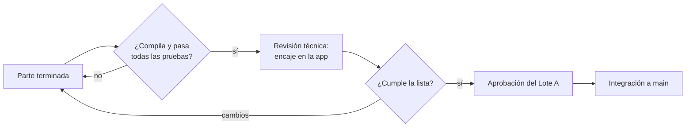

# Revisión y entregas

Cómo se entrega cada parte de un lote y cómo se revisa antes de integrarla a `main`.

## Ramas

- `main` siempre compila y pasa sus pruebas.
- Una rama por parte, creada desde `main`: `lote-<letra>/parte-<n>-<tema>`
  (por ejemplo, `lote-b/parte-1-otp`).
- Antes de pedir revisión: `git fetch origin && git rebase origin/main`.

## Entregar una parte

1. Marca las tareas de la parte en `openspec/changes/<change>/tasks.md` y cambia su estado a
   **Hecha** en la tabla "Estado del lote" de `docs/fase-0/<lote>/README.md`.
2. Compila y depura lo que tocaste:
   - backend: `npm run verify` y `npm run test:integration`;
   - app: `tool/verify.cmd` (Windows) o `tool/verify.sh`;
   - contrato: `npx @redocly/cli lint contracts/openapi.yaml`;
   - specs: `openspec validate --all --strict`.
3. Sube la rama y abre el pull request con la plantilla. Un PR = una parte.

## Cómo se revisa (Lote A)

Lista de revisión:

- [ ] **Alcance:** hace exactamente las tareas de la parte; lo demás va en otra parte.
- [ ] **Encaje:** respeta los puntos de contacto de `plan-de-lotes.md` y no rompe a otros lotes.
- [ ] **Fronteras:** `npm run boundaries` en verde; un módulo no lee tablas de otro.
- [ ] **Contrato:** cada ruta nueva está en `contracts/openapi.yaml` y en los esquemas Zod.
- [ ] **Offline:** toda escritura desde el celular lleva `Idempotency-Key` y muestra su estado.
- [ ] **Datos sensibles:** nunca en streams automáticos ni en el texto de un aviso.
- [ ] **Pruebas:** cada tarea tiene la verificación que pide `tasks.md`.
- [ ] **Convenciones:** código en inglés; textos, contrato JSON, tablas y docs en español.
- [ ] **Seguridad:** sin secretos ni `.env`; variables nuevas documentadas en `.env.example`.
- [ ] **Grafo:** si cambian dependencias, `npm run graph` actualizado en el mismo PR.
- [ ] **Estado:** la parte figura como **Hecha** en `docs/fase-0/<lote>/README.md` y sus tareas
      están marcadas en `tasks.md`.

Resultados posibles: **aprobado** (el Lote A lo integra con *squash*), **cambios pedidos** (se
corrige en la misma rama) o **dividir** (la parte era demasiado grande).

## Definición de terminado de un lote

Todas sus partes aprobadas e integradas, sus criterios de `criterios-de-salida.md` con evidencia
y su change de OpenSpec archivado (`openspec archive <change>`).
