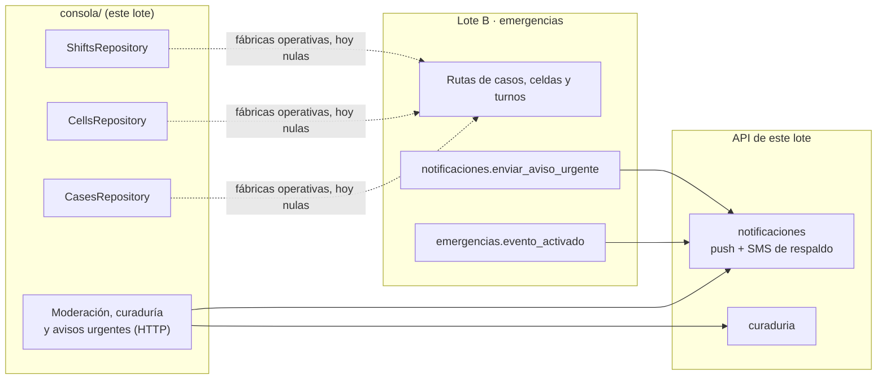

# Integración de la consola web y los avisos urgentes

Esta entrega trae el código de las 4 partes del lote en la rama
`f2-lote-c/consola-web-y-avisos-urgentes`. **Se escribió sin compilar, sin analizar y sin pruebas**,
por indicación del responsable: nada de lo que sigue está verificado todavía. La sección
[Cómo compilar y probar](#cómo-compilar-y-probar) dice qué correr y en qué orden.

El diseño está en el change de OpenSpec
[`fase-2-lote-c-consola-web-y-avisos-urgentes`](../../../openspec/changes/fase-2-lote-c-consola-web-y-avisos-urgentes/).

## Qué entrega la rama

| Parte | Qué hay | Dónde |
|---|---|---|
| 1 · Base de la consola | Proyecto Flutter web, tema accesible, sesión en memoria con OTP (API o Firebase), cierre por inactividad, CORS y `no-store` en la API, módulo de Cloudflare Pages | `consola/`, `backend/src/main.ts`, `infra/cloud/modules/console-site/` |
| 2 · Cola y asignación | Cola por prioridad con "Por escalar" y "Fuera de tiempo", detalle minimizado, acciones de la sección 7.2 con motivo, historial y errores explicados | `consola/lib/features/casos/` |
| 3 · Celdas, turnos y curaduría | Mapa de celdas con tabla equivalente, turnos con la regla de cobertura, moderación de la Fase 1 y módulo `curaduria` con versiones y publicación | `consola/lib/features/{celdas,turnos,moderacion,curaduria}/`, `backend/src/modules/curaduria/` |
| 4 · Avisos urgentes | Aviso por push con SMS de respaldo (solo el adaptador falso), topes de gasto, aviso público de zona, confirmación en la app y en la consola, medición | `backend/src/modules/notificaciones/`, `app/lib/features/avisos/`, `consola/lib/features/avisos_urgentes/` |

## Lo que falta del Lote B (Fase 2)

La consola habla con Emergencias solo a través de tres puertos. Sus fábricas operativas son nulas:
sin ellas, cada pantalla explica que el módulo todavía no está en la API.



| Puerto | Archivo | Fábrica que B inyecta |
|---|---|---|
| `CasesRepository` | `consola/lib/features/casos/domain/cases_repository.dart` | `operationalCasesFactoryProvider` |
| `CellsRepository` | `consola/lib/features/celdas/domain/cells.dart` | `operationalCellsFactoryProvider` |
| `ShiftsRepository` | `consola/lib/features/turnos/domain/shifts.dart` | `operationalShiftsFactoryProvider` |

Para conectarlos, B escribe los adaptadores HTTP sobre `ConsoleApi` (que ya agrega el token,
explica Problem Details y llama a cerrar la sesión ante un 401) y los inyecta en
`consola/lib/main.dart`:

```dart
ProviderScope(
  overrides: [
    consoleEnvironmentProvider.overrideWithValue(environment),
    operationalCasesFactoryProvider.overrideWithValue(HttpCasesRepository.new),
    operationalCellsFactoryProvider.overrideWithValue(HttpCellsRepository.new),
    operationalShiftsFactoryProvider.overrideWithValue(HttpShiftsRepository.new),
  ],
  // …
)
```

Lo que la consola espera del contrato de B (los nombres son una propuesta, ver la sección "Lo que
la consola necesita del Lote B" del `design.md`):

- **Casos:** cola de la zona con `id`, `version`, prioridad, necesidad, estado, celda pública,
  `creadoEn`, `sinRevisarDesde` y persona asignada; detalle con historial (estado anterior y nuevo,
  rol, hora y motivo) y la ubicación exacta **solo** para la persona asignada mientras el caso está
  *en camino*; acciones con `versionVista` e `Idempotency-Key` que respondan 409
  `conflicto_de_version` o `transicion_invalida`; personas disponibles con su turno.
- **Celdas:** agregados por celda y por necesidad con el umbral de 3 ya aplicado en el servidor
  (menos de 3 llega sin número). La consola nunca suma conteos.
- **Turnos:** lista de la zona, crear y terminar (con `versionVista`), coordinadores habilitados
  y la respuesta 409 `zona_sin_cobertura` cuando corresponda.
- **Rol `curador`:** cuando exista, sumarlo a `@RequireRole` en
  `backend/src/modules/curaduria/api/curation.controller.ts` y al enum `roles` de `Sesion` en el
  contrato. La consola ya lo reconoce.
- **Eventos y trabajos:**
  - `emergencias.evento_activado` con `carga.zonaId`: lo consume `notificaciones` para el aviso
    público de zona. El registro de trabajos admite **un solo consumidor por evento**; si B u otro
    módulo también lo necesita, hace falta un reparto (*fan-out*) en `JobHandlerRegistry`.
  - `notificaciones.enviar_aviso_urgente` con `{ avisoId, usuarioId, plantilla, datos: { casoId } }`
    al asignar un caso (`caso_asignado`), cuando un pedido está por escalar (`pedido_por_escalar`)
    y cuando escaló (`pedido_escalado`). Encolarlo con `priority: 'critical'` y un `avisoId` estable
    por motivo (por ejemplo, UUIDv5 del caso y la versión), así un reintento no avisa dos veces.

## Otras piezas pendientes

| Qué | Dónde | Nota |
|---|---|---|
| Proveedor real de SMS (decisión 13.3.4) | `backend/src/modules/notificaciones/infrastructure/` | Un adaptador más de `SmsProvider`; `SMS_PROVIDER` hoy admite `none` y `fake` (y `fake` está prohibido en producción) |
| Publicación del directorio en la nube | `backend/src/modules/curaduria/infrastructure/` | Un adaptador de `PublicContentPublisher` sobre el almacenamiento de la Fase 1 (Lote C). En staging y producción `CURATION_PUBLISH_DRIVER=disabled` responde 503 hasta entonces |
| Uso del módulo `console-site` | `infra/cloud/main.tf` | Cuando la Fase 1 (Lote C) esté en `main`; ver el README del módulo |
| Flujo de CI de la consola | `.github/workflows/consola.yml` | Esquema más abajo |

## Configuración

Variables nuevas de la API (documentadas en `backend/.env.example`):

| Variable | Por defecto | Para qué |
|---|---|---|
| `SMS_PROVIDER` | `fake` | `none` apaga el respaldo; `fake` lo escribe en el log (prohibido en producción) |
| `URGENT_ACK_TIMEOUT_SECONDS` | `120` | Plazo para confirmar antes del SMS (30 a 3600) |
| `SMS_COST_CENTS` | `5` | Costo estimado de un SMS, en centavos de dólar |
| `SMS_DAILY_BUDGET_CENTS` / `SMS_MONTHLY_BUDGET_CENTS` | `500` / `5000` | Topes de gasto por día (America/Lima) y por mes |
| `CONSOLE_ORIGINS` | (vacío) | Orígenes de la consola para CORS, separados por comas (`https://` en producción) |
| `CURATION_PUBLISH_DRIVER` | `disabled` | `filesystem` escribe en `CURATION_PUBLIC_ROOT` (solo fuera de producción) |
| `CURATION_PUBLIC_ROOT` | `../infra/cdn/publico` | Carpeta pública de la CDN local |

Las de la consola (`--dart-define`) están en [`consola/README.md`](../../../consola/README.md).

## Cómo compilar y probar

Nada de esto se corrió todavía. El orden importa: primero lo que no necesita servicios.

### 1. Contrato

```bash
npx @redocly/cli lint contracts/openapi.yaml
```

### 2. Backend

```bash
cd backend
npm ci
npm run verify              # tipos, lint, formato, límites de módulos, pruebas unitarias y build
docker compose -f ../infra/docker-compose.yml up -d --wait
npm run db:migrate          # crea notificaciones.avisos_urgentes, notificaciones.gasto_sms y curaduria.*
npm run test:integration
npm run graph               # regenera el grafo de módulos con curaduria
```

Puntos a mirar si algo falla:

- `emitDecoratorMetadata` + `isolatedModules`: los tipos inyectados en constructores van como
  `import type`.
- `npm run boundaries`: `curaduria` y `notificaciones` usan otros módulos solo por su `index.ts`
  (`IdentityContactsModule` para el teléfono).
- `npm run graph` regenera `docs/grafos/dependencias-backend.md` con `curaduria` y la flecha
  `notificaciones → identidad`; ese archivo no se edita a mano, así que hay que subir el resultado.

### 3. Consola

```bash
cd consola
flutter pub get && flutter gen-l10n
flutter analyze             # análisis estricto: falla con cualquier aviso
dart format lib             # y revisar que no queden diferencias
tool/vendor_maplibre.sh     # MapLibre GL JS en web/vendor/ (necesita npm)
flutter build web --release --no-web-resources-cdn --dart-define=CONSOLE_DATA=demo
```

Puntos a mirar si algo falla:

- Versiones: `maplibre_gl` 0.28 en web y la versión de MapLibre GL JS de
  `tool/vendor_maplibre.sh` (`MAPLIBRE_GL_VERSION`) deben coincidir con lo que pide el plugin.
- APIs de Riverpod 3 (`ProviderScope.retry`, `Notifier`, `FutureProvider.autoDispose.family`) y de
  Flutter 3.47 (`WidgetStateProperty`, `Color.withValues`, `Color.toARGB32`).
- Elementos con `?` en colecciones (Dart 3.8 o superior).

### 4. App

```bash
cd app
tool/verify.sh              # Windows: tool\verify.cmd
```

Cambios de la app: `routeFor` abre el tablero de emergencia con `aviso_urgente` y
`modo_emergencia_activado`, y `PushService` confirma el aviso urgente al abrirlo
(`app/lib/features/avisos/data/urgent_notice_confirmation.dart`).

### 5. Infraestructura

```bash
tofu -chdir=infra/cloud/modules/console-site init -backend=false
tofu -chdir=infra/cloud/modules/console-site validate
tofu -chdir=infra/cloud fmt -check -recursive
```

### Pruebas por escribir

| Dónde | Qué cubrir |
|---|---|
| `backend` (unitarias) | Plantillas nuevas en `templates.spec.ts`; `UrgentNotices`: el push falla y sale el SMS, tope alcanzado, confirmado a tiempo, trabajo repetido, sin teléfono; validación del directorio (`findDirectoryProblems`, esquema Zod) |
| `backend` (integración) | Curaduría: 422 `directorio_invalido`, 409 `conflicto_de_version`, 404 y 503 `servicio_no_disponible`, y que se escriban el archivo y `indice.json`; `npm test` de `infra/cdn` sobre lo publicado; reserva del tope de SMS con dos trabajos a la vez; encabezados CORS y `Cache-Control: no-store` |
| `consola` (unitarias) | `markFor`, `sortQueue`, `actionsFrom`, `showsExactLocation`, `CellCount`, `coverageOf`, `validateEntry`, `suggestId`, `normalizePhone`, `SessionTokens.fromJson` |
| `consola` (widgets) | Ingreso sin rol operativo; aviso y cierre por inactividad; cola al 200 % y con teclado; cada `codigo` de `explainProblem`; conflicto que conserva lo escrito; tabla de celdas con «menos de 3»; decisión de moderación con `Idempotency-Key`; banner de avisos urgentes |
| `app` | `routeFor` y `urgentNoticeIdFor` con datos válidos y maliciosos; `PushService` confirma al abrir y espera la sesión si aún no está |

### Flujo de CI por crear

`.github/workflows/consola.yml`, con el mismo estilo que `app.yml`:

1. En cada PR que toque `consola/**`: `flutter pub get`, `flutter gen-l10n`, `flutter analyze`,
   `flutter test`, formato, `tool/vendor_maplibre.sh` y
   `flutter build web --release --no-web-resources-cdn --dart-define=CONSOLE_DATA=demo`.
2. Con cada integración a `main`: build de staging con sus `--dart-define`,
   `tool/write_headers.sh <API de staging> <CDN de staging>` y
   `wrangler pages deploy build/web --project-name=vecinal-consola-staging`.
3. Con una etiqueta `consola-v*`: lo mismo para producción (`CONSOLE_ENV=produccion`, sin
   `CONSOLE_DATA`).

Secretos de GitHub: `CLOUDFLARE_API_TOKEN` y `CLOUDFLARE_ACCOUNT_ID`. Ningún secreto en el repo.

## Verificación manual

Con la API local, la consola en `http://localhost:8081` y `CONSOLE_ORIGINS` apuntando a ella:

1. **Ingreso:** un vecino sin rol operativo verifica su código y la consola cierra la sesión y lo
   explica. Una cuenta con `coordinador` entra a la cola.
2. **Nada en el navegador:** después de usar la consola, las herramientas del navegador muestran
   `localStorage`, `sessionStorage` e IndexedDB vacíos y las respuestas de `/v1/operacion`,
   `/v1/moderacion`, `/v1/auth` y `/v1/avisos-urgentes` con `Cache-Control: no-store`. Recargar
   obliga a ingresar.
3. **Inactividad:** con `INACTIVITY_MINUTES=2`, el aviso aparece al minuto y la sesión se cierra en
   la API al segundo.
4. **Teclado y lector de pantalla:** recorrer la cola y una acción solo con el teclado, con el foco
   siempre visible; repetir con NVDA o VoiceOver y con el texto del navegador al 200 %.
5. **Moderación:** un moderador oculta una reseña con motivo; la petición lleva `Idempotency-Key` y
   el caso sale de los pendientes.
6. **Curaduría:** con `CURATION_PUBLISH_DRIVER=filesystem`, publicar una versión y comprobar
   `infra/cdn/publico/emergencia/<archivo>` e `indice.json`; publicar desde dos pestañas para ver el
   409 y sus dos salidas.
7. **Avisos urgentes:** encolar `notificaciones.enviar_aviso_urgente` para un coordinador sin
   dispositivos y ver en el log el SMS falso (solo los dos últimos dígitos); con un dispositivo,
   confirmar desde el banner de la consola o al abrir el aviso en la app y comprobar que no sale el
   SMS. El resumen de avisos urgentes refleja el gasto frente a los topes.
8. **Modo demostración:** `CONSOLE_DATA=demo` muestra la franja fija en todas las pantallas y no
   hace ninguna petición a la API.

Cuando todo esté en verde, guardar la evidencia en [`../evidencias/`](../evidencias/) y marcar las
tareas de verificación del `tasks.md`.
