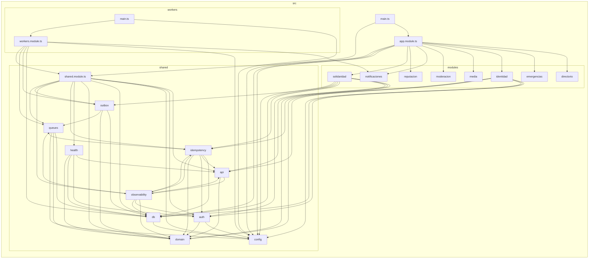

# Grafo de dependencias del backend

Generado con `cd backend && npm run graph` (dependency-cruiser). No lo edites a mano.
Cada flecha es un `import`. Las raíces de composición son `app.module.ts` y `workers/`
y todos dependen de `shared`, nunca al revés (reglas en `backend/.dependency-cruiser.cjs`).

