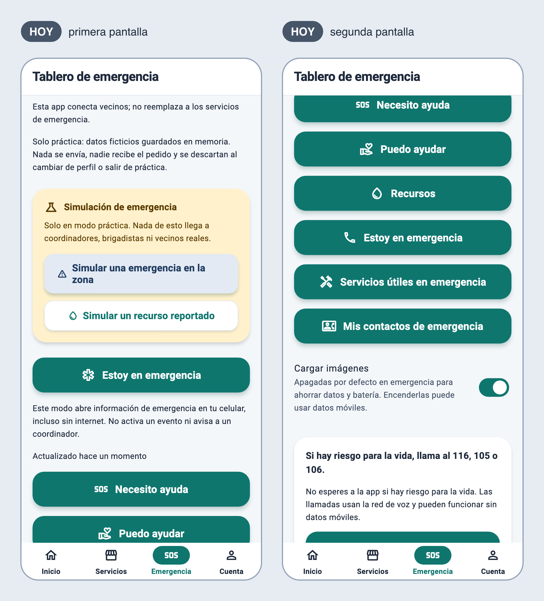
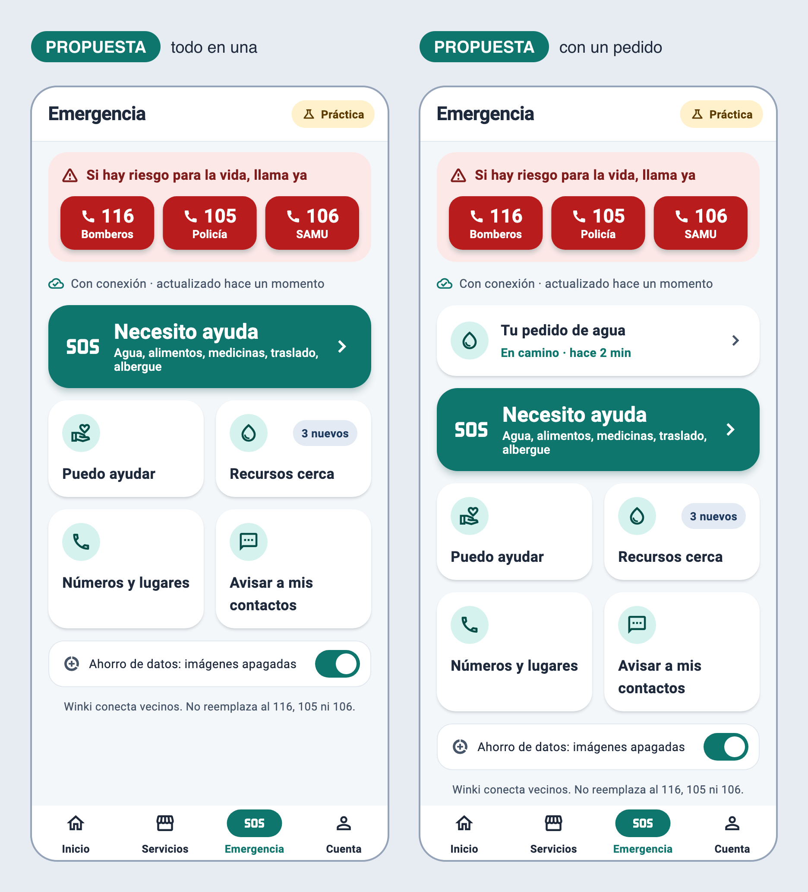
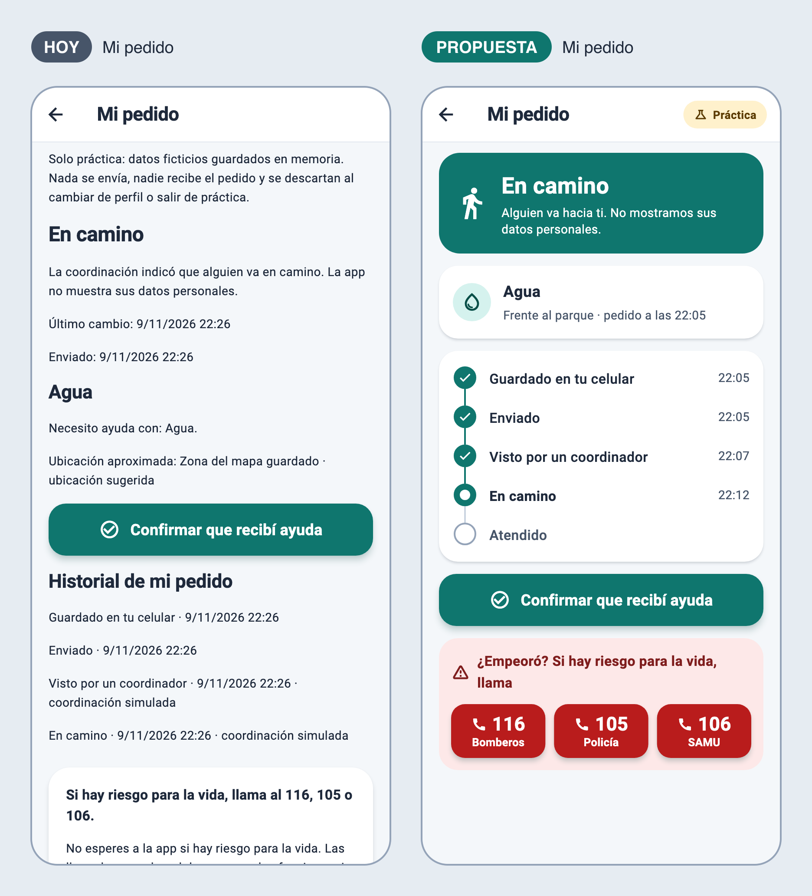
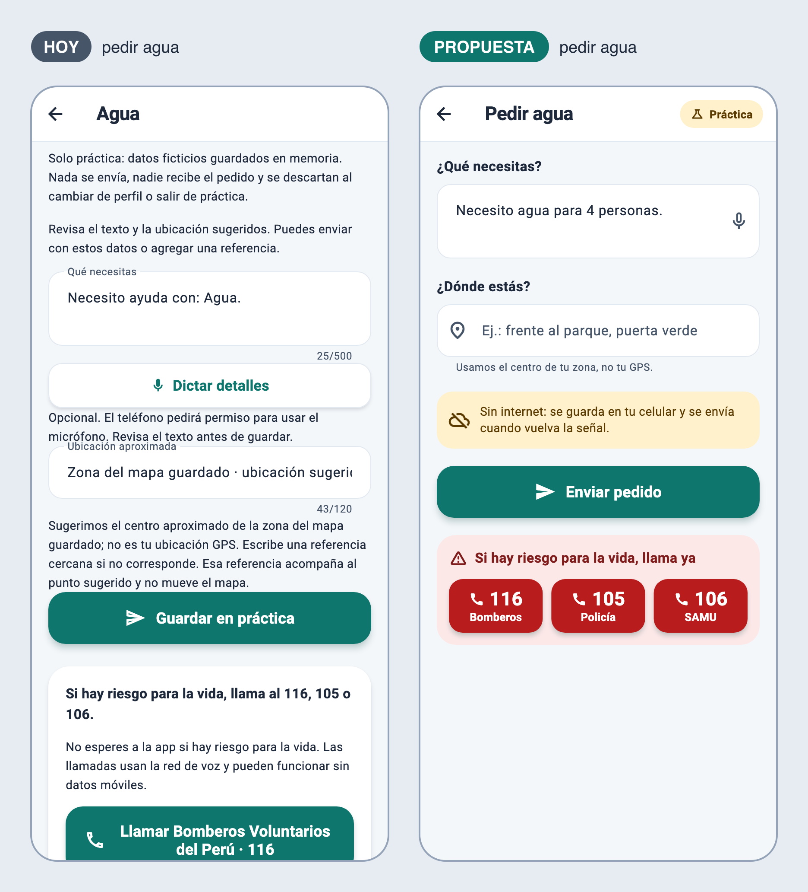
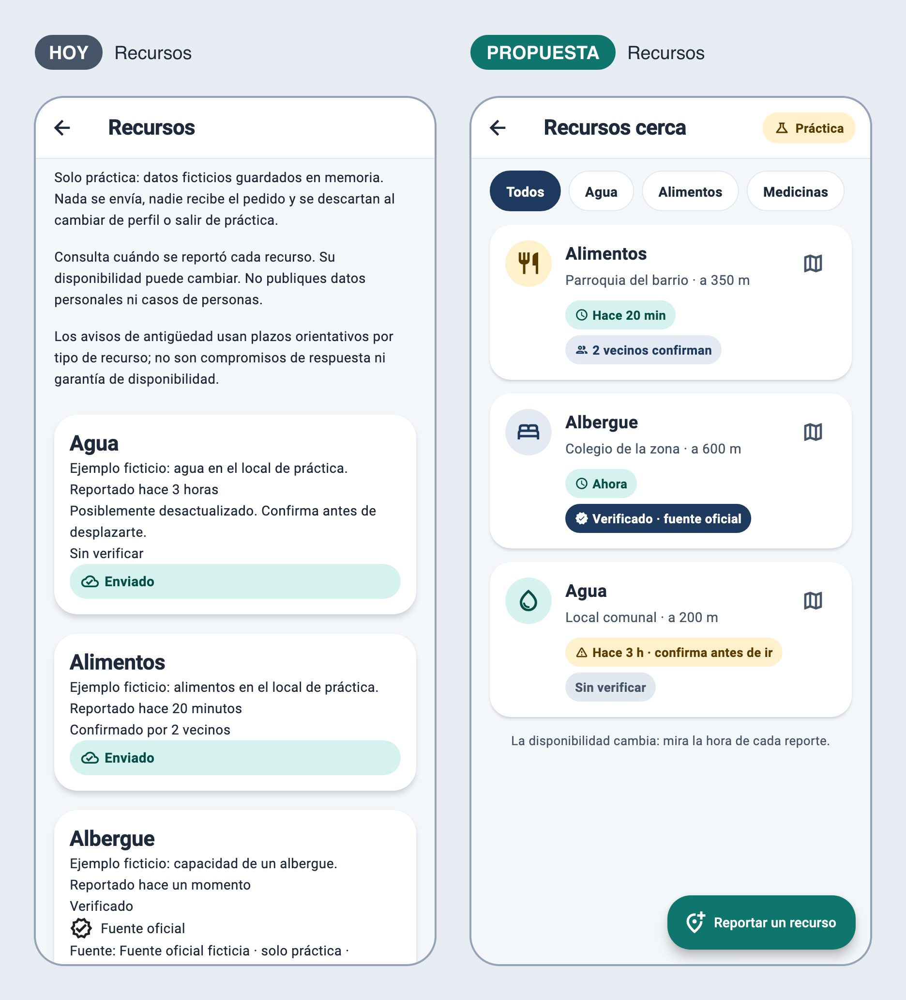
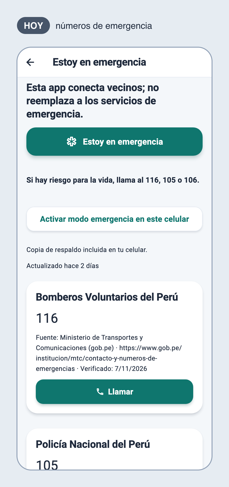

# Winki: opinión honesta y propuestas de mejora

Revisión del 9 de noviembre de 2026 sobre el código de `main` (`93c909c`). Este documento no cambia nada de la app: reúne el diagnóstico y las propuestas para que el equipo decida qué hacer y cuándo. Las rutas de archivo que aparecen corresponden a `main`.

## 1. En corto

**Veredicto.** Por dentro, Winki está muy por encima de lo habitual en una hackathon. En el día a día (Inicio, Servicios, Cuenta) se ve bien y es coherente. El modo emergencia es lo más completo que tiene la app y, a la vez, lo que peor se ve. La sensación de "mucho texto" es correcta y se puede medir:

| Tablero de emergencia | Hoy | Maqueta propuesta |
|---|---|---|
| Alto | 2,2 pantallas (2,7 en un Android pequeño) | 1 pantalla |
| Palabras de texto corrido | 152 | unas 30 |
| Acciones | 14 botones, diez de ellos verdes e iguales | 8, con jerarquía: 3 de llamada, 1 principal y 4 secundarias |
| Botones para llamar al 116, 105 y 106 | abajo: hay que deslizar más de una pantalla para verlos | arriba, siempre visibles |

**La causa no es estética, es de jerarquía.** Cada precaución correcta del diseño (no reemplazar al 116, no prometer que alguien recibió el pedido, avisar que es práctica) terminó escrita como un párrafo en la pantalla. Esa honestidad es de lo mejor que tiene Winki y no hay que quitarla. Hay que pasarla de párrafos a diseño: estados, color, íconos y una línea, con el detalle a un toque.

**El riesgo para ganar.** El jurado decide con lo que ve en pocos minutos. Hoy, lo primero que ve en Emergencia son dos avisos, un panel amarillo de simulación y un botón que se llama igual que otros seis. Además, la demo repite en cada pantalla "Nada se envía, nadie recibe el pedido", cuando el flujo real (pedido, consola, en camino, confirmación) existe y tiene pruebas. Lo más fuerte del proyecto es lo que menos se ve.

**Las cinco cosas que más mueven la aguja**

1. Rehacer el tablero de emergencia para que quepa en una pantalla (sección 5.2).
2. Un nombre para cada cosa: hoy "Estoy en emergencia" aparece en siete lugares y hace tres cosas distintas (sección 4.2).
3. Convertir "Mi pedido" en una línea de tiempo: es el momento estrella de la demostración (sección 5.3).
4. Mostrar el flujo real con la consola en la presentación, con un video de respaldo (sección 9).
5. Cerrar tres vacíos frente al reto: ubicación del vecino, tutorial en el primer arranque y datos de demostración que cuenten una historia (secciones 6 y 7).

## 2. Qué va a mirar el jurado

Según las [bases publicadas por la UTP](https://www.utp.edu.pe/sites/default/files/Hackathon%20UTP%20-%20El%20Comercio%202026.pdf): la presentación de propuestas y la elección de finalistas es el 10 y 11 de noviembre (15 minutos por equipo); la defensa de finalistas es el 17 de noviembre (hasta 20 minutos: unos 5 para lo técnico y el valor agregado, y 15 para mostrar el funcionamiento según el reto). El jurado decide por cumplimiento de los requisitos funcionales y técnicos, más innovación y originalidad. No encontré pesos numéricos por criterio. Conviene confirmar fechas y formato con las comunicaciones oficiales que recibió el equipo.

Cómo llega Winki a cada requisito del reto (los diez de `docs/arquitectura/arquitectura-app-vecinal-parte-2.md`, sección 6):

| # | Requisito | Estado | Comentario |
|---|---|---|---|
| 1 | Información recomendada de productos y servicios cercanos | Sí | "Cercano" se mide desde el centro de la zona, no desde el vecino (ver 7.1). |
| 2 | Promocionar servicios y compartir recomendaciones | Sí | |
| 3 | Pedir y ofrecer ayuda, intercambios solidarios | Sí | En emergencia, "Puedo ayudar" todavía no llega a nadie (ver 7.2). |
| 4 | Servicios de emergencia y grupos de apoyo | A medias | El directorio de la demo trae solo tres números; no hay lugares ni grupos de apoyo (ver 7.3). |
| 5 | Coordinación de necesidades y recursos en emergencias | Sí por dentro, a medias en la demo | El flujo real existe; la demo lo muestra como simulación y con mucho texto. |
| 6 | Geolocalización de servicios, recursos y necesidades | A medias | Hay mapa sin conexión y celdas, pero la app no usa la ubicación del teléfono (ver 7.1). |
| 7 | Tutorial | A medias | Existe, pero no se abre solo la primera vez y no guía sobre la pantalla real (ver 6.3). |
| 8 | Máximo 3 clics para publicar | Sí | Hay pruebas automáticas de tres toques para publicar, ofrecer un servicio y pedir ayuda, incluso sin señal. Vale la pena decirlo en la presentación. |
| 9 | Funciona con y sin internet | Sí, es el punto más fuerte | Falta probarlo en modo avión en teléfonos reales. |
| 10 | Intuitiva y accesible | Sí en el día a día, a medias en emergencia | La accesibilidad está probada de forma automática; falta TalkBack y VoiceOver reales. |

## 3. Lo que está fuerte (para lucirlo, no para tocarlo)

- **Sin internet de verdad.** Cola de envíos con claves de idempotencia, base cifrada en el teléfono, mapa descargado y estados visibles: "Guardado en tu celular", "Enviado", "No se pudo completar". Pocos equipos pueden poner el teléfono en modo avión delante del jurado.
- **Honestidad de estados.** La app nunca dice "en camino" si una persona no lo confirmó, y no acepta pedidos donde no hay coordinación confirmada. Es un argumento de seguridad que se explica en una frase.
- **Información con fuente y fecha.** Cada recurso dice cuándo se reportó, si está verificado y por quién, y avisa cuando puede estar desactualizado. Para un jurado que viene de un diario, "contra el rumor en plena emergencia" es un mensaje muy potente.
- **Privacidad.** Pedidos agregados por celdas, ubicación exacta solo cuando el caso está "en camino", contactos cifrados en el teléfono.
- **Pruebas.** Según `docs/fase-2/integracion.md`: 246 pruebas unitarias y 199 de integración en el backend, 251 en la app, más las de la consola, con la integración continua en verde. Son casi 700 pruebas automáticas.
- **Accesibilidad comprobada.** Texto al 200 % sin desbordes, contraste en tema claro y oscuro, tamaño de los botones, modo sencillo y orden de lectura para lector de pantalla, todo con pruebas.
- **Consola web de operación** para coordinadores, y un APK de demostración que funciona sin servidor.

## 4. Emergencia: diagnóstico

### 4.1 Lo que se midió

Capturas del modo práctica con la tipografía real, en un teléfono de 414 × 896.

| Pantalla | Alto (en pantallas) | Palabras de texto corrido | Botones |
|---|---|---|---|
| Tablero | 2,2 | 152 | 14 |
| Necesito ayuda (elegir necesidad) | 1,3 | 69 | 10 |
| Formulario del pedido | 1,4 | 146 | 6 |
| Mi pedido (en camino) | 1,6 | 153 | 6 |
| Recursos | 2,3 | 209 | 5 |
| Números de emergencia (directorio) | 1,6 | 105 | 5 |
| Puedo ayudar | 1,2 | 99 | 5 |
| Recursos y pedidos de mi zona | 1,3 | 124 | 1 |

"Texto corrido" es todo lo que se lee fuera de los botones y de los campos. En un Android de 360 × 800 el tablero ocupa 2,7 pantallas y "Necesito ayuda" queda fuera de la primera: hay que deslizar para encontrar la acción principal.

### 4.2 Los problemas, en orden de importancia

**1. "Estoy en emergencia" aparece en siete lugares y hace tres cosas distintas.** Las cadenas `activateLocalEmergency` y `emergencyTitle` tienen el mismo texto.

| Dónde | Qué hace |
|---|---|
| Botón rojo del inicio (`wall_page.dart:177`) | Cambia la app a modo emergencia. No navega: el inicio se convierte en el tablero. |
| Botón verde del tablero (`emergency_dashboard_page.dart:51`) | Lo mismo. |
| Botón con teléfono del tablero (`emergency_dashboard_page.dart:78`) | Abre el directorio de números. |
| Enlace dentro de la tarjeta "Si hay riesgo para la vida" (`emergency_widgets.dart:160`), presente en casi todas las pantallas | Abre el directorio. |
| Botón cuando no hay sesión (`emergency_widgets.dart:98`) | Abre el directorio. |
| Título de la pantalla del directorio (`emergency_page.dart:31`) | Es un título. |
| Botón verde dentro del directorio (`emergency_page.dart:39`) | Activa el modo y vuelve al tablero: un círculo. Debajo hay otro botón, "Activar modo emergencia en este celular", que hace lo mismo. |

Además, el nombre promete más de lo que hace: suena a "avisar a alguien", y el propio texto de ayuda aclara que "no activa un evento ni avisa a un coordinador".

**2. Lo vital está abajo.** En el tablero, los botones para llamar al 116, 105 y 106 empiezan a 1 473 px del inicio: el primero asoma al final de la segunda pantalla y los otros dos quedan en la tercera. Arriba, donde se mira primero, hay dos avisos y el panel de simulación. En la pantalla de números pasa algo parecido: el primer "Llamar" está a 704 px, debajo de un titular y de dos botones para activar el modo, y en la primera pantalla cabe un solo número porque cada tarjeta muestra la dirección web completa de su fuente.

**3. Diez botones verdes idénticos.** Mismo color, mismo tamaño y mismo peso para "Necesito ayuda", "Mis contactos de emergencia" o "Servicios útiles en emergencia". Si todo es principal, nada lo es.

**4. Los avisos son párrafos.** El de práctica (25 palabras) está arriba en casi todas las pantallas de emergencia de la demo. El tablero suma once bloques de texto. Varios usan palabras internas: "celda", "coordinación", "datos ficticios guardados en memoria", "evento".

**5. El formulario del pedido tiene un defecto visible.** La columna del formulario no tiene separación entre elementos: el texto de ayuda del dictado se encima con la etiqueta "Ubicación aproximada", el valor de la ubicación sale cortado y la ayuda de 33 palabras queda pegada al botón de enviar. Se ve en la captura de la sección 5.4.

**6. "Mi pedido" no aprovecha su mejor momento.** El estado es un título de texto, el historial son líneas con la fecha completa repetida y el rótulo "coordinación simulada" aparece en cada paso. Es la pantalla que demuestra que la coordinación funciona y hoy parece un registro.

**7. Los recursos son líneas de texto.** Las tarjetas no distinguen tipo, antigüedad ni verificación más que con frases. El chip "Enviado" se estira a todo el ancho y parece un botón. No hay lugar ni mapa, y en la otra pantalla el lugar es "Celda aproximada · A3", que no significa nada para un vecino. El formulario para reportar está debajo de la lista, a más de una pantalla.

**8. Dos pantallas para lo mismo.** "Recursos" y "Recursos y pedidos de mi zona" se pisan.

**9. Con el modo emergencia activo, las pestañas Inicio y Emergencia muestran el mismo tablero.**

**10. Las pantallas de emergencia no usan los componentes que ya existen.** `NoticeCard`, los chips de estado y el aviso de conexión resolverían buena parte del aspecto sin diseñar nada nuevo.

### 4.3 Lo que no se ve en la demo

- **"Recursos y pedidos de mi zona" no se puede abrir en modo práctica.** El botón se oculta cuando la app está en práctica (`emergency_page.dart:27-29` y `:61`), aunque existen datos de práctica para esa pantalla y el `LEEME.md` de la entrega la lista como algo que se puede probar.
- **"Puedo ayudar" se queda en el teléfono.** No hay ruta en el servidor para las ofertas; la pantalla lo dice con la frase "no confirma recepción humana ni una asignación".
- **El directorio de emergencia trae solo tres números.** No hay puntos de encuentro, centros de salud ni albergues, y la app lo avisa con otro párrafo.

## 5. Emergencia: propuesta

Las maquetas de esta sección están dibujadas con el tema real de la app (colores, tipografía y botones), pero son ilustraciones, no código de la app. Todavía no pasaron por las pruebas de texto al 200 % ni de tema oscuro.

### 5.1 Seis reglas

1. **Una pantalla, una decisión.** El tablero cabe sin deslizar.
2. **Lo vital arriba y en rojo.** Llamar es siempre el primer gesto disponible.
3. **Un solo botón principal por pantalla.** Lo demás baja de peso visual.
4. **Un aviso es una línea con ícono y color.** El detalle se abre al tocarlo.
5. **Un nombre, una cosa.**
6. **Estados antes que explicaciones.** "En camino" con una marca vale más que un párrafo.

### 5.2 Tablero

A dónde va cada cosa del tablero actual, para que no se pierda nada:

| Hoy | En la propuesta |
|---|---|
| Tarjeta "Si hay riesgo para la vida" al fondo | Franja roja arriba con tres botones: 116, 105 y 106 |
| "Necesito ayuda", uno de nueve botones | Único botón principal, más grande y con las necesidades como subtítulo |
| "Puedo ayudar", "Recursos", directorio, contactos | Cuadrícula de cuatro accesos secundarios |
| "Estoy en emergencia" (activar) y su párrafo | Se quita del tablero: la pestaña ya funciona sin activar nada |
| "Servicios útiles en emergencia" | Dentro de "Recursos cerca", como filtro |
| "Mi pedido · estado" (un botón por pedido) | Tarjeta con el estado en color, encima del botón principal |
| Interruptor "Cargar imágenes" con dos líneas | Una fila: "Ahorro de datos: imágenes apagadas" |
| "Esta app conecta vecinos…" arriba | Una línea al pie |
| Párrafo de práctica | Chip "Práctica" en la barra superior (ver 5.9) |
| Panel de simulación arriba | Menú de la barra superior o tarjeta plegada al final (ver 5.9) |
| Botón "Mi cuenta" | Se quita: ya está en la barra inferior |
| Aviso de sin conexión o sin cobertura (párrafo) | Tarjeta de aviso de una línea, en ámbar, en el lugar de la línea de estado |

Detalles que importan al construirlo: con texto grande la cuadrícula pasa a una columna y los tres botones de llamada a tres filas; los colores salen de los roles del tema para que el modo oscuro funcione; el rojo solo se usa para llamar.

En un Android de 360 × 800 la maqueta casi cabe: quedan 57 px por deslizar, en la zona del pie.

### 5.3 Mi pedido

- El estado es una franja de color con ícono y una frase corta.
- El historial es una línea de tiempo: pasos cumplidos, paso actual y lo que falta. Solo la hora; la fecha completa sobra.
- Un único botón principal: "Confirmar que recibí ayuda".
- Las llamadas van al final, porque en esta pantalla el estado debe leerse primero (así lo exige la prueba de orden de lectura).
- Idea barata con mucho efecto, "Mientras esperas": si el pedido es de agua y hay un recurso de agua reportado en la zona, mostrarlo aquí. Los datos ya están en el teléfono.

### 5.4 Formulario del pedido

- Dos preguntas con sus palabras: "¿Qué necesitas?" y "¿Dónde estás?".
- El dictado es un ícono de micrófono dentro del campo; el sistema ya pide el permiso, no hace falta explicarlo antes.
- La ayuda de la ubicación baja de 33 palabras a una línea.
- El aviso de sin conexión aparece solo cuando aplica y dice qué va a pasar.
- En práctica el botón dice "Guardar (práctica)": la honestidad queda en el punto donde importa.
- La pantalla anterior ("Necesito ayuda") puede ser una cuadrícula de seis necesidades con ícono grande en lugar de seis botones iguales.

### 5.5 Recursos

- Ícono y color por tipo de recurso.
- La antigüedad y la verificación son chips: verde si es reciente, ámbar con "confirma antes de ir" si es antiguo, azul si lo verificó una fuente oficial.
- Filtros por tipo arriba; "Reportar un recurso" como botón flotante que abre su propio formulario.
- Las dos pantallas actuales se unen en una sola, "Recursos cerca", con los pedidos por zona como segunda pestaña.
- **Sobre los lugares de la maqueta.** Hoy el reporte de un vecino no lleva texto libre, y eso está bien. La propuesta es traducir la celda a una referencia conocida: el punto del directorio curado más cercano ("cerca de…"), calculado en el teléfono. La distancia ("a 350 m") solo aparece si el vecino dio permiso de ubicación (ver 7.1).

### 5.6 Números y lugares

- La pantalla abre con los tres números, uno por fila: número grande, nombre y botón "Llamar" a la derecha. Los tres caben arriba, sin deslizar.
- La fuente queda en una línea corta ("Fuente: MTC · verificado el 7/11/2026"); la dirección web se abre al tocarla.
- Salen de aquí el titular, el botón "Estoy en emergencia" y el de activar el modo.
- Debajo, los lugares (puntos de encuentro, centros de salud, albergues) con "Ver en el mapa", cuando existan (ver 7.3).

### 5.7 Textos: antes y después

Los textos nuevos son un borrador. Antes de adoptarlos conviene revisar que cada uno conserve su sentido de seguridad.

| Dónde | Hoy | Propuesta |
|---|---|---|
| Aviso de práctica (25 palabras) | "Solo práctica: datos ficticios guardados en memoria. Nada se envía, nadie recibe el pedido y se descartan al cambiar de perfil o salir de práctica." | Chip "Práctica". Al tocarlo: "Estás practicando. Nada se envía a nadie." |
| Modo emergencia (21) | "Este modo abre información de emergencia en tu celular, incluso sin internet. No activa un evento ni avisa a un coordinador." | "Funciona sin internet. No avisa a nadie por ti." |
| Sin cobertura (25) | "Todavía no hay coordinación vecinal disponible y confirmada en esta zona. Los pedidos y las ofertas están deshabilitados. Usa el directorio y los números oficiales." | "Tu zona aún no tiene coordinación vecinal. Aquí no puedes pedir ni ofrecer ayuda: llama a los números de arriba." |
| Sin conexión (20) | "Sin conexión confirmada: estás viendo información guardada que puede haber cambiado. El estado de un pedido también puede haber cambiado." | "Sin internet. Ves lo último guardado; puede haber cambiado." |
| Ubicación del pedido (33) | "Sugerimos el centro aproximado de la zona del mapa guardado; no es tu ubicación GPS. Escribe una referencia cercana si no corresponde. Esa referencia acompaña al punto sugerido y no mueve el mapa." | "Usamos el centro de tu zona, no tu GPS. Escribe una referencia para que te encuentren." |
| Pedido sin enviar (20) | "Tu pedido todavía no fue enviado. Nadie lo ha recibido. No esperes a la app: usa las alternativas de abajo." | "Aún no se envía: nadie lo ha visto. Si es urgente, llama." |
| En camino (15) | "La coordinación indicó que alguien va en camino. La app no muestra sus datos personales." | "Alguien va hacia ti. No mostramos sus datos personales." |
| Recursos (dos párrafos, 38) | "Consulta cuándo se reportó cada recurso…" y "Los avisos de antigüedad usan plazos orientativos…" | Una línea al pie: "La disponibilidad cambia: mira la hora de cada reporte." |
| Imágenes (15) | "Apagadas por defecto en emergencia para ahorrar datos y batería. Encenderlas puede usar datos móviles." | "Ahorro de datos: imágenes apagadas" |
| Dictado (15) | "Opcional. El teléfono pedirá permiso para usar el micrófono. Revisa el texto antes de guardar." | Se quita: queda el ícono de micrófono. |

### 5.8 Nombres

| Hoy | Propuesta |
|---|---|
| "Estoy en emergencia" en el inicio (botón rojo) | Se queda, y es el único lugar con ese nombre. |
| "Estoy en emergencia" en el tablero (activar) | Se quita. |
| "Estoy en emergencia" con teléfono, enlace de la tarjeta y botón sin sesión | "Números y lugares" |
| "Estoy en emergencia" como título del directorio | "Números y lugares de emergencia" |
| Botones para activar el modo dentro del directorio | Se quitan. Salir del modo queda como "Volver al inicio normal". |
| "Tablero de emergencia" | "Emergencia" |
| "Recursos" y "Recursos y pedidos de mi zona" | "Recursos cerca" |
| "Celda aproximada · A3" | "Cerca de" más un lugar conocido |

Cambiar solo la cadena `emergencyTitle` arregla cuatro de los siete usos de una vez.

### 5.9 Práctica y simulación

- El chip "Práctica" va en la barra superior de todas las pantallas de emergencia. El aviso completo se muestra una vez, al entrar a práctica, y siempre que se toque el chip.
- Las herramientas de simulación salen del tope del tablero. Opciones: un menú en la barra superior ("Simular emergencia en la zona", "Simular un recurso", "Siguiente paso del pedido") o una tarjeta plegada al final.
- En modo práctica los botones de llamada no marcan; eso ya funciona así y conviene conservarlo.
- Vale la pena presentar la práctica como una función y no como una disculpa: "Winki trae un simulacro: el vecino ensaya cómo pedir ayuda antes de necesitarla".

### 5.10 Lo que no cambiaría

- Los estados reales del pedido y la regla de no decir "en camino" sin confirmación humana.
- La regla de cobertura: sin coordinación confirmada no se aceptan pedidos.
- La privacidad por celdas y la ubicación exacta solo "en camino".
- Los tres estados de envío: "Guardado en tu celular", "Enviado", "No se pudo completar".
- Las pruebas de accesibilidad: el rediseño tiene que pasarlas.

## 6. El resto de la app

### 6.1 Inicio

- El chip "Enviado" en todas las tarjetas es ruido. Sirve mostrar solo lo que no es normal ("Guardado en tu celular", "No se pudo completar") o solo en las publicaciones propias.
- El botón de las tarjetas dice "Tomar favor" sea cual sea el tipo de publicación. En "Necesito dos bidones de agua" debería decir algo como "Puedo ayudar".
- Un error de carga muestra el texto técnico tal cual (`wall_page.dart:233`).

### 6.2 Publicar

- Las opciones muestran el valor interno en mayúsculas, por ejemplo "OFREZCO" (`choose_type_page.dart:63`, `publish_form_page.dart:129`), y "Ofrezco un servicio" y "OFREZCO" comparten ícono.
- Si falla, el vecino ve "Error al guardar:" seguido del error técnico (`publish_form_page.dart:98`); los mensajes de validación están escritos en el código y no en el archivo de textos.
- Al publicar vuelve al inicio sin mensaje. Un aviso breve ("Publicado" o "Guardado en tu celular; se enviará cuando vuelva la señal") cierra mejor los tres toques.
- El título abre el teclado de inmediato; hay que comprobar en un teléfono que no tape el botón "Publicar".

### 6.3 Tutorial

- Solo se llega desde el menú del inicio y desde Cuenta. La app guarda que el tutorial ya se vio, pero nunca lo consulta para abrirlo en el primer arranque (`tutorial_provider.dart`).
- La primera pantalla parece de ajustes: un interruptor de modo práctica y una lista de perfiles antes de empezar.
- Cada paso es una ficha con texto y un botón que abre la pantalla real, pero una vez ahí nada señala qué tocar. El paquete `showcaseview` ya está en `pubspec.yaml` y no se usa: sirve para marcar "toca aquí para publicar" sobre la pantalla real.
- Propuesta: tres pasos en el primer arranque (publicar, buscar un servicio, emergencia), con opción de saltar, y el tutorial actual como "ver más".

### 6.4 Datos de demostración

- El inicio de la demo tiene dos publicaciones; los perfiles se llaman "Perfil de práctica 1" a "5"; los recursos dicen "Ejemplo ficticio: agua en el local de práctica".
- Propuesta: un barrio de ejemplo con una historia. Ocho o diez publicaciones variadas, cinco vecinos con nombre de pila y un rasgo (la señora que usa el modo sencillo, el bodeguero que ofrece un servicio), recursos con lugares reconocibles. Una sola marca "Datos de ejemplo" en lugar de la palabra "ficticio" en cada texto.

### 6.5 Detalles

- Los APK de la entrega se llaman `vecinal-*.apk`; la marca es Winki.

## 7. Vacíos frente al reto

### 7.1 La ubicación del vecino (requisito 6)

La app no pide permiso de ubicación ni usa el GPS (`map_view.dart:71`). Las distancias se calculan desde el centro de la zona y el pedido de ayuda sale con ese mismo punto. Es defendible por privacidad, pero un jurado que lee "geolocalización" va a buscar el punto azul.

Propuesta en tres pasos, sin romper la privacidad:

1. Pedir el permiso solo al usarlo ("Usar mi ubicación" o al abrir el mapa), nunca al arrancar.
2. Usarla dentro del teléfono: ordenar servicios y recursos por distancia real y mostrar el punto en el mapa.
3. En el pedido, enviar la celda y no el punto exacto, igual que hoy.

Si no da tiempo, decirlo en la presentación como una decisión: "geolocalización sin rastrear a nadie", con este plan como siguiente paso.

### 7.2 "Puedo ayudar" no llega a nadie

Es una decisión pendiente del equipo (`docs/fase-2/integracion.md`). Para la final conviene lo mínimo: una ruta que reciba la oferta y una lista en la consola de voluntarios disponibles por zona. Si las ofertas pasan a ser opciones fijas ("Tengo agua", "Puedo trasladar", "Tengo espacio", "Sé primeros auxilios"), se evita el texto libre y el párrafo que pide no escribir datos personales.

### 7.3 Lugares y grupos de apoyo (requisito 4)

Cargar para la zona de la demostración puntos de encuentro, centros de salud, albergues y grupos de apoyo, con fuente y fecha como ya exige el diseño. Con eso "Números y lugares" y el mapa cobran vida.

### 7.4 "Recursos y pedidos de mi zona" en la demo

Mostrarla en práctica, o corregir el `LEEME.md` de la entrega. Con la propuesta de 5.5 pasa a ser una pestaña de "Recursos cerca".

## 8. Plan por prioridad

Tamaños orientativos para una persona: S, unas horas; M, uno o dos días; L, tres días o más.

**Antes de la presentación del 10 y 11 de noviembre.** No conviene rediseñar la víspera. Lo que sí rinde:

- Ensayar el guion con cronómetro (sección 9) y grabar un video de respaldo del flujo completo.
- Entrar a Emergencia directo por "Necesito ayuda" y no detenerse en el tablero actual.
- Solo si las bases permiten actualizar el APK y hay tiempo de probarlo en un teléfono: el lote 1.

**Lote 1: textos y orden (S, riesgo bajo).**

1. Renombrar según 5.8; empieza por la cadena `emergencyTitle`.
2. Subir la tarjeta de llamadas al inicio del tablero y bajar el panel de simulación al final.
3. Acortar los textos de 5.7.
4. Dar separación al formulario del pedido.
5. No estirar el chip "Enviado" en las tarjetas de recursos.
6. Reemplazar los errores técnicos por mensajes del archivo de textos.

**Lote 2: rediseño de emergencia (L).** Tablero, "Mi pedido" con línea de tiempo, formulario, tarjetas de recursos y unión de las dos pantallas, chip de práctica y menú de simulación.

**Lote 3: completar el reto (M cada punto).** Tutorial en el primer arranque, datos de demostración con historia, ubicación del vecino, lugares en el directorio, "Puedo ayudar" con servidor.

**Lote 4: si el proyecto sigue.** Los pendientes que ya lista `docs/fase-2/integracion.md` y los diez criterios de salida sin marcar de `docs/fase-2/criterios-de-salida.md`: modo avión en pantallas, teléfonos reales con TalkBack y VoiceOver, revisión manual de seguridad, simulacro con aliados y las decisiones del equipo.

## 9. La presentación

**Una frase para abrir.** "La red de vecinos que usas un martes cualquiera es la que te ayuda el día del sismo." Las apps de emergencia fallan porque nadie las tiene instaladas; Winki ya está en el teléfono y ya tiene a los vecinos.

**Guion para 15 minutos**

| Minutos | Qué se muestra |
|---|---|
| 1 | El problema y la frase. |
| 3 | Un día normal: publicar en tres toques contándolos en voz alta, un servicio recomendado, el mapa. |
| 1 | Poner el teléfono en modo avión delante del jurado. |
| 4 | Emergencia: llamar está a un toque. "Necesito ayuda", "Agua", enviar. Queda "Guardado en tu celular". Vuelve la señal: "Enviado". En la consola aparece el caso; el coordinador marca "En camino"; el teléfono cambia; "Confirmar que recibí ayuda". |
| 2 | Recursos: reportar agua; antigüedad, verificación y fuente. El mensaje: contra el rumor. |
| 2 | Accesibilidad: modo sencillo, texto grande, tema oscuro. |
| 2 | Lo técnico en tres cifras: funciona sin internet, datos cifrados, casi 700 pruebas automáticas. |

Para los 20 minutos de la final, el mismo guion con más tiempo en la consola y una sección de privacidad.

**Cuidados**

- El flujo real (teléfono más consola) necesita el servidor levantado y ensayo. La integración aún lista como pendientes las pruebas en teléfonos reales y en modo avión, así que hay que ensayarlo antes de confiar en él. El respaldo es el video y el APK de demostración con la simulación.
- Dos teléfonos o un teléfono y una portátil: se entiende mejor quién pide y quién coordina.
- No mostrar pantallas con "Perfil de práctica 1" ni "Ejemplo ficticio" si se pueden sembrar datos antes.

## 10. Al implementar: qué cuidar

- `app/test/features/emergencias/emergency_accessibility_test.dart` revisa las seis pantallas de emergencia: texto al 200 % sin desbordes, tamaño y nombre de los botones, contraste en tema claro y oscuro, modo sencillo y orden de lectura. La cuadrícula y la fila de llamadas tienen que reacomodarse con texto grande.
- Orden de lectura que hoy se exige: el título primero y "Necesito ayuda" después; en "Mi pedido", el estado antes que las alternativas.
- Hay seis referencias visuales de macOS que cambian con cualquier ajuste. Se regeneran con `flutter test --update-goldens test/features/emergencias/emergency_accessibility_test.dart`.
- Otras pruebas buscan elementos concretos que la propuesta mueve o quita: el botón con `activateLocalEmergency` en el tablero, el interruptor de imágenes como `SwitchListTile` y los textos `emergencyPracticeHelp`, `emergencyNoCoverage`, `emergencyOfflineWarning` y `emergencyRequestLocalHelp`. Hay que actualizarlas junto con el cambio.
- Cambiar solo textos no rompe las pruebas que usan las claves, pero sí las referencias visuales.
- Por las reglas del repositorio, un cambio de este tamaño va con su propuesta en OpenSpec.

## 11. Cómo se hizo esta revisión y qué no cubre

- Lectura del código de la app, el backend, la consola y la documentación de `main` (`93c909c`).
- Capturas y medidas tomadas en una copia temporal del proyecto, en modo práctica, a 414 × 896 y 360 × 800. Ninguna copia de trabajo del repositorio se modificó.
- No se probó en un teléfono real ni con el servidor levantado. Lo que dependa del teclado, del lector de pantalla o de la red hay que comprobarlo en un equipo.
- No se ejecutaron las pruebas del proyecto; las cifras de pruebas son las que registra `docs/fase-2/integracion.md`.
- Las fechas y el formato de la hackathon salen de las bases publicadas. En las bases que encontré hay una cláusula sobre la propiedad intelectual de lo desarrollado a favor de los organizadores, y el repositorio tiene licencia MIT a nombre del equipo: vale la pena confirmarlo con la organización usando la versión de las bases que firmó el equipo.
