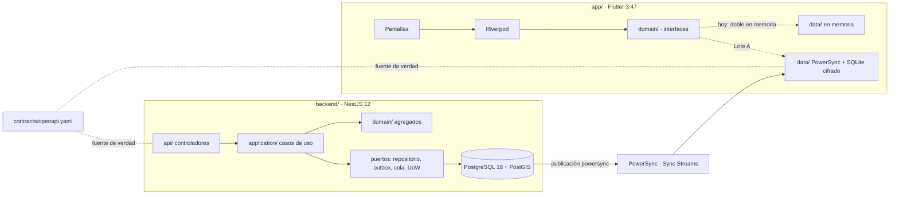

# Design

## Context

Ver `proposal.md`. El repositorio solo tenía la licencia. La red de este entorno de trabajo no
permite descargar el SDK de Flutter, así que la app se compila en la PC del Lote A (SDK 3.47.9) y en
GitHub Actions; el backend se compila y prueba aquí contra PostgreSQL con PostGIS.

## Goals / Non-Goals

**Goals:**
- Que los Lotes A, B, C y D arranquen el mismo día sin esperarse: contratos y dobles listos.
- Una implementación de referencia que muestre el patrón completo (dominio → caso de uso →
  repositorio → API idempotente → outbox), copiable por cada lote.
- Reglas de arquitectura verificadas por máquinas (tipos, fronteras, Sync Streams, CI).

**Non-Goals:**
- Funcionalidades de los lotes (ver `docs/fase-0/plan-de-lotes.md`).
- Despliegue en la nube: la Fase 0 corre local y en CI.

## Decisions

1. **Contrato primero (OpenAPI 3.1 en `contracts/`)** en vez de generar el contrato desde el código:
   la app puede avanzar con un mock (Prism) antes de que exista el endpoint. Alternativa
   descartada: `@nestjs/swagger` como fuente, porque obliga a esperar al backend.
2. **Kysely + migraciones por módulo** (`<modulo>/infrastructure/migrations/AAAAMMDDHHmm_...`),
   con `allowUnorderedMigrations` porque los lotes integran en paralelo. Cada módulo recibe la
   conexión tipada solo con sus tablas (`Kysely<TablasSolidaridad & TablasCompartidas>`): el
   compilador impide leer tablas ajenas. Alternativa descartada: Drizzle (PostGIS menos explícito).
3. **Idempotencia y outbox propios detrás de puertos.** Los paquetes oficiales `@nestjs/idempotency`
   (0.0.x) y `@nestjs/outbox` (0.1.x) son anteriores a 1.0; se reevalúan en la Fase 1 (ADR-0005).
4. **JWT ES256 con JWKS público**: la misma clave sirve a la API y a PowerSync con audiencias
   distintas (`vecinal-api` y `powersync`).
5. **Fronteras verificadas** con dependency-cruiser (`npm run boundaries`): dominio puro, casos de uso
   sin adaptadores, módulos solo por su `index.ts`, `shared` sin conocer módulos.
6. **App sin generación de código en la Fase 0** (Riverpod manual, sin freezed): menos piezas que
   pueden romper el build en CI. Cada lote agrega sus paquetes en su propio PR.
7. **Cifrado local con `powersync` 2.x** (`EncryptionOptions`, SQLite3MultipleCiphers): corrige la
   matriz de compatibilidad, porque `powersync_sqlcipher` quedó descontinuado (ADR-0004).

## Risks / Trade-offs

- [No todos los entornos de desarrollo tienen el SDK de Flutter] → compilación en la PC del
  Lote A y en GitHub Actions; las carpetas `android/` e `ios/` las genera `flutter create` en esa PC.
- [Desarrollo local en PostgreSQL 16 sin `uuidv7()` nativa] → la migración base define una
  equivalente solo si falta; CI corre en PostgreSQL 18 + PostGIS 3.6 como producción.
- [La publicación `powersync` incluye tablas completas] → los Sync Streams eligen columnas; el rol
  de PowerSync solo tiene SELECT sobre lo publicado.
- [PostGIS 3.7.0 salió el 5-nov-2026] → se mantiene 3.6 hasta que el proveedor gestionado la ofrezca.

## Migration Plan

Primer contenido del repositorio: no hay datos que migrar. Se integra por PR a `main`.
