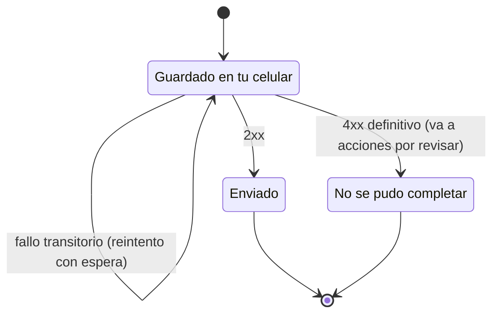

# Design

## Context

Ver `proposal.md`. Los cimientos ya traen: la máquina de estados de envío
(`app/lib/core/submissions/`), la clasificación de respuestas (`core/network/classify_response.dart`),
la política de reintentos con jitter, el puerto `SyncService`, la interfaz
`PostRepository` con un doble en memoria, y en el backend los endpoints idempotentes de
publicar y tomar favor, `GET /v1/sync/credenciales`, el JWKS y los Sync Streams por zona.

## Goals / Non-Goals

**Goals:**
- Reemplazar los dobles por PowerSync sin cambiar ninguna pantalla (solo se sobreescriben
  proveedores de Riverpod).
- Cumplir con evidencia los criterios de la sección 13.1 que son de este lote.

**Non-Goals:**
- Pantallas finales (Lote D), OTP y sesiones reales (Lote B), mapas y notificaciones (Lote C).

## Decisions

### Flujo de una acción sin conexión

```mermaid
sequenceDiagram
  autonumber
  actor V as Vecino
  participant R as PowerSyncPostRepository
  participant DB as SQLite cifrado
  participant C as Conector (uploadData)
  participant API as API /v1
  V->>R: Tomar favor (versión vista = 1)
  R->>DB: Transacción local: cambio optimista + comando + envío "guardado en tu celular"
  Note over V,DB: Sin red: nadie más lo recibió y la UI lo dice
  C->>DB: getNextCrudTransaction()
  C->>API: POST /v1/publicaciones/{id}/tomar + Idempotency-Key del comando
  alt 2xx
    API-->>C: 200 (o 200 repetido)
    C->>DB: envío = enviado; complete()
  else 4xx definitivo
    API-->>C: 409 favor_no_disponible
    C->>DB: envío = no se pudo completar + motivo; revertir; complete()
  else red caída / 5xx / 408 / 429
    C-->>C: lanzar error → PowerSync reintenta con espera
  end
  API-->>DB: el cambio real vuelve por Sync Streams y reemplaza al optimista
```

1. **Acciones como comandos explícitos.** Cada intención se guarda como fila de una tabla de
   comandos *insert-only* de PowerSync (tipo, recurso, cuerpo, `Idempotency-Key`), más una fila en
   una tabla *local-only* `envios` con su estado visible. `uploadData` traduce cada comando a su
   endpoint. Alternativa descartada: inferir la intención de un PATCH genérico sobre
   `publicaciones` (frágil: "tomar" no es un cambio de columnas cualquiera).
2. **Rechazo definitivo = `complete()` de la transacción.** Si no se completa, PowerSync la
   reintentaría para siempre y bloquearía la cola.
3. **Reintentos:** los transitorios se dejan a PowerSync lanzando el error; `RetryPolicy`
   define la espera cuando la app controla el ciclo (por ejemplo, al reabrir).
4. **Cifrado:** `EncryptionOptions(key: …)` con la clave en `SecureStore`; en `pubspec.yaml`,
   `hooks.user_defines.sqlite3.source: sqlite3mc` (ADR-0004).
5. **Datos sensibles:** stream bajo demanda `caso_asignado` con `subscription.parameter('pedido_id')`
   y una subconsulta a `emergencias.asignaciones` del usuario autenticado; TTL de suscripción corto.

### Estados de un envío



### Puntos de contacto con otros lotes

| Con | Qué | Regla |
|---|---|---|
| Lote B | Endpoints del muro y, más adelante, `getToken` con OTP | El contrato manda; A usa la sesión de desarrollo mientras tanto |
| Lote D | Pantallas que leen `PostRepository` y "acciones por revisar" | D trabaja con el doble; A solo sobreescribe el proveedor |
| Lote C | `app/pubspec.yaml`, `infra/` | Cambios pequeños y en PR separado; rebase antes de integrar |

## Risks / Trade-offs

- [`powersync` 2.x usa build hooks; un plugin viejo podría chocar] → probarlo en la Parte 1 en
  Android de gama baja e iPhone antes de seguir.
- [Esquemas de Postgres no `public` en los Sync Streams] → validado con el parser oficial
  (`npm run sync:validate`); confirmarlo en el servicio real en la Parte 1.
- [iOS limita el trabajo en segundo plano] → se mide y se documenta; la UI no promete inmediatez.
- [Un teléfono perdido y desbloqueado expone datos hasta su caducidad] → riesgo residual aceptado
  en la sección 8.4; caducidades cortas.

## Open Questions

- Umbral exacto de caducidad local de datos sensibles (propuesto: 24 h; decisión abierta 6, sección 13.3).
