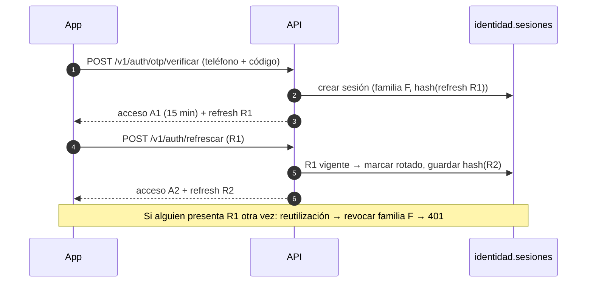
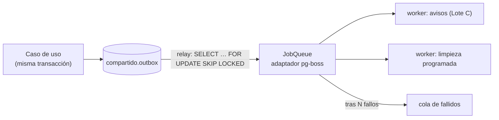

# Design

## Context

Ver `proposal.md`. Los cimientos ya traen el patrón completo en `modules/solidaridad` (copiarlo),
la emisión de tokens ES256 (`shared/auth/token.service.ts`), el outbox
(`shared/outbox/`), el puerto `JobQueue` con un doble en memoria y la idempotencia.

## Goals / Non-Goals

**Goals:** identidad lista para producción, eventos confiables y evidencia de capacidad.

**Non-Goals:** validación de DNI, consola web, Valkey/BullMQ, extracción de microservicios.

## Decisions

### Bloqueos OTP independientes del código (Parte 1)

`identidad.limites_otp` guarda el contador, el inicio de ventana y `bloqueado_hasta` por
teléfono e IP. Una migración adicional crea esta tabla privada sin modificar la migración
original de códigos ni agregar datos a PowerSync. Solicitar y verificar comparten bloqueos
transaccionales de PostgreSQL por teléfono e IP; las IP se normalizan antes de calcular sus
claves para que las representaciones equivalentes no eludan el límite.

La ventana y el bloqueo duran `OTP_LOCK_MINUTES`. Alcanzar `OTP_MAX_ATTEMPTS` por teléfono
o `OTP_MAX_ATTEMPTS_PER_IP` por IP inicia el bloqueo desde ese fallo; las peticiones bloqueadas
no lo prolongan. Los errores se lanzan después del commit para conservar los contadores.
El bloqueo se consulta antes de emitir o buscar un código, por lo que sobrevive a reenvíos,
caducidades y reinicios. Un acceso correcto reinicia únicamente los fallos del teléfono.
Las tablas de códigos mantienen sus intentos para diagnóstico, pero ya no deciden el bloqueo.

### Sesiones con refresh token rotativo

La Parte 2 guarda solo `HMAC-SHA256(REFRESH_TOKEN_SECRET, refresh)` en `identidad.sesiones`.
El secreto es independiente del OTP; `dev:keys` genera ambos. Cada refresh contiene 32 bytes
aleatorios codificados en base64url. La vigencia se renueva desde cada rotación (30 días por
defecto); las filas rotadas se conservan para detectar reutilización.

El acceso lleva `sid = familia_id`. La emisión inicial comparte transacción con el consumo OTP;
la rotación marca la fila anterior e inserta la nueva en una sola transacción. Ambas firman el
acceso antes del commit, de modo que un fallo de firma revierte todo. El resultado de reutilización
se convierte en 401 **después del commit** para conservar la revocación de toda la familia.

Todas las mutaciones de sesiones toman un bloqueo transaccional por usuario antes de bloquear
filas. Para renovar se identifica primero al dueño sin bloqueo de fila, se bloquea al usuario
y se relee el hash con `FOR UPDATE`. Esto ordena creación, rotación, cierre y revocación total,
e impide que una revocación omita un refresh insertado concurrentemente. Sync y elección de zona
comprueban bajo el mismo bloqueo que exista una fila de esa familia y usuario sin rotar, sin
revocar y no vencida. La elección de zona conserva `sid` y firma dentro de su transacción.

El acceso ya emitido conserva su vigencia, limitada por configuración a 1–15 minutos. Las
credenciales PowerSync ya emitidas también valen hasta su vencimiento; revocar impide obtener
credenciales nuevas, sin prometer una desconexión instantánea. Las sesiones de desarrollo sin
`sid` siguen disponibles únicamente bajo su configuración actual y no tienen refresh.

No hay ventana de gracia: el Lote A debe serializar las renovaciones, guardar de forma segura
el par nuevo y evitar reintentos automáticos con el refresh anterior. Si la respuesta se pierde,
se requiere un nuevo inicio por OTP. Estas rutas son en línea y no entran en la cola offline;
cierre y revocación total son idempotentes por su propia operación, sin almacenar respuestas.

### Del outbox a los workers

1. **pg-boss** (cola sobre PostgreSQL) detrás de `JobQueue`, como dice la sección 4.3;
   se reemplaza por BullMQ + Valkey en la Fase 3 sin tocar a quien encola.
2. **Relay con `FOR UPDATE SKIP LOCKED`** para que varias réplicas no publiquen dos veces el mismo
   evento; marcar `publicado_en` en la misma transacción que el `send` a la cola. El adaptador
   `fromKysely` de pg-boss 12.38.1 comparte la transacción de Kysely; un savepoint por evento
   permite persistir el intento fallido y continuar el lote sin dejar trabajos huérfanos.
3. **Workers en un proceso aparte** (`src/workers/main.ts`) con el mismo código del monolito.
4. **Hash del refresh token** (HMAC-SHA256 con secreto del servidor); nunca se guarda el token.
5. **Proveedor OTP**: adaptador falso en desarrollo; el real (Twilio Verify o Firebase Auth) se
   elige con la decisión abierta 4 de la sección 13.3.

La API tiene supervisión y programación apagadas. Solo el proceso de workers registra
manejadores, ejecuta el relay sin solapar lotes y programa la limpieza a las 04:00 de
`America/Lima`. Al cerrar, primero espera al relay y después a los trabajos activos, antes de
cerrar la conexión de negocio. Las colas sin manejador conservan sus trabajos pendientes para
que el Lote C pueda conectar sus consumidores.

`JobOptions.retries` se traduce a `retryLimit`: cinco reintentos además del intento inicial.
La cola `<nombre>.fallidos` conserva la carga y el error final. Las claves `singletonKey`
deduplican trabajos pendientes o activos; los manejadores siguen siendo idempotentes porque
la entrega es al menos una vez. El catálogo de contratos está en `docs/fase-0/trabajos.md`.

### Muro completo (Parte 5)

La búsqueda se limita a la zona del actor y usa `ST_DWithin` sobre `geography` con el índice
GiST existente. Solo devuelve filas abiertas, con ubicación, no eliminadas y sin vencer.
`ST_Distance` establece el orden por distancia/id, con `limite + 1` para detectar la página
siguiente. La ubicación de búsqueda no se persiste y las distancias visibles se redondean
a 50 m.

El cursor conserva `base64url(JSON { d, id })`, pero `d` contiene la distancia redondeada;
no se debe filtrar la distancia precisa a través de un JSON decodificable. Al continuar se
recalcula en el servidor la distancia del id de anclaje y se usa esa clave precisa para
paginar. El ancla sigue sirviendo tras cancelarse, vencer o borrarse lógicamente; si ya no
existe físicamente o no corresponde a la búsqueda se devuelve 400 para reiniciarla. La
ubicación de una publicación es inmutable en esta fase. El cliente mantiene punto y radio
entre páginas; el cursor no fija una instantánea del muro.

Cancelar y resolver comprueban primero al participante, luego el estado y la versión.
La repetición válida no genera eventos. Si la actualización optimista pierde una carrera,
se relee el agregado y se distingue una transición ya aceptada del conflicto real. Actualización
y outbox comparten transacción y se revierten juntos ante un error.

El límite es una ventana móvil de 24 horas por autor: se cuentan también publicaciones
canceladas o eliminadas, y una creada exactamente hace 24 horas ya queda fuera. La búsqueda
del id existente precede al límite y a la creación del agregado. Un bloqueo transaccional por
autor serializa comprobación e inserción; los reintentos del mismo id con otras claves no
consumen cupo ni generan eventos. `Retry-After` cuenta hasta que sale la fila más antigua.

### Capacidad y observabilidad (Parte 6)

Con autorización explícita, la rama de la Parte 6 integra las dependencias de las Partes 1–5
sin modificar sus ramas originales ni `main`. No hay staging disponible: se verifica el humo
local de 30 segundos, y se entrega el escenario completo sin certificar aún su capacidad.

El middleware propaga un `x-request-id` acotado a ASCII seguro o genera UUIDv7, lo devuelve y
lo asocia al log JSON de finalización. Se registra plantilla de ruta, método, estado y duración;
no consulta, cuerpo, cabeceras de autenticación ni respuesta. El filtro agrega la correlación
actual también a los rechazos guardados, sin modificar el objeto cacheado. Los errores internos
omiten texto y stack para evitar registrar secretos de adaptadores.

`GET /v1/operacion/metricas` exige administrador. Los contadores de los cuatro resultados de
reserva de idempotencia son de proceso y exponen instancia/inicio. Outbox y profundidad de colas
son lecturas actuales; el adaptador pg-boss consulta su propio esquema sin usar estadísticas
cacheadas. La edad crítica considera solo trabajos elegibles, no diferidos/bloqueados.

k6 usa llegada constante para 1750 lecturas/s y 500 escrituras/s durante diez minutos;
reconexión usa llegada variable con base 250/s, picos y jitter. Los replays son deterministas
entre VUs, un 10 % de solicitudes de escritura. Se conserva el límite diario y se dimensiona
la cantidad de usuarios sintéticos. Las credenciales son revocables, sin sesión de desarrollo,
con archivo local 0600 ignorado por Git y un observador administrador.

El humo inicia API y workers reales con pg-boss en una base temporal, registra serie temporal
y procesa una sonda crítica sintética. Verifica además que umbrales imposibles de latencia
y de cola crítica fallen. Los umbrales de la guía son valores provisionales configurables;
la aceptación en staging requiere los valores acordados por el equipo. La corrida completa
no se ejecuta en la laptop ni se infiere del humo.

### Puntos de contacto con otros lotes

| Con | Qué | Regla |
|---|---|---|
| Lote A | `getToken` y revocación (401 en credenciales) | Contrato en `contracts/openapi.yaml` antes de implementar |
| Lote C | Trabajo `notificaciones.enviar_aviso` | B define el nombre y la carga del trabajo en la Parte 4; C implementa el manejador |
| Todos | `contracts/openapi.yaml` | PR pequeño solo del contrato al inicio de cada parte |

## Risks / Trade-offs

- [El proveedor de SMS cobra por mensaje y puede tardar] → límites por teléfono e IP; WhatsApp como alternativa.
- [k6 local no reproduce la red real] → correrlo contra staging; local solo como humo.
- [pg-boss crea su propio esquema] → aislarlo en el esquema `colas` y documentarlo.
