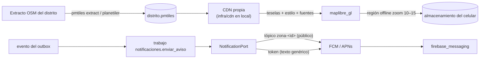

# Design

## Context

Ver `proposal.md`. Los cimientos dejan la ruta `/mapa` y el módulo `notificaciones` como esqueletos,
la CDN local (`infra/cdn/`, nginx con Range) y el puerto de colas. El Lote B define el trabajo
`notificaciones.enviar_aviso` en su Parte 4; mientras tanto C envía de forma directa por el puerto.

## Goals / Non-Goals

**Goals:** mapa offline viable y permitido; avisos por token y por tópico verificados en
dispositivos reales.

**Non-Goals:** SMS de respaldo, mapas de calor de pedidos de ayuda (Fase 2).

## Decisions

1. **PMTiles auto-hospedado** como opción por defecto (sin dependencia de terceros, costo de
   salida cero en R2); si MapLibre no descarga regiones offline desde `pmtiles://`, servir las
   teselas como XYZ desde la CDN (por ejemplo, con `pmtiles serve`) y registrar la decisión en un ADR.
2. **Tópicos solo para avisos públicos**, tokens para lo personal (sección 7.5).
3. **Puerto `NotificationPort`** con adaptador `firebase-admin` y uno falso para pruebas; credenciales
   de servicio fuera del repositorio.
4. **Proyecto de Firebase** creado por el equipo; `google-services.json` y
   `GoogleService-Info.plist` se distribuyen fuera del repositorio público.

### Puntos de contacto con otros lotes

| Con | Qué | Regla |
|---|---|---|
| Lote B | Trabajo `notificaciones.enviar_aviso` (nombre y carga) | B lo define; C implementa el manejador |
| Lote D | Ruta `/mapa` y botón de descarga en la UI | C entrega la pantalla; D revisa accesibilidad |
| Lote A | `app/pubspec.yaml`, carpetas nativas | Agregar paquetes en un PR pequeño y temprano |

## Risks / Trade-offs

- [El tamaño de la región supera lo razonable en gama baja] → limitar zoom y área; medir en la Parte 2.
- [Configuración nativa de Firebase en iOS] → empezar por Android; iOS en la misma parte con TestFlight interno.
- [Términos del proveedor cambian] → la opción auto-hospedada no depende de terceros.
