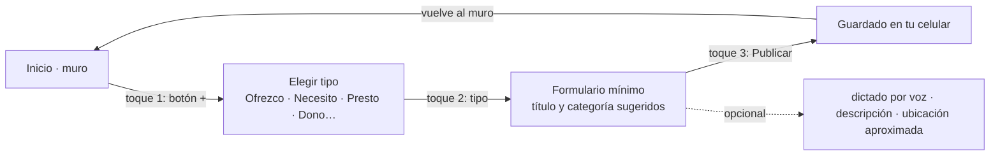

# Design

## Context

Ver `proposal.md`. Los cimientos traen `AccessibleTheme`, `SubmissionStatusChip`, `ConnectionBanner`,
`timeAgo`, el archivo de idioma `app_es.arb`, el muro de referencia y el doble
`InMemoryPostRepository` con `recordResponse(...)` para simular al servidor.

## Goals / Non-Goals

**Goals:** pantallas listas para producción que funcionen igual con el doble y con PowerSync.

**Non-Goals:** lógica de sincronización (Lote A), mapas (Lote C), modo emergencia completo (Fase 1).

## Decisions

### Flujo de publicación en tres toques

1. **Las pantallas solo conocen interfaces de `domain/`** y proveedores de Riverpod; nunca
   PowerSync ni Dio. Así el Lote A cambia la implementación sin tocar la UI.
2. **Golden tests** con escala de texto 1,0 y 2,0 en tema claro y oscuro para las pantallas
   principales; las referencias se generan en la PC del Lote A o en CI y se revisan en el PR.
3. **Textos en `app_es.arb`** con plurales ICU (por ejemplo, "hace {n, plural, …}"); `timeAgo`
   pasa a usar las localizaciones.
4. **Tutorial con `showcaseview`** sobre los widgets reales; el modo práctica usa un repositorio
   en memoria aislado que nunca encola envíos.

### Puntos de contacto con otros lotes

| Con | Qué | Regla |
|---|---|---|
| Lote A | `PostRepository`, `SyncService`, "acciones por revisar" | D no cambia las interfaces sin acordarlo en el PR de A |
| Lote C | Ruta `/mapa` | C entrega la pantalla; D revisa su accesibilidad |
| Todos | `core/router/router.dart`, `app_es.arb`, `pubspec.yaml` | Cambios pequeños, rebase antes del PR |

## Risks / Trade-offs

- [Los golden tests cambian entre plataformas por fuentes] → generarlos siempre en CI (Linux) con la fuente incluida en el repo.
- [El modo sencillo duplica pantallas] → mismo widget con parámetros, no pantallas paralelas.
