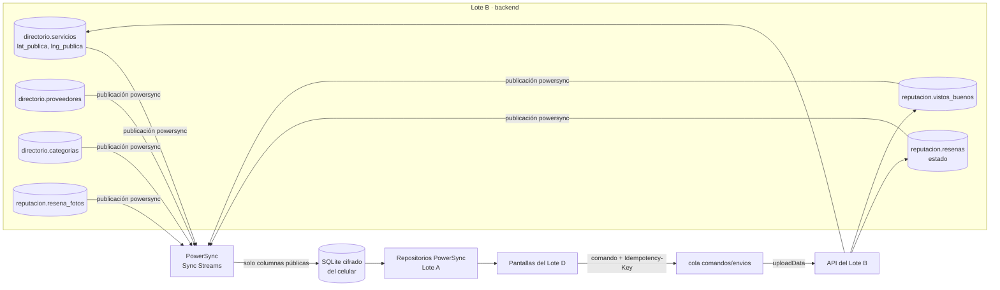
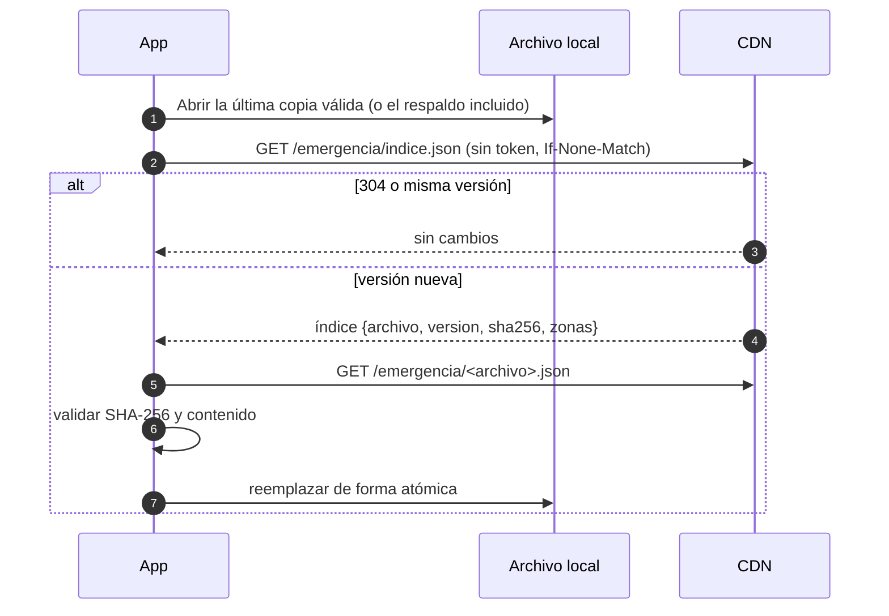

# Design

## Context

Ver `proposal.md`. De la Fase 0 ya existen:

- Sync Streams `mi_zona`, `muro_de_mi_zona`, `mis_publicaciones` y `caso_asignado` en
  `infra/powersync/sync-config.yaml`, con pruebas de acceso que usan el parser oficial
  (`backend/src/modules/emergencias/sync-config-access.spec.ts`).
- En la app, una base PowerSync cifrada por cuenta (`AuthenticatedSyncSession`), el esquema local
  (`core/sync/local_schema.dart`) con `comandos` (*insert-only*) y `envios` (*local-only*), y el
  conector `VecinalConnector`, que hoy solo conoce dos comandos (`publish` y `takeFavor`) y siempre
  usa `POST`.
- `PowerSyncPostRepository` como patrón de repositorio: lectura reactiva de SQLite, y escritura de
  cambio optimista, comando y envío en una sola transacción local.
- `AuthenticatedApp._activate` ya cierra y purga la sesión local cuando cambia la zona del vecino.
- `GET /v1/operacion/metricas` (administradores) en `backend/src/shared/observability/`.
- La CDN local `infra/cdn/` con nginx, Range, CORS y ETag.

Las tablas del directorio, la reputación y la moderación todavía no existen: las crea el Lote B.
Este diseño fija las columnas públicas que leen los streams; el diseño del change del Lote B
(`fase-1-lote-b-directorio-reputacion-y-moderacion`) las define con los mismos nombres.

## Goals / Non-Goals

**Goals:**
- Llevar al celular solo columnas públicas, con la precisión del ADR 0010.
- Que el Lote D construya sus pantallas sobre puertos de dominio y dobles en memoria que este lote
  define, y que la versión real entre sobreescribiendo proveedores de Riverpod.
- Medir la sincronización sin datos personales y dejar el celular limpio en cada salida de la zona
  o de la cuenta.

**Non-Goals:**
- Rutas, tablas y reglas de negocio del directorio, la reputación y la moderación (Lote B).
- Subida de fotos, módulo Media, OpenTelemetry y tableros (Lote C).
- Pantallas finales del directorio, las reseñas, la emergencia y la privacidad (Lote D).

## Decisions

### 1. Flujo de los datos públicos

### 2. Precisión de la ubicación (ADR 0010)

- La copia pública se redondea a 3 decimales (≈110 m), como ya hace el muro
  (`approximate()` en `solidaridad/domain/post.ts`).
- `directorio.servicios` guarda la ubicación exacta en `ubicacion` (privada, para búsquedas) y la
  copia pública en `lat_publica` y `lng_publica`. Si el proveedor activa
  `muestra_ubicacion_exacta`, la copia pública es la exacta de su local.
- Los streams nunca seleccionan `ubicacion`. Se comprobó que la semilla no crea publicaciones y que
  toda publicación pasa por el redondeo del dominio desde los cimientos: el muro no necesita una
  migración de datos. El ADR lo deja registrado.
- Alternativa descartada: geohash o celdas H3 en los streams. Exige tablas o funciones nuevas para
  el mismo resultado práctico en un barrio.

### 3. Streams nuevos

Todos con `auto_subscribe: true`. El alias de la tabla (`AS`) fija el nombre de la tabla en el
celular; se comprobó con el parser oficial que una misma fila llega a dos tablas locales distintas
cuando dos streams la seleccionan con alias diferentes.

| Stream | Prioridad | Tabla local | Fuente y filtro |
|---|---|---|---|
| `categorias` | 1 | `categorias` | `directorio.categorias`: `id, nombre, icono, util_en_emergencia, orden` (global) |
| `servicios_de_mi_zona` | 2 | `servicios` | `directorio.servicios` de `zona_id = auth.parameter('zona')`, sin `eliminado_en` ni `oculto_en`: `id, proveedor_id, zona_id, categoria_id, titulo, descripcion, lat_publica AS lat, lng_publica AS lng, radio_cobertura_m, disponible_en_emergencia, atributos, total_resenas, promedio, puntaje_ranking, vistos_buenos_de_la_zona, version, actualizado_en` |
| `proveedores_de_mi_zona` | 2 | `proveedores` | `directorio.proveedores` de la zona, sin borrados ni ocultos: `id, nombre_publico, descripcion, actualizado_en` |
| `resenas_publicadas` | 3 | `resenas` | `reputacion.resenas` con `estado = 'publicada'` y `servicio_id` en los servicios vigentes de la zona (subconsulta): `id, servicio_id, calificacion, comentario, publicada_en` (sin autor) |
| `fotos_de_resenas_publicadas` | 3 | `fotos_resena` | `reputacion.resena_fotos` sin `oculta_en`, cuyas reseñas están publicadas y son de servicios vigentes de la zona (subconsulta anidada): `id, resena_id, archivo_id, orden, ancho, alto, blurhash` |
| `mis_resenas` | 2 | `mis_resenas` | `reputacion.resenas` con `autor_id = auth.user_id()`: `id, servicio_id, calificacion, comentario, estado, motivo_estado, creado_en, actualizado_en` |
| `mis_vistos_buenos` | 2 | `mis_vistos_buenos` | `reputacion.vistos_buenos` con `vecino_id = auth.user_id()`: `id, servicio_id, creado_en` |

- Los streams `muro_de_mi_zona` y `mis_publicaciones` agregan `AND oculta_en IS NULL`. La columna
  `solidaridad.publicaciones.oculta_en` la crea el Lote B en su parte 5; hasta entonces PowerSync
  local registra una advertencia de columna inexistente.
- "Visto Bueno de tu zona" viaja como el contador `vistos_buenos_de_la_zona`, que calcula el
  servidor. No se replican los Visto Bueno de otros vecinos.
- Las fotos se identifican con `archivo_id`. La app arma su dirección con la plantilla pública del
  Lote C: `<CDN>/media/<archivoId>/<variante>.webp`. No viajan URLs firmadas ni claves privadas.
- Alternativa descartada: copiar `zona_id` y `estado` en cada tabla de reputación para evitar
  subconsultas. Duplica datos que el Lote B tendría que mantener coherentes; las subconsultas ya
  las usa `caso_asignado` y el parser las acepta.

### 4. Pruebas de acceso de los streams

`backend/test/sync/datos-publicos.spec.ts`, con el mismo método que la prueba de datos sensibles
(`parseSyncConfig`, `hydrate`, `evaluateRow` y `getBucketParameterQuerier`), cubre:

- un vecino de otra zona no recibe filas;
- una reseña en revisión solo llega a su autor, sin fotos para los demás;
- un servicio o una reseña ocultos no pertenecen a ningún bucket;
- ninguna columna seleccionada por un stream automático se llama `ubicacion`, `telefono`,
  `autor_id` (en datos públicos), `lat`/`lng` exactos de servicios ni `direccion`.

`vitest.config.ts` incluye `test/sync/**/*.spec.ts`.

### 5. App: puertos, dobles y repositorios

- `features/directorio/domain/`: `Category`, `Service`, `ProviderProfile`, `NewService`,
  `ServiceDirectoryRepository` (`watchCategories`, `watchServices({categoryId, query,
  emergencyOnly})`, `watchProvider`, `publishService`, `updateService`, `withdrawService`) y la
  búsqueda local tolerante a tildes (normalización sin acentos y en minúsculas).
- `features/reputacion/domain/`: `Review`, `ReviewPhoto`, `ReputationRepository`
  (`watchPublishedReviews(serviceId)`, `watchMyReviews`, `watchMyEndorsements`, `writeReview`,
  `giveEndorsement`, `withdrawEndorsement`, `report`).
- Dobles `data/in_memory_*` y proveedores `serviceDirectoryRepositoryProvider` y
  `reputationRepositoryProvider`. `AuthenticatedApp` los sobreescribe con
  `PowerSyncServiceDirectoryRepository` y `PowerSyncReputationRepository`.
- Las filas optimistas se guardan en `envios.optimista` (JSON, *local-only*) y se combinan con
  las descargadas al leer, como hace hoy `publicacion_optimista`, que se conserva.

### 6. Conector de subida

`SubmissionKind` crece y cada tipo declara su método y su ruta (contrato del Lote B):

| Tipo | Método y ruta |
|---|---|
| `publishService` | `POST /v1/servicios` |
| `updateService` | `PUT /v1/servicios/{id}` |
| `withdrawService` | `DELETE /v1/servicios/{id}` |
| `upsertProvider` | `PUT /v1/yo/proveedor` |
| `writeReview` | `POST /v1/resenas` |
| `giveEndorsement` / `withdrawEndorsement` | `POST` / `DELETE /v1/servicios/{id}/visto-bueno` |
| `report` | `POST /v1/denuncias` |

La clasificación de respuestas no cambia (`classifyResponse`), así que un rechazo definitivo nunca
bloquea la cola. El 401 de la API se sigue tratando como transitorio para renovar la sesión.

### 7. Directorio de emergencia

- Contrato `contracts/directorio-emergencia.schema.json` (JSON Schema 2020-12): `version`,
  `distrito`, `generadoEn` y `entradas[]` con `id`, `tipo` (`numero`, `punto_de_encuentro`,
  `centro_de_salud` o `albergue`), `nombre`, `telefono` (obligatorio en `numero`) o `ubicacion`
  (obligatoria en los demás tipos), `direccion` opcional, `fuente` y `verificadoEn`. El índice
  (`indice.json`) tiene su propio esquema en el mismo archivo (`$defs`).
- `infra/cdn/publico/emergencia/`: el archivo de Lince (demo) solo trae los números 116, 105 y 106,
  verificados en una fuente oficial al crearlo. Los puntos de encuentro, centros de salud y
  albergues los agrega el curador con un PR; no se inventan datos de emergencia.
- `infra/cdn`: un script recalcula el índice y una prueba con `node:test` falla si un hash no
  coincide. La app valida los archivos publicados con su propio validador en una prueba.
- La app guarda la copia en un archivo del directorio de soporte, fuera de la base de la cuenta:
  es información pública y debe abrirse aunque no haya sesión. Cerrar sesión no la borra.
- La copia de respaldo es un asset (`assets/emergencia/respaldo.json`) que pasa el mismo
  validador. Umbrales de antigüedad por tipo, configurables (30 días por defecto; 180 para
  `numero`).
- `/emergencia` muestra una lista básica y accesible, con la fuente y la fecha de cada dato. El
  Lote D (parte 4) agrega el botón "Estoy en emergencia", las llamadas y el mapa.

### 8. Métricas de sincronización

- La app calcula los contadores desde `envios` (`creado_en` → `ultimo_intento_en` de los
  enviados), `ps_crud` (cola) y el estado de PowerSync (última sincronización y errores de
  conexión), en una ventana desde el último envío.
- `POST /v1/telemetria/sincronizacion` (`@Idempotent()`, con sesión) en
  `shared/observability`. El esquema Zod es estricto y la tabla `compartido.telemetria_sincronizacion`
  no tiene columnas de usuario ni de dispositivo. El registro de idempotencia guarda el alcance del
  vecino durante su retención normal y nada más.
- `GET /v1/operacion/metricas` agrega una sección `sincronizacion` con el resumen de los últimos 7
  días. El Lote C (parte 5) exporta esas mismas cifras por OpenTelemetry a su tablero.
- Alternativa descartada: ruta pública sin sesión. Facilita el abuso y no aporta anonimato,
  porque la fila ya se guarda sin identidad.

### 9. Zona, cuenta y fotos pendientes

- `AuthRepository` gana `changeZone(zoneId)` y `deleteAccount()`. La versión HTTP llama a
  `PUT /v1/yo/zona` y `DELETE /v1/yo` (contrato del Lote B, parte 4).
- Cambio de zona: solo con `pendingUploads == 0`. El token nuevo cambia la zona y
  `AuthenticatedApp._activate` purga y reabre la base de la cuenta, así que los datos de la zona
  anterior no quedan en el celular.
- Borrado de cuenta: primero la baja del token de avisos (con el límite de 5 s que ya usa el
  cierre de sesión), luego `DELETE /v1/yo`, y con la confirmación del servidor la misma purga que el
  cierre de sesión más los archivos del vecino.
- Puerto `PendingPhotoPurger` con implementación vacía. El Lote C (parte 2) lo implementa sobre su
  cola de fotos, y el cierre de sesión y el borrado de cuenta lo llaman antes de purgar.

### 10. Piloto e integración

- La parte 5 usa las betas del Lote C (parte 4) y deja las evidencias en `docs/fase-1/evidencias/`
  sin datos personales.
- La parte 6 integra las ramas aprobadas de B, C y D con autorización del equipo y recorre el flujo
  completo de la guía.

### Puntos de contacto con otros lotes

| Con | Qué | Regla |
|---|---|---|
| B | Columnas públicas de `directorio.*`, `reputacion.*` y `solidaridad.publicaciones.oculta_en` | Las define este diseño y el de B; las pruebas de acceso del stream fallan si cambian |
| B | Rutas de servicios, proveedor, reseñas, Visto Bueno, denuncias, zona y `DELETE /v1/yo` | Contrato de B; A prueba con HTTP falso hasta tenerlas |
| B | `POST /v1/telemetria/sincronizacion` en `contracts/openapi.yaml` | Lo agrega A en su parte 3 |
| C | Plantilla pública de fotos `<CDN>/media/<archivoId>/<variante>.webp` | La implementa C1; A la usa para armar URLs |
| C | `PendingPhotoPurger` | Lo define A4; C2 lo implementa |
| C | Resumen de sincronización y CDN del directorio de emergencia | C5 lo exporta por OpenTelemetry; C4 publica `emergencia/` en la CDN de cada entorno |
| D | Puertos de directorio y reputación, `AuthRepository.changeZone` y `deleteAccount`, pantalla `/emergencia` | D construye sobre los dobles; A sobreescribe los proveedores |
| Todos | `app/pubspec.yaml`, `app_es.arb`, `core/router/router.dart`, `contracts/openapi.yaml` | Cambios pequeños, en commits propios |

## Risks / Trade-offs

- [Los streams leen tablas que B todavía no creó] → El parser valida la sintaxis y las pruebas de
  acceso evalúan filas simuladas. El PowerSync local registra advertencias hasta que lleguen las
  migraciones de B, y la parte 6 lo comprueba de punta a punta.
- [El contrato de columnas cambia en B] → Las pruebas de acceso fijan los nombres y el diseño de B
  los repite; cualquier cambio se acuerda en ambos changes.
- [Un cambio de zona con acciones en cola podría enviarlas a la zona nueva] → Se bloquea el cambio
  hasta vaciar la cola.
- [La copia del directorio de emergencia puede quedar vieja sin conexión] → Cada dato muestra su
  fecha y se marca posiblemente desactualizado pasado el umbral; nunca se oculta.
- [Métricas que permitan identificar a alguien] → Contrato estricto sin identificadores, sin
  contenido y sin ubicaciones; la revisión de privacidad queda en la evidencia.
- [Sin celular de pruebas en el entorno del lote] → Las pruebas en dispositivo quedan como tareas
  abiertas con su evidencia, sin marcarlas antes de correrlas.

## Migration Plan

- Las migraciones nuevas solo agregan objetos (`compartido.telemetria_sincronizacion`). El `down`
  los elimina.
- El esquema local de PowerSync solo agrega tablas y la columna *local-only* `optimista`, así que
  una instalación existente se actualiza sin perder su cola.
- Para volver atrás basta con revertir `sync-config.yaml` y reiniciar PowerSync: los celulares
  borran las filas que ya no pertenecen a sus streams.

## Open Questions

- Umbrales definitivos de antigüedad por tipo de dato de emergencia (decisión 13.3.6), que se fijan
  con los aliados en la Fase 2. Hasta entonces se usan los valores configurables de este diseño.
