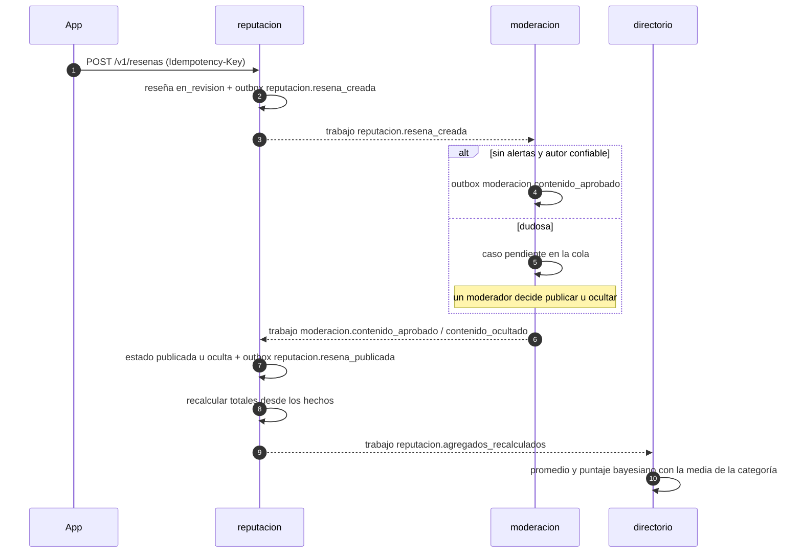

# Design

## Context

Ver `proposal.md`. Patrón de referencia: `backend/src/modules/solidaridad/` (dominio puro, casos de
uso con puertos, adaptadores Kysely y en memoria, API con Zod alineada con el contrato). Ya existen
de la Fase 0: `@RequireTrustLevel`, `@RequireRole`, `@Idempotent()`, `UNIT_OF_WORK`,
`OUTBOX_WRITER`, pg-boss con `JobHandlerRegistry` y el proceso de workers. Los módulos `directorio`,
`reputacion` y `moderacion` son esqueletos. El Lote A ya definió en su diseño los Sync Streams que
leen estas tablas (`fase-1-lote-a-datos-offline-y-metricas`, decisión 3): los nombres de tablas y
columnas públicas de este diseño son ese contrato.

## Goals / Non-Goals

**Goals:**
- Cada módulo es dueño de su esquema; entre módulos solo `index.ts` o eventos del outbox
  (`npm run boundaries`).
- Toda escritura que el celular reintenta lleva `@Idempotent()` y acepta un id UUIDv7 del celular.
- Primero el contrato: cada parte empieza con su commit de `contracts/openapi.yaml`.

**Non-Goals:**
- Procesamiento de imágenes y URLs firmadas (Lote C, parte 1).
- Pantallas y textos de la app (Lote D).
- Validación del DNI (Fase 2).

## Decisions

### 1. Modelo de datos

Columnas públicas (las que leen los streams del Lote A) en **negrita**.

`directorio.categorias`: **`id`** texto estable (`^[a-z0-9-]{2,40}$`, por ejemplo `gasfiteria`),
**`nombre`**, **`icono`** (nombre de un ícono de Material), **`util_en_emergencia`**, **`orden`** y
`actualizado_en`. Se siembran con la migración.

`directorio.proveedores`: **`id`** (= `identidad.usuarios.id`), `zona_id`, **`nombre_publico`**
(2–60), **`descripcion`** (≤ 500), `creado_en`, **`actualizado_en`**, `eliminado_en`, `oculto_en`.

`directorio.servicios`: **`id`** (UUIDv7 del celular), **`proveedor_id`**, **`zona_id`**,
**`categoria_id`**, **`titulo`** (3–120), **`descripcion`** (≤ 2 000), `ubicacion`
(`geography(Point, 4326)`, exacta y privada), **`lat_publica`**, **`lng_publica`**,
`muestra_ubicacion_exacta`, **`radio_cobertura_m`** (100–20 000), **`disponible_en_emergencia`**,
**`atributos`** (`jsonb`, ≤ 4 KB), **`total_resenas`**, `suma_calificaciones`, **`promedio`**,
**`puntaje_ranking`**, `total_vistos_buenos`, **`vistos_buenos_de_la_zona`**, **`version`**,
`creado_en`, **`actualizado_en`**, `eliminado_en`, `oculto_en` y `busqueda` (`tsvector`
generado). Índices: GiST en `ubicacion`, GIN en `atributos` y `busqueda`, trigramas en el título
sin tildes.

`reputacion.resenas`: **`id`** (UUIDv7 del celular), **`servicio_id`**, `autor_id`,
`zona_autor_id`, **`calificacion`** (1–5), **`comentario`** (≤ 2 000), **`estado`**
(`en_revision`, `publicada` u `oculta`), **`motivo_estado`** (código público o nulo),
**`creado_en`**, **`actualizado_en`**, **`publicada_en`** y `UNIQUE (servicio_id, autor_id)`.

`reputacion.resena_fotos`: **`id`**, **`resena_id`**, **`archivo_id`** (de `media.archivos`),
**`orden`** (0–2), **`ancho`**, **`alto`**, **`blurhash`** y `oculta_en`.

`reputacion.vistos_buenos`: **`id`** (`uuidv7()`), **`servicio_id`**, `vecino_id`,
`nivel_al_dar`, `zona_vecino_id`, **`creado_en`** y `UNIQUE (servicio_id, vecino_id)`. Quitar el
Visto Bueno borra la fila.

`moderacion.denuncias`, `moderacion.casos` y `moderacion.sanciones`: privadas, fuera de la
publicación `powersync`.

`identidad`: `consentimientos` (finalidad, versión, aceptado y fecha), `presencias` (usuario y día,
sin coordenadas), `avales`, `confirmaciones` (manuales, con motivo y autor) y las columnas
`zona_elegida_en` y `eliminado_en` en `usuarios`.

`solidaridad.publicaciones`: columna nueva `oculta_en`; `GET /v1/publicaciones` la excluye.

A la publicación `powersync` (con `SELECT` para `powersync_rol`) se agregan solo `categorias`,
`proveedores`, `servicios`, `resenas`, `resena_fotos` y `vistos_buenos`. Ningún stream lee
`ubicacion`, `autor_id` de reseñas públicas, teléfonos ni tablas de moderación o identidad.

Alternativa descartada: ids enteros (`serial`) en categorías. Un id de texto estable es legible en
el contrato (`categoriaId=gasfiteria`) y en los Sync Streams.

### 2. Rutas (contrato que usan los Lotes A y D)

| Ruta | Reglas |
|---|---|
| `GET /v1/categorias` | Con sesión |
| `PUT /v1/yo/proveedor` | `@Idempotent()`, nivel 1 |
| `POST /v1/servicios` | `@Idempotent()`, nivel 1; 201 o 200 si el id ya era suyo; 409 `id_en_uso` |
| `PUT /v1/servicios/{id}` | `@Idempotent()`, dueño, `versionVista`; 409 `conflicto_de_version` |
| `DELETE /v1/servicios/{id}` | `@Idempotent()`, dueño; 204 aunque ya estuviera retirado |
| `GET /v1/servicios` | `lat`, `lng`, `radioM`, `categoriaId`, `q`, `soloEmergencia`, `cursor`, `limite` |
| `GET /v1/proveedores/{id}` | Sin teléfono ni ubicación privada |
| `POST /v1/resenas` | `@Idempotent()`, nivel 1; `{ id, servicioId, calificacion, comentario?, fotos?: archivoId[] }` |
| `POST` y `DELETE /v1/servicios/{id}/visto-bueno` | `@Idempotent()`, nivel 1 |
| `POST /v1/denuncias` | `@Idempotent()`, nivel 0; `{ id, tipoContenido, contenidoId, motivo, detalle? }` |
| `GET /v1/moderacion/casos` y `POST /v1/moderacion/casos/{id}/decision` | Rol `moderador` |
| `PUT /v1/yo/zona` | `@Idempotent()`; 409 `cambio_de_zona_muy_pronto` con `disponibleDesde` |
| `POST /v1/yo/residencia/presencia` | `@Idempotent()`; `{ fecha, dentroDeLaZona }`; exige el consentimiento `confirmacion_por_presencia` |
| `POST /v1/vecinos/{id}/residencia` | Rol `moderador`, con motivo |
| `POST /v1/vecinos/{id}/aval` | `@Idempotent()`, nivel 2, misma zona |
| `GET` y `POST /v1/yo/consentimientos` | `POST` con `@Idempotent()` |
| `GET /v1/yo/datos`, `PATCH /v1/yo`, `DELETE /v1/yo` | `DELETE` responde 202 |

- Se usa `conflicto_de_version` (de `VersionConflict`) en lugar del `version_desactualizada` de la
  guía, porque la app ya traduce ese código en "Acciones por revisar".
- Motivos de denuncia: `spam`, `ofensivo`, `informacion_falsa`, `datos_personales`, `peligroso` y
  `otro`.
- Finalidades de consentimiento: `uso_del_servicio` (obligatoria) y `confirmacion_por_presencia`
  (opcional), cada una con la versión vigente de su texto en la configuración del módulo.

### 3. Eventos y trabajos entre módulos

- `reputacion` cuenta desde cero sus reseñas publicadas y Visto Bueno vigentes y emite
  `{ servicioId, totalResenas, sumaCalificaciones, totalVistosBuenos, vistosBuenosDeLaZona }`.
  `directorio` guarda esos totales y calcula `promedio` y `puntaje_ranking` =
  (C × m + suma) / (C + n), con C = 7 y m = la media de su categoría. Ningún módulo escribe tablas
  ajenas.
- Ocultar un contenido emite `moderacion.contenido_ocultado { tipoContenido, contenidoId, motivo }`
  y cada módulo dueño registra su manejador. Restaurar emite `moderacion.contenido_restaurado`.
- `identidad.zona_cambiada` hace que `directorio` retire los servicios del proveedor en la zona
  anterior.
- `identidad.cuenta_borrada` hace que cada módulo borre o anonimice lo suyo, de forma idempotente.
- `GET /v1/yo/datos` usa un `PersonalDataRegistry`: cada módulo registra en `onModuleInit` una
  función que devuelve los datos de un usuario, igual que `JobHandlerRegistry`.
- `reputacion` consulta a `directorio` (zona y dueño de un servicio) y a `media` (dueño de un
  archivo) solo por sus `index.ts`.

### 4. Búsqueda

`GET /v1/servicios` es una lectura con `KYSELY`: `ST_DWithin` sobre el índice GiST, filtros por
categoría y emergencia, y texto con `busqueda @@ websearch_to_tsquery('spanish', sin_tildes(q))`
o `word_similarity(sin_tildes(q), sin_tildes(titulo)) > 0,3`. `sin_tildes` envuelve `unaccent` como
`IMMUTABLE`. Orden: `vistos_buenos_de_la_zona DESC, puntaje_ranking DESC, id`. El cursor es
`base64url` de esos tres valores. `distanciaMetros` se redondea a 50 m. El `EXPLAIN` que confirma
los índices va en la evidencia de la parte.

### 5. Niveles y residencia (ADR 0011)

- Presencia: el celular decide en el propio teléfono si estuvo dentro del polígono y envía solo
  `{ fecha, dentroDeLaZona }`. Con 3 días distintos dentro de 14 sube al nivel 1. Las presencias se
  borran a los 30 días.
- Confirmación manual por un moderador, con motivo y auditoría.
- Avales: 2 de vecinos de nivel 2 o más de la misma zona suben al nivel 2. Los primeros niveles 2
  los confirma un moderador a mano.
- Antigüedad mínima para reseñar (`MIN_ACCOUNT_AGE_HOURS_TO_REVIEW`, 72 por defecto) y límite diario
  (`MAX_REVIEWS_PER_DAY`, 5 por defecto), documentados en `.env.example`.

### 6. Sanciones

`sancionar` oculta el contenido y crea una suspensión de publicación de 7 días. `moderacion/index.ts`
exporta `isSuspended(userId, now)`, que `solidaridad`, `directorio` y `reputacion` consultan antes de
publicar (403 `cuenta_suspendida`).

### Puntos de contacto con otros lotes

| Con | Qué | Regla |
|---|---|---|
| A | Tablas y columnas públicas de la decisión 1 | Las pruebas de acceso del Lote A fallan si cambian; un cambio se acuerda en ambos changes |
| A | `PUT /v1/yo/zona`, `DELETE /v1/yo` y códigos de error | A los usa en su parte 4 con HTTP falso hasta que existan |
| C | `media/index.ts`: dueño y estado de un `archivoId`; evento `media.archivo_listo` | B enlaza fotos solo de archivos listos del autor; C publica las variantes cuando la reseña se publica |
| C | Avisos "tu reseña se publicó" | C escribe el manejador de `reputacion.resena_publicada` |
| D | Contrato y códigos de error de cada ruta | D muestra el motivo con el `codigo` estable |
| Todos | `contracts/openapi.yaml`, `backend/package.json`, `scripts/seed-data.ts` | Commits pequeños; primero el contrato |

## Risks / Trade-offs

- [Ranking inflado con cuentas falsas] → Antigüedad mínima, límites diarios, Visto Bueno que solo
  cuenta desde el nivel 2 y patrones a moderación.
- [Moderación sin personas disponibles] → La cola expone el tiempo hasta la primera revisión y el
  criterio de salida la vigila.
- [Datos personales que quedan tras borrar la cuenta] → Manejadores por módulo con una prueba que
  busca el teléfono y el nombre en toda la base después del trabajo.
- [Búsqueda lenta en el pico] → Índices GiST, GIN y de trigramas, comprobados con `EXPLAIN`;
  réplicas en la Fase 3.

## Migration Plan

Migraciones aditivas por módulo con `up` y `down`. Las tablas públicas se agregan a la publicación
`powersync` en la misma migración. La columna `oculta_en` del muro es nula por defecto, así que no
cambia nada existente.
