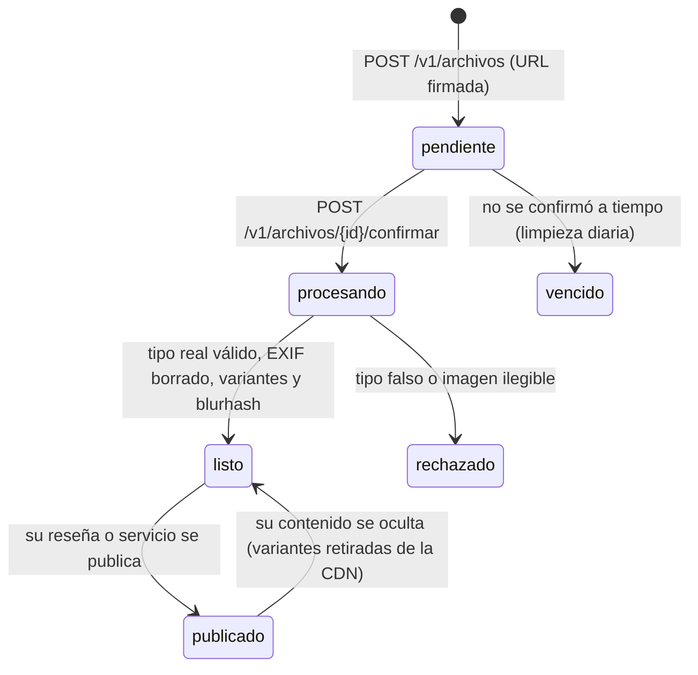

# Design

## Context

Ver `proposal.md`. Ya existen la CDN local (`infra/cdn/`, nginx con Range, CORS y ETag), el puerto
`JobQueue` con pg-boss y el proceso de workers, la CI de backend, app (APK e iOS sin firma),
especificaciones y mapas, y el ingreso por SMS con Firebase (ADR 0009). El módulo `media` es un
esqueleto. El Lote A define la plantilla pública de fotos y el puerto `PendingPhotoPurger`
(`fase-1-lote-a-datos-offline-y-metricas`, decisiones 3 y 9). El Lote B enlaza fotos a reseñas por
`archivoId` y emite los eventos de publicación y ocultamiento.

## Goals / Non-Goals

**Goals:**
- Las fotos nunca viven en la base de datos ni salen con metadatos de ubicación.
- Una foto solo es pública cuando su contenido lo es.
- Entornos y despliegues reproducibles sin secretos en el repositorio.

**Non-Goals:**
- Moderación del contenido de las imágenes (Lote B usa un puerto que este lote implementa con un
  filtro básico).
- WAF, varias regiones y costos a escala (Fase 3).

## Decisions

### 1. Ciclo de vida de un archivo

- `media.archivos`: `id`, `propietario_id`, `proposito` (`resena` o `servicio`), `tipo`, `bytes`,
  `ancho`, `alto`, `blurhash`, `estado`, `creado_en` y `actualizado_en`. Privada, fuera de la
  publicación `powersync`.
- Dos espacios en el almacenamiento: uno privado para originales y variantes, y el prefijo público
  `media/<archivoId>/<variante>.webp` que sirve la CDN. El worker copia las variantes al prefijo
  público con `moderacion.contenido_aprobado` o `reputacion.resena_publicada`, y las borra con
  `moderacion.contenido_ocultado`.
- Variantes: `miniatura` (320 px) y `grande` (1 280 px), WebP al 75 %.
- `media/index.ts` exporta `findOwnedReadyFile(archivoId, propietarioId)` para el Lote B.

### 2. Almacenamiento

- Puerto `ObjectStorage` (`presignPut`, `get`, `put`, `copy`, `delete`) con dos adaptadores: S3
  compatible (Cloudflare R2 en la nube, sección 11) y sistema de archivos local para desarrollo y
  pruebas unitarias.
- Local: un servicio compatible con S3 en `infra/docker-compose.yml` y, en la CI, el mismo servicio
  como contenedor del job de integración, para probar el adaptador S3 de verdad.
- Procesamiento de imágenes con una librería de licencia permisiva; la revisión de licencias va en la
  evidencia (sección 14).

### 3. Fotos en la app

- `features/fotos/`: `image_picker`, `flutter_image_compress` (lado mayor 1 280 px, ~75 %, sin EXIF)
  y `background_downloader` para subir con la URL firmada en segundo plano.
- Cola persistente por cuenta en `<directorio de soporte>/fotos/<cuentaId>/` con un índice local;
  estados visibles iguales a los de la cola de datos y la misma `RetryPolicy`.
- `PhotoQueuePurger implements PendingPhotoPurger` borra la carpeta de la cuenta; el Lote A lo
  llama al cerrar sesión y al borrar la cuenta.
- El componente `PhotoPicker` (hasta 3 fotos, accesible) es el que usan las pantallas del Lote D.

### 4. Compartir y enlaces

- `share_plus` con un texto corto y `https://<dominio>/s/<id>` o `/p/<id>`.
- `go_router` atiende `/s/:id` y `/p/:id`; el dominio sirve `/.well-known/assetlinks.json` y
  `apple-app-site-association` con las huellas de la clave de firma, y una página estática con
  los enlaces a las tiendas, que no consulta la API.

### 5. Entornos

- `infra/tofu/` con módulos por pieza y un directorio por entorno (`staging`, `prod`). El proveedor
  se decide en un ADR al empezar la parte, con el presupuesto de la etapa micro (13.3.5) y la
  matriz 13.2 (PostgreSQL 18 + PostGIS 3.6 con replicación lógica).
- Estado remoto de OpenTofu y secretos en el gestor del proveedor; GitHub Actions usa OIDC o
  secretos del repositorio, nunca archivos en el repositorio.
- Despliegue: staging en cada integración a `main`; producción con una etiqueta `v*`.
- Betas con Fastlane: TestFlight y las pruebas internas de Google Play. Las huellas SHA-1 y
  SHA-256 de la firma de Google Play y de la clave de subida se registran en Firebase, y en iOS se
  carga la clave APNs (ADR 0009).
- La CDN de cada entorno publica `infra/cdn/publico/` (teselas, estilo y directorio de emergencia
  del Lote A).

### 6. Observabilidad

- OpenTelemetry en la API y los workers con exportación OTLP; la correlación `x-request-id`
  existente se agrega a los atributos de cada traza. Adoptarlo lleva su ADR (pedido por la parte 6
  del Lote B en la Fase 0).
- Sentry en el backend y en la app (`sentry_flutter`) con `beforeSend` que limpia teléfonos,
  nombres, contenido, ubicaciones, tokens y cuerpos.
- Tableros: sincronización (resumen del Lote A en `GET /v1/operacion/metricas`), operación y colas;
  alertas por cola crítica detenida y por aumento de errores.

### Puntos de contacto con otros lotes

| Con | Qué | Regla |
|---|---|---|
| A | Plantilla `media/<archivoId>/<variante>.webp`, `PendingPhotoPurger`, resumen de sincronización, CDN del directorio de emergencia | A los define; C los implementa o publica |
| B | `findOwnedReadyFile`, `media.archivo_listo`, eventos de publicación y ocultamiento, puerto de filtro de imágenes, capacidad en staging | B consume la interfaz de `media/index.ts`; C registra los manejadores |
| B | Avisos "tu reseña se publicó" | C escribe el manejador de `reputacion.resena_publicada` |
| D | `PhotoPicker`, botón compartir y rutas `/s/:id` y `/p/:id` | C entrega los componentes; D los usa en sus pantallas |
| Todos | `infra/docker-compose.yml`, `.github/workflows/`, `app/pubspec.yaml`, `app/android`, `app/ios` | Cambios pequeños y en commits propios |

## Risks / Trade-offs

- [Una foto pública antes de su reseña] → Prefijo público solo al publicar y prueba de que la CDN
  responde 404 antes.
- [EXIF que sobrevive a la compresión del celular] → Segunda barrera en el worker y muestreo de
  todas las fotos del piloto para el criterio de salida.
- [Costos o cuentas que el equipo no tiene] → La parte 4 empieza con el ADR del proveedor y no se
  aplica nada sin su aprobación.
- [Datos personales en la telemetría] → Limpieza en `beforeSend`, prueba con un error que contiene un
  teléfono y revisión de los atributos de las trazas.

## Migration Plan

Migración aditiva de `media.archivos`. Los entornos se crean desde cero con OpenTofu; para volver
atrás se aplica la versión anterior de `infra/tofu/`, y la base se recupera a un punto en el tiempo.
