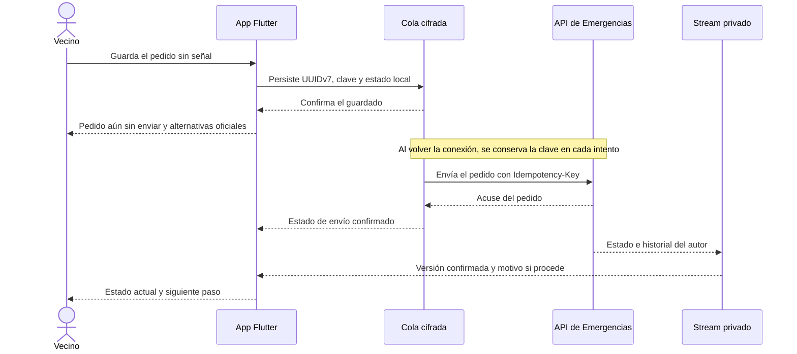

# Design

## Context

`LocalSyncDatabase` abre una base cifrada por cuenta y elimina el archivo y su clave al purgar. `PowerSyncPostRepository` guarda el comando y su estado de envío en una transacción. `VecinalConnector` reutiliza la clave de idempotencia y aplica la política de reintentos. En la Fase 0, `AssignedCaseCache` validó el stream `caso_asignado` con una base cifrada separada, caducidad y purga. Las tablas de esa prueba técnica carecen del contrato completo de Emergencias.

La rama de D, revisada en `1dd4388`, define `EmergencyRepository` y deja `operationalEmergencyFactoryProvider` sin un repositorio real. D mantiene un repositorio de práctica en memoria. La rama de trabajo de A se inicia desde `origin/main` en `0435b98`. El puerto de D es el punto de integración cuando su código esté disponible en la base acordada.

## Goals / Non-Goals

- **Objetivos.** Reusar la infraestructura de envío y almacenamiento de Flutter. Separar las vistas del autor, del personal asignado y del público por identidad, estado y zona.
- **Límites.** B es dueño del contrato, la máquina de estados y la auditoría del backend. D controla las pantallas del vecino. El primer incremento verifica el comportamiento local desde las pruebas, con el transporte controlado por el equipo de pruebas.

## Decisions

1. **Guardar el pedido y su estado en una transacción.** Usar la cola durable de PowerSync (`comandos` y `envios`), la generación UUIDv7 de la app y la política de reintentos existente. Guardar el pedido mínimo para el envío y el estado local como una sola operación. Un segundo guardado del mismo pedido devuelve el estado existente. El cuerpo del comando debe vivir en la base cifrada de la cuenta y quedar fuera de diagnósticos y telemetría. Reusar la cola conserva su comportamiento ante cortes entre el acuse y la retirada del comando.
2. **Empezar con el camino local y una respuesta controlada.** Los primeros casos de prueba inyectan un transporte ficticio y un reloj controlable. Aíslan la persistencia, la pérdida de acuse y el rechazo definitivo. Cuando B apruebe el contrato, el adaptador de envío usará su ruta y sus errores en el flujo de la app. La fábrica operativa de D se conecta tras acordar la base de integración y verificar cuenta, zona y cobertura.
3. **Separar envío de estado operativo.** `envios` representa la entrega al servidor. El stream privado `mi_pedido` aporta el estado y el historial de B, filtrados en el servidor por el autor autenticado. El repositorio presenta una sola entrada por UUID, conserva la evidencia del acuse mientras llega el stream y aplica la versión de B al mostrar el estado operativo. Al recibir un cierre o una derivación, conserva para el autor el motivo apto para su historial y purga el detalle sensible que corresponda.
4. **Separar el detalle asignado de la ubicación exacta.** Extender el patrón de `caso_asignado` con consultas bajo demanda. Antes de entregar filas, el backend registra la apertura y los streams validan en el servidor el alcance de ese acceso y la asignación vigente. El flujo de ubicación exacta comprueba además el estado «En camino». El mecanismo con B debe impedir que una suscripción directa eluda la auditoría. Los cambios de asignación y estado sacan las filas de la suscripción en la siguiente sincronización. El diseño para B vincula cada permiso de apertura a la familia de sesión firmada, la asignación y el alcance. La ubicación exacta se guarda con una clave propia para borrarla sin retirar el resumen todavía autorizado.
5. **Proteger la vista y revisar caducidad antes de mostrarla.** Mantener el bloqueo operativo separado de la sesión general. Usar autenticación del dispositivo con `local_auth` para biometría o credencial del dispositivo, y el temporizador de inactividad con reloj inyectable. Proteger la vista con `FLAG_SECURE` en Android y una cubierta difuminada al salir de primer plano en iOS. Revisar caducidad antes de restaurar la vista, al volver a primer plano y durante el uso. Al cerrar el caso o alcanzar el plazo configurado, eliminar el detalle de las vistas en memoria y de la caché sensible.
6. **Publicar agregados calculados en el servidor.** B produce una vista pública con el umbral mínimo de tres aplicado por celda y necesidad. PowerSync descarga agregados y recursos por zona con prioridad de emergencia. La app usa la fecha del último reporte, la fuente y los umbrales por tipo para mostrar frescura. D consume los datos desde el repositorio y la app desactiva las imágenes en modo emergencia.

### Puntos de contacto

| Lote | Artefacto compartido | Acuerdo |
|---|---|---|
| B | `contracts/openapi.yaml`, esquema `emergencias`, eventos `emergencias.*` | B define rutas, estados, historial, asignaciones, permisos y auditoría. A consume el contrato y coordina la elegibilidad de las filas y la purga al cierre. |
| C | Consola, avisos urgentes y directorio curado | C consume los agregados autorizados y aporta avisos sin datos sensibles. A y D consumen la versión publicada del directorio. |
| D | `EmergencyRepository`, `EmergencyScope`, `operationalEmergencyFactoryProvider` | A aporta el repositorio del pedido y los datos descargados. D presenta los estados, la frescura, las alternativas y el tablero. |

## Risks / Trade-offs

- Acuse perdido o llegada tardía del stream → conservar la identidad del pedido y separar la confirmación de envío de las transiciones del caso.
- Dos cuentas sucesivas en el mismo dispositivo → aislar la base y las suscripciones, cerrar sus observadores y purgar datos al salir.
- Revocación con el teléfono sin señal → la app depende del bloqueo y la caducidad hasta que conoce la revocación. Registrar la aceptación del riesgo residual en los criterios de salida antes de la activación.
- Retención del cuerpo en la cola interna o una copia en memoria → comprobar archivos, metadatos y el ciclo de vida de la cola al diseñar su limpieza. Para el historial, exponer únicamente el motivo permitido para el autor.

## Migration Plan

1. Verificar la cola con datos ficticios y los dobles de respuesta. Comprobar que una base con acciones de solidaridad pendientes sigue funcionando después de abrirla con el esquema extendido.
2. Con el contrato de B y la base de D acordados, habilitar el repositorio operativo en el entorno de integración. Verificar que el stream propio, los streams asignados y la purga respetan sus fronteras antes de activar cobertura.
3. Ante una reversión, deshabilitar nuevas solicitudes y suscripciones operativas. Resolver los pedidos en cola con su UUID y clave originales y purgar las vistas sensibles que hayan perdido autorización. Mantener el directorio y las alternativas oficiales disponibles.

## Open Questions

- Acordar con B las columnas definitivas y el formato de la autorización auditada de los streams. Esto condiciona la integración, mientras las pruebas iniciales usan dobles.
- Registrar con el equipo y los aliados los tiempos de inactividad, respuesta y caducidad antes de operar. Las pruebas iniciales usan plazos controlados.
