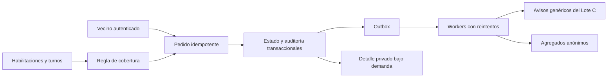

## Context

La base es `origin/f1-lote-b/parte-5-moderacion`. Se conservan las tablas mínimas de A y sus
identificadores. La consola de C y el tablero de D están en ramas independientes sin integrar.

## Goals / Non-Goals

Implementar las reglas operativas sin exponer detalles en colas públicas. No activar una operación
real ni inventar fuentes, acreditaciones, cobertura o garantías de atención.

## Decisions

- Máquina de estados pura, versiones optimistas y escrituras idempotentes.
- Coordinación con habilitación vigente y turnos; dos coordinadores habilitados y al menos uno
  de turno antes de aceptar pedidos. Las relaciones de apoyo entre zonas se aprueban explícitamente.
- Datos privados en tabla sin publicación PowerSync. Cada lectura autorizada escribe auditoría.
- Notificaciones y trabajos parten del outbox transaccional; solo identificadores en sus cargas.
- Plazos persistentes y barrido programado de recuperación. Los trabajos revalúan el estado al ejecutarse.
- Cierre por lotes y anonimización; las tareas incompletas se recuperan desde la base.

## Risks / Trade-offs

Los plazos iniciales son propuestas configurables. La API no equivale a un servicio de despacho
oficial. La integración de streams, las plantillas urgentes y los adaptadores de la consola se
acuerdan con A/C/D. No se realizaron compilaciones ni pruebas por instrucción del usuario.

## Migration Plan

Migración aditiva sobre Fase 1 B, separando el detalle privado heredado del texto mínimo
replicado. Aplicarla antes del código y revisar permisos con A. No ejecutarla en esta entrega.
No revertir automáticamente una migración con datos sensibles nuevos.
