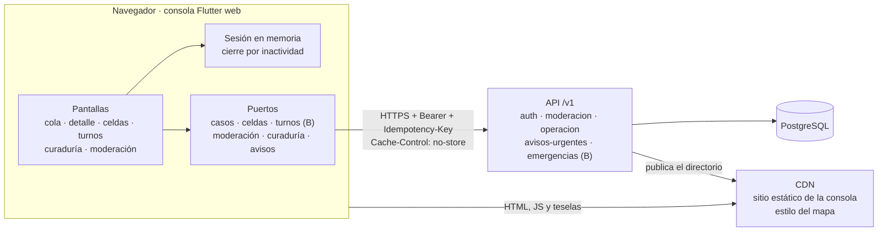
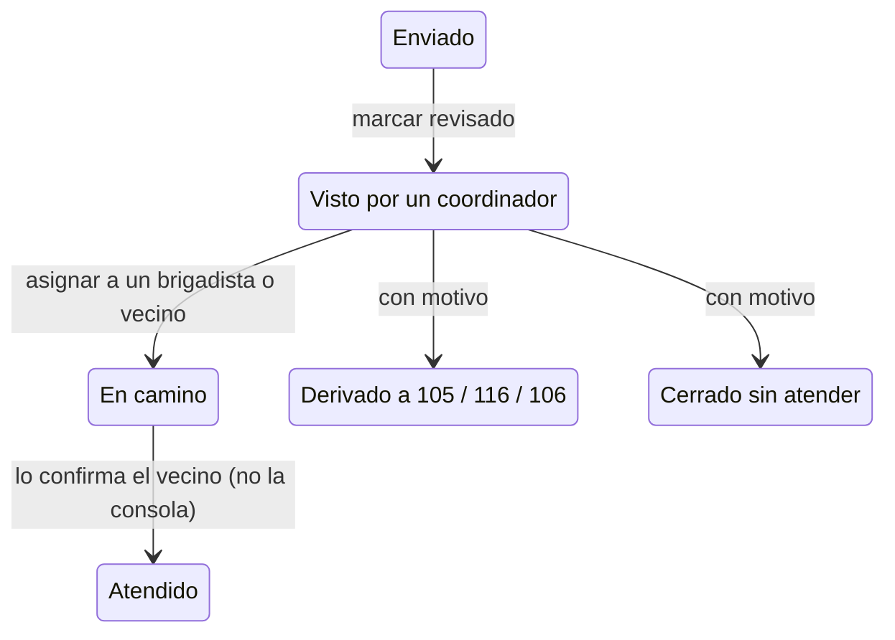
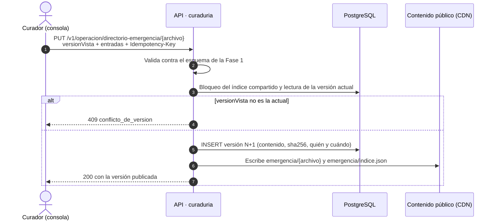
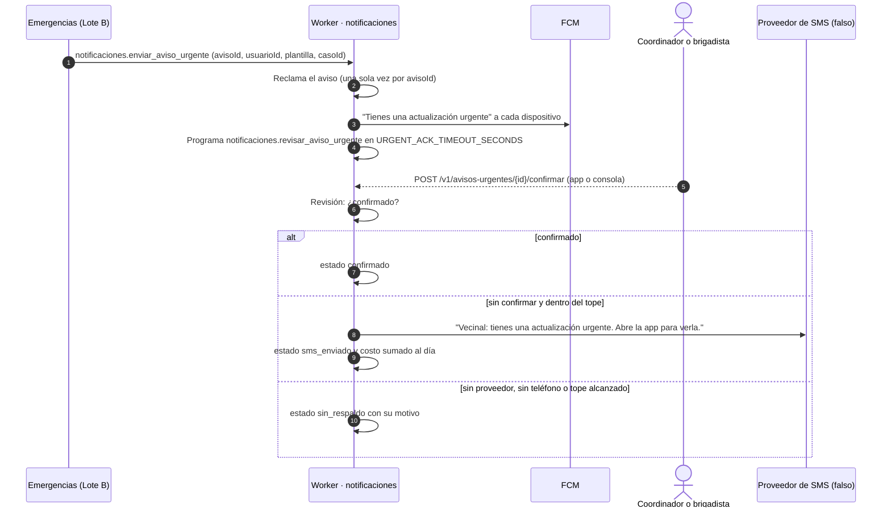

# Design

## Context

Ver `proposal.md`. Ya existen:

- el ingreso con OTP o Firebase (ADR 0009) y la sesión renovable;
- los roles del token (`coordinador`, `brigadista`, `moderador` y `administrador`);
- el módulo Notificaciones, con envío idempotente por token y por tópico
  (`notificaciones.enviar_aviso`);
- la cola pg-boss con el relay del outbox;
- el estilo del mapa servido por la CDN (Fase 0);
- el esquema del directorio de emergencia y su índice en la CDN (Fase 1, Lote A, parte 2).

El módulo Emergencias de esta fase (Lote B) todavía no existe: ni sus tablas, ni sus rutas, ni sus
eventos. La consola lo usa detrás de puertos, igual que el Lote D de esta fase usa
`operationalEmergencyFactoryProvider`.

## Goals / Non-Goals

**Goals:**
- Una consola accesible (WCAG 2.2 AA), solo en línea y para roles operativos, que no guarda datos
  sensibles en el navegador.
- Un aviso urgente nunca depende de un solo canal, y el respaldo por SMS tiene un tope de gasto.
- El directorio de emergencia se publica desde la consola con versiones auditables, sin PR.

**Non-Goals:**
- Definir las rutas de Emergencias: las define el Lote B. La sección "Lo que la consola necesita
  del Lote B" las propone.
- Un proveedor real de SMS (decisión 13.3.4). Solo hay un adaptador falso y el modo `none`.
- El modo operativo en el celular (Lote A) y el tablero de emergencia (Lote D).

## Decisions

### 1. Consola en Flutter web (ADR 0014)

Usa los mismos patrones que la app: Riverpod, go_router, Dio, textos en ARB y el tema accesible
con la misma semilla.

- **Es un proyecto aparte, `consola/`, que no depende del paquete `app/`.** `app/` trae plugins
  móviles (PowerSync, cifrado y cámara) que no deben llegar al navegador.
- **Lo que se reutiliza se copia, en pequeño.** El tema, `ProblemDetails` y la convención de
  idempotencia.
- **La semántica de Flutter queda siempre activa** (`SemanticsBinding.instance.ensureSemantics()`),
  con foco visible y orden de tabulación explícito.

### 2. Sesión solo en memoria

- **Los tokens viven en el estado de Riverpod.** Nada va a `localStorage`, `sessionStorage`,
  IndexedDB ni a la caché.
- **Recargar la página obliga a ingresar de nuevo.** Es el precio de no guardar nada.
- **La API responde `Cache-Control: no-store`** en `/v1/auth`, `/v1/operacion`,
  `/v1/moderacion` y `/v1/avisos-urgentes`.
- **CORS solo para los orígenes de `CONSOLE_ORIGINS`.**
- **El ingreso usa el mismo flujo que la app:** el OTP de la API o Firebase (`PHONE_AUTH`).
  - Si la sesión no trae un rol operativo, la consola la cierra en el acto y explica por qué.
- **Inactividad:** a los `INACTIVITY_MINUTES` minutos sin actividad (10 por defecto), la consola
  cierra la sesión en la API y borra el estado. Avisa 60 segundos antes.

### 3. Fuentes de datos y puertos

| Puerto | Implementación real | Mientras tanto |
|---|---|---|
| `CasesRepository` | Rutas de Emergencias del Lote B | `operationalCasesFactoryProvider` nulo: la pantalla explica que falta el módulo |
| `CellsRepository` | Agregados por celda del Lote B (parte 4) | Igual |
| `ShiftsRepository` | Turnos del Lote B (parte 3) | Igual |
| `ModerationRepository` | `GET /v1/moderacion/casos` y `POST …/decision` (Fase 1, Lote B, parte 5) | — |
| `CurationRepository` | Rutas de curaduría de este change | — |
| `UrgentNoticesRepository` | Rutas de avisos urgentes de este change | — |

Con `--dart-define=CONSOLE_DATA=demo`, todos los puertos usan dobles con datos sembrados, y una
franja fija dice "Datos de demostración". Así ninguna cifra inventada se confunde con una real.

### 4. Cola de casos

**Orden:** primero por prioridad (alta, media, baja) y luego por el tiempo sin revisar, de mayor a
menor. El riesgo de vida no entra a la cola: se deriva al 116, 105 o 106 (sección 9.2).

**Tiempos de primera revisión** (configurables, sección 9.2):

| Prioridad | Tiempo |
|---|---|
| Alta | 15 minutos |
| Media | 2 horas |
| Baja | Sin límite |

**Marcas de cada pedido:**
- "Por escalar": le queda el 25 % del tiempo o menos de 5 minutos.
- "Fuera de tiempo": ya lo superó.

**Refresco:** cada 15 segundos mientras la pestaña está visible.

**Transiciones que ofrece la consola** (sección 7.2):

**Detalle minimizado:**
- muestra tipo de necesidad, prioridad, celda pública, tiempos, estado e historial;
- la ubicación exacta solo aparece si quien mira es la persona asignada y el caso está *en
  camino*. La API también lo aplica: la consola nunca la pide de otra forma.

**Errores:** un Problem Details se muestra con su título, su detalle y una acción según el
`codigo`. Por ejemplo, `conflicto_de_version` lleva a recargar el caso.

### 5. Mapa de celdas y turnos

**Mapa de celdas:**
- MapLibre GL en web, con el estilo de la Fase 0, más una tabla equivalente para lectores de
  pantalla;
- una celda con menos de 3 pedidos se muestra como "menos de 3", sin cifra;
- nunca hay puntos de personas.

**Turnos:**
- lista por zona;
- crear un turno y terminarlo;
- la regla de cobertura (sección 9.3): 2 coordinadores activos y un turno vigente.

La consola calcula la regla para mostrarla, pero quien decide es el Lote B (409
`zona_sin_cobertura`).

### 6. Curaduría del directorio de emergencia

Nuevo módulo `curaduria`.

- **Valida con Zod**, replicando campo por campo `contracts/directorio-emergencia.schema.json`.
  La prueba de contrato con el JSON Schema sigue en `infra/cdn`.
- **Guarda cada versión** en `curaduria.versiones_directorio`.
- **Publica el archivo del distrito y el índice** por el puerto `PublicContentPublisher`. El índice
  tiene el mismo formato que `infra/cdn/scripts/build-emergency-index.mjs`, y la asignación de
  zonas no cambia.

**Adaptadores:**
- sistema de archivos (`CURATION_PUBLISH_DRIVER=filesystem`), que en local escribe en
  `infra/cdn/publico`;
- `s3`, que escribe bajo `emergencia/` en un bucket dedicado al directorio y se verifica
  localmente con MinIO. El índice se cachea por 60 segundos y los distritos se revalidan;
- `disabled`, que responde 503 `servicio_no_disponible`.

La conexión del bucket a la CDN requiere confirmar el entorno y verificar la ruta pública en staging.

**Roles:** `administrador` y `coordinador`. El rol `curador` lo agrega el Lote B (parte 5); entonces
se suma a la ruta.

### 7. Avisos urgentes con SMS de respaldo

**Tablas:**
- `notificaciones.avisos_urgentes`: estado, motivo, plazo de confirmación, confirmación, envío por
  SMS, intentos y costo;
- `notificaciones.gasto_sms`: costo y mensajes por día de America/Lima.

**Envío por push:** reutiliza el envío idempotente por dispositivo (`entregas_aviso`). Si ningún
dispositivo recibió el aviso, la revisión se adelanta.

**SMS:**
- el tope se revisa y se reserva en la misma transacción, con `FOR UPDATE` sobre el día y la suma
  del mes;
- el SMS se envía *al menos una vez*: si el proceso cae entre el envío y la marca, se puede repetir.
  El texto es genérico, así que el riesgo es solo de costo, y lo acota el tope;
- `SMS_PROVIDER` vale `none` o `fake`. `fake` está prohibido en producción; `none` deja el
  respaldo apagado y lo registra como `sin_respaldo`/`sin_proveedor`;
- el teléfono se obtiene de `identidad` mediante su `index.ts` (`ContactDirectory`). Nunca se
  escribe en logs.

**Aviso público de zona:** `emergencias.evento_activado` produce `notificaciones.enviar_aviso` al
tópico `zona-<zonaId>`, con la plantilla `modo_emergencia_activado` y solo información pública.

**Medición:** `GET /v1/operacion/avisos-urgentes/resumen`, con totales por estado, latencia de
confirmación (p50 y p95), SMS enviados y gasto del día y del mes frente a sus topes.

### 8. Despliegue

- **Build:** `flutter build web --release --no-web-resources-cdn` con los `--dart-define` del
  entorno. MapLibre GL JS y CanvasKit se sirven desde el propio sitio, así la CSP solo permite
  `'self'` para el código.
- **Sitio estático:** el módulo `infra/cloud/modules/console-site`, junto al OpenTofu de la Fase 1
  (Lote C), crea el proyecto de Cloudflare Pages, su dominio y el registro DNS.
- **Encabezados:** `consola/tool/write_headers.sh` escribe el `_headers` del build para cada
  entorno:
  - CSP con los orígenes de la API y de la CDN del entorno;
  - `index.html` con `Cache-Control: no-store`;
  - el resto se revalida en cada visita (Flutter web no pone hash en los nombres de archivo).
- **CI:** pendiente. El flujo `.github/workflows/consola.yml` (analizar y compilar en cada PR,
  desplegar staging con cada integración a `main` y producción con una etiqueta `consola-v*`) está
  descrito en `docs/fase-2/lote-c-consola-web-y-avisos-urgentes/integracion.md` para crearlo
  después.

## Lo que la consola necesita del Lote B

Para que B lo incluya en su contrato. Los nombres son una propuesta.

- **Cola de la zona:** id, prioridad, tipo de necesidad, estado, celda pública, `creadoEn`,
  `sinRevisarDesde`, persona asignada (nombre visible y rol) y `version`.
- **Detalle:** lo de la cola, más el historial (estado anterior y nuevo, rol, hora y motivo) y la
  ubicación exacta solo cuando corresponde.
- **Acciones:** marcar visto, asignar a una persona disponible, derivar y cerrar sin atender con
  motivo, todas con `versionVista` e `Idempotency-Key`.
- **Personas disponibles para asignar** en la zona y su turno.
- **Agregados por celda** con el umbral de 3.
- **Turnos de la zona:** crear y terminar, y el estado de cobertura.
- **Eventos y trabajos:**
  - B emite `emergencias.evento_activado`, con `carga.zonaId`;
  - B encola `notificaciones.enviar_aviso_urgente` al asignar y al escalar.

## Puntos de contacto

| Con | Qué | Regla |
|---|---|---|
| B (Fase 2) | Rutas de casos, celdas y turnos; `emergencias.evento_activado`; trabajo de aviso urgente | B define el contrato; C lo usa detrás de puertos |
| B (Fase 1) | Rutas de moderación y rol `moderador` | C las consume tal cual |
| B (Fase 2, parte 5) | Rol `curador` | Se suma a las rutas de curaduría cuando exista |
| A (Fase 1) | Esquema y archivos del directorio de emergencia | C publica en el mismo formato |
| A y D (Fase 2) | Apertura del aviso urgente en la app | La app confirma el aviso al abrirlo |
| C (Fase 1) | Almacenamiento en la nube y entornos con OpenTofu | Este change agrega un módulo que se conecta a ellos |

## Risks / Trade-offs

- **Accesibilidad y tamaño de Flutter web.** La semántica activada mitiga la accesibilidad, y el
  *tree shaking* de íconos el tamaño. El ADR registra la comparación.
- **SMS repetido.** Por la entrega al menos una vez, el SMS se puede repetir. Lo acotan el tope y el
  texto genérico.
- **Caché de la CDN.** Al publicar el directorio, la caché de la CDN puede servir la versión
  anterior hasta 5 minutos. El despliegue purga `emergencia/`.
- **El contrato de B puede cambiar los puertos.** Las pantallas solo conocen el dominio de la
  consola.
- **Firebase en web.** Exige reCAPTCHA y que el dominio esté autorizado en Firebase.

## Migration Plan

- Migraciones nuevas: `notificaciones.avisos_urgentes`, `notificaciones.gasto_sms` y
  `curaduria.versiones_directorio`. Ninguna va a la publicación `powersync`.
- Variables nuevas:
  - `SMS_PROVIDER`, `URGENT_ACK_TIMEOUT_SECONDS`, `SMS_COST_CENTS`, `SMS_DAILY_BUDGET_CENTS` y
    `SMS_MONTHLY_BUDGET_CENTS`;
  - `CONSOLE_ORIGINS`;
  - `CURATION_PUBLISH_DRIVER` y `CURATION_PUBLIC_ROOT`.
  - Todas tienen un valor por defecto seguro.

## Open Questions

- Proveedor de SMS y moneda del tope (13.3.4). El tope se expresa en centavos de dólar.
- Tiempos de primera revisión definitivos (13.3.6).
- Dominio de la consola y de la CDN.
