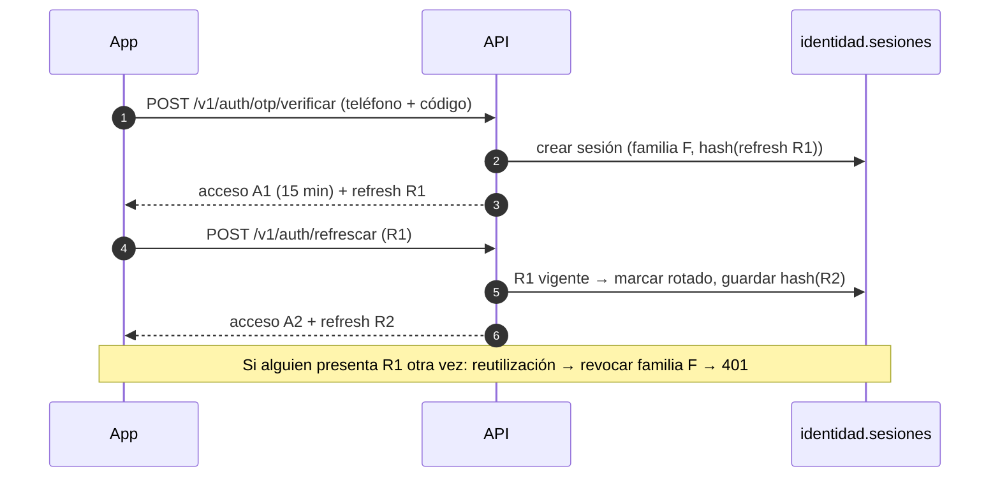
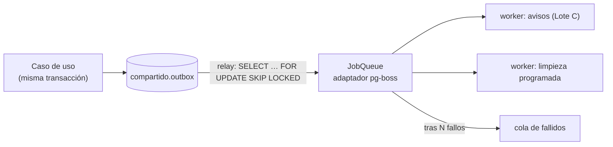

# Design

## Context

Ver `proposal.md`. Los cimientos ya traen el patrón completo en `modules/solidaridad` (copiarlo),
la emisión de tokens ES256 (`shared/auth/token.service.ts`), el outbox
(`shared/outbox/`), el puerto `JobQueue` con un doble en memoria y la idempotencia.

## Goals / Non-Goals

**Goals:** identidad lista para producción, eventos confiables y evidencia de capacidad.

**Non-Goals:** validación de DNI, consola web, Valkey/BullMQ, extracción de microservicios.

## Decisions

### Sesiones con refresh token rotativo

### Del outbox a los workers

1. **pg-boss** (cola sobre PostgreSQL) detrás de `JobQueue`, como dice la sección 4.3;
   se reemplaza por BullMQ + Valkey en la Fase 3 sin tocar a quien encola.
2. **Relay con `FOR UPDATE SKIP LOCKED`** para que varias réplicas no publiquen dos veces el mismo
   evento; marcar `publicado_en` en la misma transacción que el `send` a la cola. El adaptador
   `fromKysely` de pg-boss 12.38.1 comparte la transacción de Kysely; un savepoint por evento
   permite persistir el intento fallido y continuar el lote sin dejar trabajos huérfanos.
3. **Workers en un proceso aparte** (`src/workers/main.ts`) con el mismo código del monolito.
4. **Hash del refresh token** (SHA-256 con sal del servidor); nunca se guarda el token.
5. **Proveedor OTP**: adaptador falso en desarrollo; el real (Twilio Verify o Firebase Auth) se
   elige con la decisión abierta 4 de la sección 13.3.

La API tiene supervisión y programación apagadas. Solo el proceso de workers registra
manejadores, ejecuta el relay sin solapar lotes y programa la limpieza a las 04:00 de
`America/Lima`. Al cerrar, primero espera al relay y después a los trabajos activos, antes de
cerrar la conexión de negocio. Las colas sin manejador conservan sus trabajos pendientes para
que el Lote C pueda conectar sus consumidores.

`JobOptions.retries` se traduce a `retryLimit`: cinco reintentos además del intento inicial.
La cola `<nombre>.fallidos` conserva la carga y el error final. Las claves `singletonKey`
deduplican trabajos pendientes o activos; los manejadores siguen siendo idempotentes porque
la entrega es al menos una vez. El catálogo de contratos está en `docs/fase-0/trabajos.md`.

### Puntos de contacto con otros lotes

| Con | Qué | Regla |
|---|---|---|
| Lote A | `getToken` y revocación (401 en credenciales) | Contrato en `contracts/openapi.yaml` antes de implementar |
| Lote C | Trabajo `notificaciones.enviar_aviso` | B define el nombre y la carga del trabajo en la Parte 4; C implementa el manejador |
| Todos | `contracts/openapi.yaml` | PR pequeño solo del contrato al inicio de cada parte |

## Risks / Trade-offs

- [El proveedor de SMS cobra por mensaje y puede tardar] → límites por teléfono e IP; WhatsApp como alternativa.
- [k6 local no reproduce la red real] → correrlo contra staging; local solo como humo.
- [pg-boss crea su propio esquema] → aislarlo en el esquema `colas` y documentarlo.
