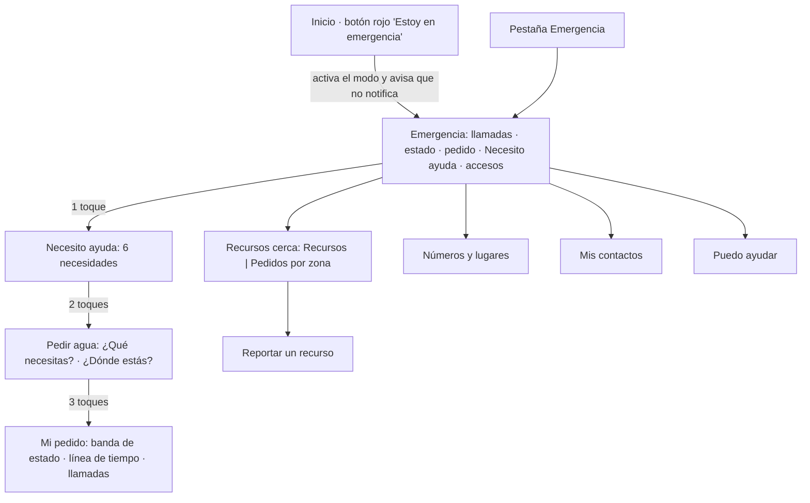

# Design

## Context

Las pantallas del modo emergencia (`app/lib/features/emergencias/`) leen el estado desde
`EmergencyRepository` (práctica en memoria o la cuenta real con la cola y los streams del Lote A y
la API del Lote B). El rediseño cambia solo la presentación: los repositorios, la cola, las reglas
de cobertura y la privacidad quedan igual. Las pruebas de accesibilidad de la Fase 2
(`emergency_accessibility_test.dart`) siguen siendo la vara: texto al 200 %, contraste en tema claro
y oscuro, botones de 48 dp con nombre, modo sencillo y orden de lectura.

## Goals / Non-Goals

**Goals:**
- Que el tablero quepa en una pantalla de 414 × 896 y que llamar sea el primer gesto.
- Reutilizar los roles de color del tema para que el modo oscuro funcione sin colores nuevos.
- Mantener intactos los textos que exigen las especificaciones vigentes ("Si hay riesgo para la
  vida, llama al 116, 105 o 106", "Esta app conecta vecinos…", "Tu pedido todavía no fue enviado…").

**Non-Goals:**
- Cambiar el contrato de la API, la cola de envíos o el modelo de datos.
- Ubicación del vecino, tutorial en el primer arranque y lugares del directorio (fuera de alcance).

## Decisions

- **Componentes en `presentation/emergency_ui.dart`.** Franja de llamadas, aviso de una línea,
  etiqueta, botón principal, accesos secundarios, cuadrícula y paso de la línea de tiempo. Todos se
  apoyan en `FilledButton` con estilos propios: así conservan la acción de toque, el foco, el estado
  deshabilitado y la etiqueta para el lector de pantalla. Alternativa descartada: `InkWell` sobre
  tarjetas, que obliga a armar la semántica a mano.
- **`EmergencyAlternatives` se conserva como la franja roja.** Mantener el nombre deja a las pruebas
  de privacidad separar los textos públicos de los del pedido. En "Mi pedido" el título cambia a
  "¿Empeoró?…" y suma el SMS preparado y el punto de encuentro más cercano, si existe.
- **Práctica en la barra (`EmergencyLayout`).** El layout lee el alcance y agrega el chip; cada
  pantalla le pasa sus simulaciones. Con texto grande el chip queda como ícono con nombre para no
  quitarle espacio al título. `wrappingAppBar` acepta acciones y una pestaña inferior.
- **Línea de tiempo con los datos que ya existen.** Se toma el historial en orden de tiempo; si no
  trae la creación o el acuse, se agregan con `createdAt` y `sentAt`. Los pasos pendientes solo se
  muestran cuando el pedido ya llegó al servidor, para no escribir "Enviado" antes de tiempo.
- **"Recursos cerca" con pestañas.** La primera lista los recursos del repositorio; la segunda, los
  agregados por sector del tablero público (en práctica, los datos de ejemplo). El reporte pasa a
  `/emergencia/recursos/reportar`. `PublicEmergencyBoardPage` y su ruta se conservan.
- **Ahorro de datos.** El interruptor representa el ahorro (encendido = imágenes apagadas). En modo
  emergencia la política de imágenes sigue impidiendo encenderlas y la app lo explica al intentarlo.

Puntos de contacto con otros lotes:
- Lote A: `syncStatusProvider` (línea de conexión), `OwnHelpRequests` en el directorio y la política
  de imágenes; sin cambios en sus contratos.
- Lote B: los códigos de estado del pedido y los campos del reporte (tipo, cantidad, punto) no
  cambian.
- Lote C: `emergencyBoardProvider` alimenta la pestaña de pedidos por zona; la consola no cambia.
- Textos compartidos en `app_es.arb`: `emergencyTitle`, `emergencyDashboard`, `emergencyResources` y
  `emergencyContacts` cambian de valor, y también se ven en la cuenta, el ingreso y el tutorial.

## Risks / Trade-offs

- [Las referencias visuales de Linux siguen pendientes de regenerar] → solo se compararon y
  regeneraron las de macOS; en Linux las pruebas visuales siguen omitidas como antes.
- [Las capturas son de pruebas de widgets, no de teléfonos] → falta revisar en Android y iOS reales,
  con TalkBack y VoiceOver, antes de dar por cerrada la accesibilidad.
- [Nombres cortos de los números (Bomberos, Policía, SAMU) vienen de una tabla por número] → un
  número desconocido muestra su nombre completo.
- [La referencia de lugar del pedido pasa a ser opcional] → si queda vacía se envía la etiqueta de
  la zona sugerida que antes venía escrita; el punto aproximado no cambia.
